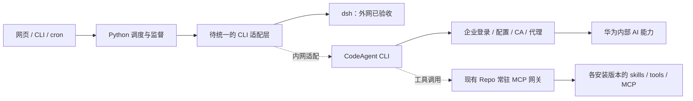
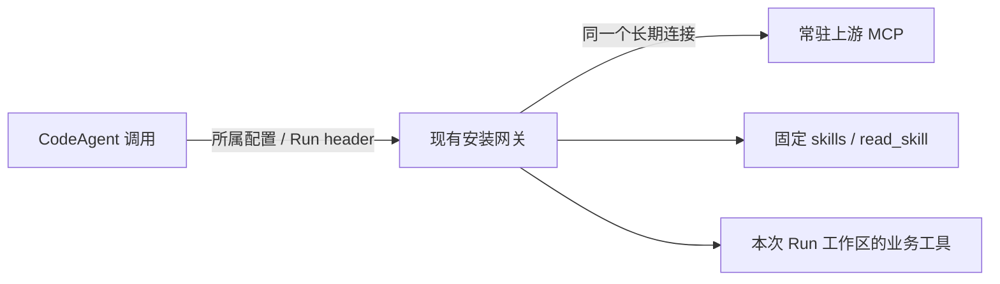
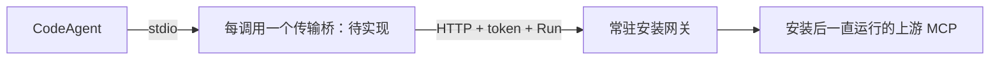

# 迁移到华为 CodeAgent CLI

基线：Agent Base 0.1.0 · 2026-11-05

迁移目标是保留 Python 调度、Repo 安装、常驻 MCP、skills、网页和验证层，把执行模型与原生 Agent 循环的 dsh CLI 换成 CodeAgent CLI。**当前不是只改 engine 就能完成迁移**：基础 print 调用已预留，完整资源挂载、事件和多轮 session 尚未在内网实现/验收。

本指南区分现状、待现场确认的能力和建议开发步骤。没有把 Claude Code 或其他 CLI 的参数假定为 CodeAgent 参数，也不要求改用模型 HTTP API。

## 1. 现有连接方式与迁移范围



内部认证、模型路由和 AI 服务请求由 CodeAgent 负责。Python 启动 CLI、传 prompt/model/effort、管理进程与结果，不需要掌握内部模型网关协议。

| 能力 | 当前状态 | 迁移处理 |
| --- | --- | --- |
| Git、v2 安装协议、固定资源、输入副本 | 已实现 | 保留，内网重新 clone/安装 |
| 调度、状态、超时、取消、验证、归档 | 已实现 | 保留，按目标平台验收进程语义 |
| 每安装版本常驻 MCP 网关 | 协议层与 dsh 无关 | 保留；只替换 CLI 如何挂载它 |
| CodeAgent 单次 print | `engines.py` 已预留，内网未验收 | 先用无工具短问题验通 |
| CodeAgent 带业务工具/MCP 的 Run | 当前显式拒绝 | 先完成挂载适配再开放 |
| CodeAgent Admin | 当前显式拒绝 | 适配管理 MCP、原生 session、输出协议 |
| CodeAgent 网页对话 | 当前显式拒绝 | 适配事件和续接，保留网页 API |
| CodeAgent 并发 | 当前仅允许 max_concurrent=1 | 验证账号/配置/session 竞争后再放开 |

### 1.1 原 AI Hub 带来的已知线索

以下来自工作区原 `ai-hub-huawei` 源码和此前 `codeagent-mvp`，属于历史实现线索，不能替代内网当前版本验收。它们不打包进本项目 Git 仓库。

| 原 Hub 文件 / 位置 | 可学习的内容 | 注意事项 |
| --- | --- | --- |
| `main/auto-title-manager.js` / `generateTitleViaCodeAgent` | `--print`、文本输出、临时 cwd、模型/effort、超时 | 原 Hub 的短问答路径，不是完整 Agent 适配 |
| `core/codeagent-config.js` | `CODEAGENT3_CONFIG_DIR`、默认认证目录、CLI 配置选择 | 历史版本不接受调用方指定 `--session-id` |
| `core/codeagent-launch-env.js` | 账号配置目录与继承 token 的关系 | 显式选账号时须避免继承 token 覆盖身份 |
| `core/session-manager.js` / `buildCodeAgentPtyLaunch` | PTY、MCP 配置、已有 session 的恢复与 hook 绑定 | 不能把 PTY 菜单/ANSI 文本直接当网页事件协议 |
| `core/codeagent-models.js`、`core/codeagent-model-picker.js` | 交互模式的模型菜单处理 | 历史交互版本可能忽略 `--model`，需要确认实际路由 |
| `core/codeagent-serve.js` | 本机辅助 serve、模型/额度元数据 | 不能据此认定存在已验证的模型推理 HTTP API |

原源码还记录过：多份 `--mcp-config` 可能只认最后一份；某交互版本需要 cwd 的 `.mcp.json` 才启动插件；严格 MCP 参数未必屏蔽全局 MCP。应在受管临时工作区生成**一份**最终配置，不修改用户项目和全局账号配置，并测试目标版本实际发现的工具。

## 2. 外网准备与内网安装

### 2.1 交接内容

带入 Git 源码或 `git bundle`，同时带入目标平台依赖安装方案。不要搬运当前 `.venv`、`.runtime`、`.agent-base`、个人认证目录或 node_modules：其中既有机器路径和平台二进制，也有会话与业务数据。

Git 操作见 [GIT_GUIDE.md](GIT_GUIDE.md)。示例的相对目录结构和已构建 `static/chat` 随源码提供，内网启动网页无需下载 CDN 或重建前端。

推荐内网先建立独立配置与状态目录，外网保持 dsh 基线。引擎切换不会自动转换原生 session；旧 dsh 对话保留在外网实例，新 CodeAgent 会话在内网重新创建。

### 2.2 依赖与平台

1. 在内网目标机安装 Python 3.11+、uv、Git，以及企业提供的 CodeAgent CLI 和它要求的运行环境。
2. 通过内网批准的 Python/npm 镜像或离线缓存准备依赖。无需安装 dsh 的 npm 包；若不修改前端，也无需安装前端开发依赖。
3. 配置企业 CA、代理、Git 认证和 CodeAgent 本人登录。认证流程由企业 CLI 管理，不在项目中填写固定 token 或内部网关。
4. 在项目根创建 Python 环境和本机配置：

```sh
uv sync --frozen
cp config/codeagent.example.toml agent-base.toml
# 编辑 agent-base.toml：command、实际 model、effort、需要时的 config_dir
.venv/bin/agent-base doctor
```

Windows PowerShell：

```powershell
uv sync --frozen
Copy-Item config/codeagent.example.toml agent-base.toml
# 编辑本机配置后：
.venv\Scripts\agent-base.exe doctor
```

模板采用 PATH 中的 `codeagent` 和待替换模型名，max_concurrent=1。模板不是完整迁移已完成的声明。当前 `doctor` 只检查 CLI/配置，不验证模型权限、在线推理、MCP 或原生 session。

`bootstrap.py --skip-dsh` 会保留已有配置，但没有配置时仍按默认 dsh 初始化。因此迁移时优先用上面的 `uv sync` + CodeAgent 模板，不能以“跳过 dsh 安装”代替引擎配置。

### 2.3 离线依赖注意事项

`uv.lock` 与 npm lock 中包含公开源的解析信息。离线环境需要预先准备完整依赖缓存/内部制品，并实际测试 `uv sync --frozen --offline`；有镜像但没有对应锁定构件也会失败。不要盲目替换锁文件里的 URL 或删除哈希来掩盖缺包。

准备缓存时考虑目标 OS、CPU 架构、Python ABI、uv 版本和构建后端。macOS 的 venv、wheel 或浏览器不能直接作为 Windows/Linux 安装结果。需要修改前端时，还要准备 `frontend/package-lock.json` 对应依赖；跑浏览器测试另外需要目标平台 Chromium。

内网业务仓库清单若包含 `uv.lock`、额外 Python 包、npm 工具或远程 MCP，也要各自验证依赖来源。Agent Base 自身能启动不代表每个业务 repo 已可离线安装。

## 3. 第一阶段：CLI 能力探测与单次推理

先记录目标 CLI 版本及 `--help`，按企业文档完成登录。若当前版本提供 auth 状态命令，可以检查状态，避免把可能包含身份信息的原始输出放入公开仓库。

历史基础入口在 `engines.py::codeagent_command`：

```text
codeagent --print --output-format text --disable-update --skip-safe-check
          --no-session-persistence --model MODEL_ID --effort high
```

这是**当前代码使用的历史参数**，不是已经确认适用于最新企业版本的命令契约。prompt 通过 UTF-8 stdin 传入，不拼到 shell 源码。`--skip-safe-check` 是旧启动路径的信任检查设置，应按内网版本和运行策略审查，不能理解为完整权限控制；`--no-session-persistence` 仅适合单次任务，不能用于需要续接的多轮对话。

现场应填完以下能力记录，建议保存为内网专用文档，不提交账号信息：

| 能力 | 必须实际确认的内容 | 未确认时 |
| --- | --- | --- |
| 非交互 | stdin、UTF-8、stdout/stderr、退出码、信任/授权是否阻塞 | 不启动无人值守 cron |
| model/effort | 合法模型 ID、支持档位、实际生效证据 | 不自动替换模型或丢弃参数 |
| 输出协议 | 文本 / JSON / NDJSON 的真实 schema、结束与错误事件 | 保留原始日志，标注 text-only |
| 原生 session | 新建如何得知 ID、如何恢复、存储位置 | 不开放多轮聊天 |
| MCP | 配置格式、stdio/HTTP、headers、cwd 配置发现 | 不开放带工具任务 |
| 权限 | 受管 cwd、信任检查、审批行为、全局插件继承 | 明确支持范围，拒绝悬挂任务 |
| 并发 | 同账号多进程是否安全、配置写锁、session 是否冲突 | max_concurrent 保持 1 |
| 平台 | Windows .cmd/.bat、进程树、代理与证书 | 不声称跨平台已验收 |

验证短问题应包含中文多行和特殊字符，检查模型真实输出与退出码。CLI 参数已传出只能证明“请求的模型/effort”，不能单凭日志回显证明后端实际路由。

可新建一个仅含 `AGENTS.md` 的受信任测试 Git repo，使用 `agent-base run <repo> --task '只回复 CODEAGENT_READY' --wait` 验证基座基础链路。当前 CodeAgent 模式不能使用三个包含 MCP 的 v2 示例，也不能通过 Admin 来发起这个最初探测。

当前 `runtime_environment` 只在设置 config_dir 时写 `CODEAGENT3_CONFIG_DIR`，并未完整移植旧 MVP 的账号选择优先级与 token 清理。内网若需要显式切换认证目录，须按实际 CLI 行为处理继承的 `CODEAGENT3_X_AUTH_TOKEN`；不要在未知账号覆盖状态下进行并发验收。

## 4. 第二阶段：统一运行时适配边界

当前需要修改的代码不止 `engines.py`：

| 文件 | 当前耦合点 | 建议改造 |
| --- | --- | --- |
| `engines.py` | dsh 命令/patch/NDJSON、基础 codeagent argv | 运行时工厂、能力声明、环境与事件适配 |
| `service.py` | 根据 engine 分支；CodeAgent 拒绝工具清单 | 使用适配器准备任务、启动和最终校验 |
| `repo_runtime.py` | dsh MCP 插件 patch | 拆成中立资源描述和各 CLI 配置生成 |
| `admin.py` | 直接构造 dsh 原生会话 | 走适配器的管理 MCP 与 session 功能 |
| `conversations.py` | dsh 命令、原生事件和 session 续接 | 用规范化事件驱动现有网页持久化 |
| `config.py` | 当前 engine/effort 验证与配置字段 | 能力驱动校验，保留旧配置兼容 |

建议接口如下，**只是设计示意，目前未实现**：

```python
class RuntimeAdapter:
    capabilities: RuntimeCapabilities

    def prepare(self, invocation, resources, native_session): ...
    # 返回 argv、cwd、env、stdin；不执行 shell 字符串

    def normalize_event(self, raw_event): ...
    # session / text / tool_call / tool_result / error / final

    def finalize(self, exit_code, normalized_events, raw_logs): ...
    # text、native_session_id、finish_reason（若真实存在）、event_contract
```

`RuntimeCapabilities` 至少区分：单次任务、管理 MCP、repo MCP、HTTP headers、原生 session 续接、流式文本、工具事件和并发。调用方必须在提交前拒绝缺失的必要能力，不能静默忽略清单或伪造工具事件。

进程派发、超时、取消、SQLite 状态、产物检查继续由 Python 通用层执行。目标 CLI 没有可用结构化输出时，可先交付 text-only 的单次任务；网页工具卡片和可靠多轮必须等真实能力适配完成。

## 5. 第三阶段：MCP 与 skills 挂载

### 5.1 首选：CLI 直连现有 HTTP 网关

若 CodeAgent 支持 Streamable HTTP 和请求 header，在每次调用的受管目录生成配置，只注册当前 installation 的 endpoint 与 namespace。保留现有 Bearer token 环境引用和 `X-Agent-Run`；若 CLI 不支持环境引用，使用权限受限的临时配置，并防止日志记录 secret。



网关校验 installation 与活动 Run，skills 和上游进程无需重建。每轮切换 Run header，不能复用已结束 Run 的上下文。

### 5.2 备选：短生命周期 stdio 传输桥

若 CodeAgent 只支持 stdio MCP，可新增薄桥：CLI 启动一个 stdio 客户端代理，再连接**已经运行的**所属安装 HTTP 网关。桥可以每次调用启动，上游业务 MCP 仍然常驻；不要把业务 MCP 配置直接复制成每任务 stdio 启动命令。



这个桥当前没有实现，需要验证工具列表/schema、中文输入、取消、工具超时与错误转发。它不负责自动重试业务调用。

### 5.3 skills 和发现范围

继续使用 `.agent/resources.json`、`.agent/skills/<name>/SKILL.md` 和网关 `read_skill`，不要求 CodeAgent 支持某种专属 slash skill 格式。AGENTS/skill 指令保持相对路径，继续跑路径检查。

若 CodeAgent 会向父目录自动加载 AGENTS、用户级 skill/MCP，需要确认其停止搜索或指定配置根的实际机制。dsh 的 `.agent-base-root` 是 dsh 配置约定，不能直接假设对 CodeAgent 有效。可以继续用说明约束全局可见资源，但当前 repo 挂载清单必须准确，验收要实际调用工具确认 namespace。

## 6. 第四阶段：Admin、网页与原生 session

基础 print 入口当前带 `--no-session-persistence`，没有记录 session ID。需要把“单次任务”和“可续接对话”分成不同 invocation 模式，而不是给全部调用统一增加 resume 参数。

建议顺序：

1. 根据真实结构化事件或有文档的 hook 记录新建 session ID，不用 Python 随机 ID 冒充原生 ID。
2. 用目标版本真实支持的恢复机制续接；历史 Hub 记录过不支持 `--session-id`，不能照抄 dsh 参数。
3. 把每个对话的工作区、原生状态目录和身份保持一致；认证目录与 session 目录是否可分离须现场确认，不盲目复制个人认证目录。
4. 接入管理 MCP，先验收 Admin 查询，再验收提交任务/等待与取消，验证管理调用与业务调用权限边界。
5. 将事件规范化后接回 `conversation_events`，保留 client_key、游标重放、显式停止和文件范围规则。
6. 用无工具的随机标记两轮记忆测试证明原生上下文续接；再做实际 MCP 两轮测试。

如果 CLI 只有交互 PTY，可把 PTY 作为独立运行时分支研究，使用真实 hook/事件绑定身份。不要通过猜测终端换行、菜单文字或 ANSI 内容判定“任务完成”；无法获得稳定契约时，应限制为单次工作，暂不开网页连续对话。

不能以 Python 重发全部网页历史来冒充已完成原生会话迁移；如以后选择这种方案，需要明确上下文预算、工具历史和压缩责任已经转移到基座。

## 7. 第五阶段：并发、权限与进程验收

保持并发 1 完成前四阶段后，再验收同账号两个独立 session、同 repo 两实例、不同 repo 实例的同时运行。检查共享认证配置是否被并发改写、session 是否串用、CLI 后台子进程是否逃逸监督范围。

Windows 特别测试 `.cmd/.bat` 包装器、带空格路径、UTF-8 stdin、Ctrl+C/超时和完整进程树退出。代码已有平台分支不等于目标 CLI 的子进程行为已经通过验证。

权限参数按实际版本映射，不把 dsh 的 permission/approval 字段直接作为 CodeAgent 的等价语义。工具等待授权时要有可见状态或明确失败，不能让 cron 静默悬挂到总超时。默认仍只接入可信仓库；需要不可信输入时另行增加操作系统隔离。

并发解除前修改 `service.py` 的限制必须附带现场验收记录。常驻 MCP 的共享状态与串行化策略保持不变，不因增加 CLI 并发而自动重启 MCP。

## 8. 内网上线验收清单

以下均为**待内网执行**，不能用现有 dsh 或 fake CLI 测试代替：

- [ ] 固定 CLI 版本，确认登录、企业网络、模型权限和 effort 支持。
- [ ] 无工具中文多行 print 成功；特殊字符不进入 shell 执行；非零退出不记成功。
- [ ] 无凭据、错误模型、断网、插件加载失败均有明确错误回执。
- [ ] finance/inventory/research 三个 repo 通过 Installation.md 初始化，初始化次数为 1。
- [ ] 每个 repo 实际 read_skill + domain__analyze + write_report；独立 checks_passed。
- [ ] 同一 repo 两实例共享 MCP PID/boot_id；其他 repo 的结果与 namespace 不串用。
- [ ] skill hash/安装目标保持不变；任务取消和超时不停止共享 MCP。
- [ ] Web 与真实分钟 cron 都产生独立 Run、输入副本和 session，成功清理/失败保留。
- [ ] Admin 连续对话与管理 MCP，repo 网页两轮原生记忆通过。
- [ ] 刷新/断网只重放 SSE，不重复推理；重复 client_key 不重复执行。
- [ ] 显式停止/超时清理 CLI 子进程；监督进程消失归 interrupted，不自动重跑。
- [ ] 同账号并发安全后再调整并发上限，并保留版本与平台说明。
- [ ] AGENTS/skills 与组装 prompt 无绝对路径，配置/日志不泄露认证信息。

现有 `validate_resources.py`、`validate_chat.py` 等脚本按 dsh 基线编写，含原生身份/配置假设；需先审查和参数化再用于 CodeAgent，不能直接把 dsh 收据当成迁移完成证明。

## 9. 故障定位与回退

| 现象 | 首先核对 |
| --- | --- |
| CLI 不启动 | PATH/包装器、CLI 所需 runtime、实际 argv、企业 CA/代理 |
| 登录账号不符 | config_dir、继承 token、启动终端身份 |
| 模型不符 | print/交互模式差异、CLI 可用模型、实际路由证据 |
| 没有工具 | 最终单份 MCP 配置、cwd 配置发现、HTTP/stdio 支持、网关健康 |
| 工具存在但调用拒绝 | Bearer 引用、X-Agent-Run、Run 活动状态与 installation_id |
| 下一轮遗忘 | 是否误用 no-session-persistence、原生 ID、同一状态目录与恢复参数 |
| 任务一直等待 | 信任/审批提示、插件启动阻塞、CLI 是否需要 PTY |
| 超时后 MCP 停了 | 是否错误地把共享 MCP 放进每次 CLI 的受管进程组 |

上线前保留外网 dsh 基线提交与独立实例。迁移失败时停止接收新 CodeAgent 任务，确认活动执行的状态和副作用；恢复基线配置并使用原 dsh 状态目录。不要把未知结果任务或用户消息自动转发到另一个引擎重跑。

Git 回退可以恢复代码，不能撤销已经发生的外部工具副作用。跨引擎会话不做透明转换；必要时由用户提供任务摘要创建新会话，并明确它没有原生历史。
## 知识库与新版页面补充

项目知识数据和集中式 Knowledge MCP 由 Python 服务管理，不依赖 dsh 的 session 格式；迁移时无需把知识嵌入 CodeAgent 的上下文历史。CodeAgent 适配器仍需验证第二个 Streamable HTTP MCP 挂载、有限范围凭证的环境引用、六个知识工具发现与章节分页。当前自动挂载只在 dsh 路径实现，不能假定切换 engine 后知识能力已经就绪。

管理员 Token 不得进入模型环境，Agent 仍只读/投稿；审批继续由网页管理 API 完成。知识数据库位于状态目录的 `knowledge/knowledge.sqlite`，应独立备份和迁移；Git bundle 只包含源码。完整契约见 [Knowledge.md](Knowledge.md)。

新版主页 `/` 跳转到 `/dashboard`，知识库 `/knowledge`，原工作台 `/workbench`；现有 `/chat` 和 `/cron` 不变。
