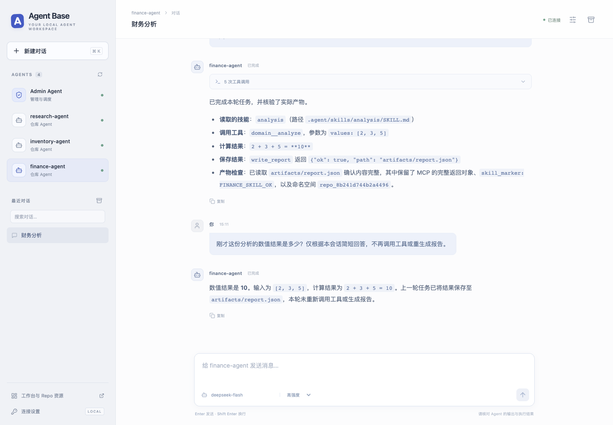
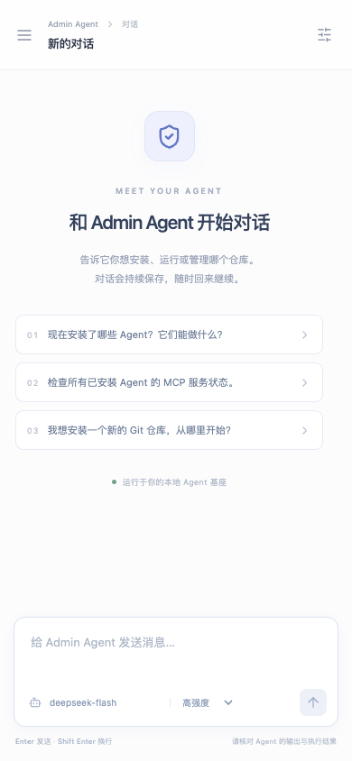
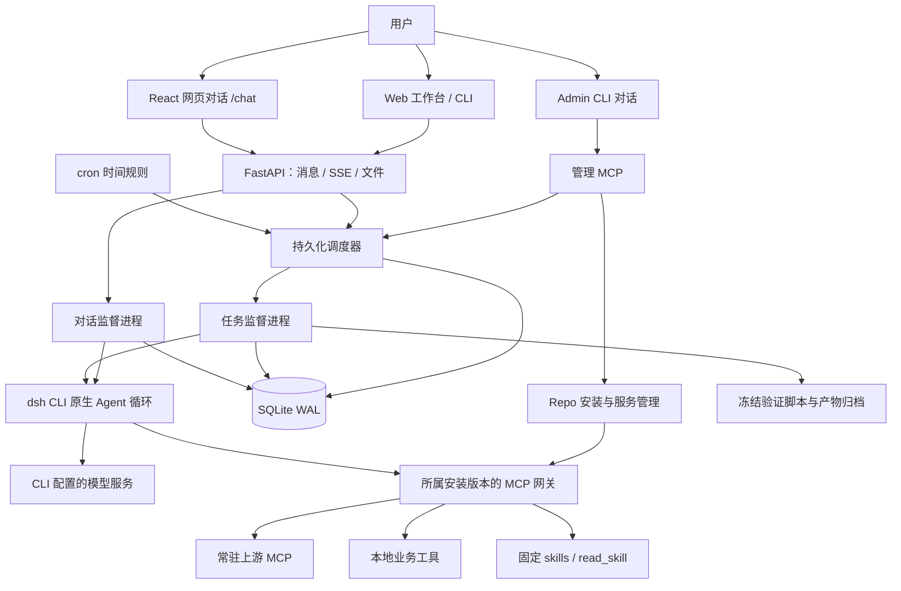
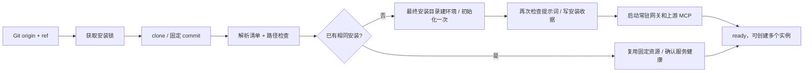
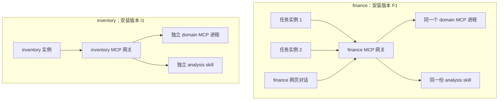
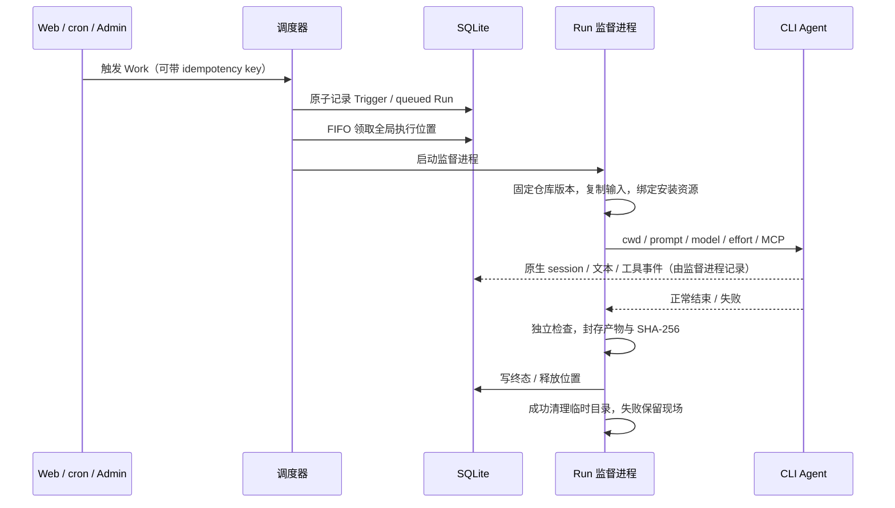
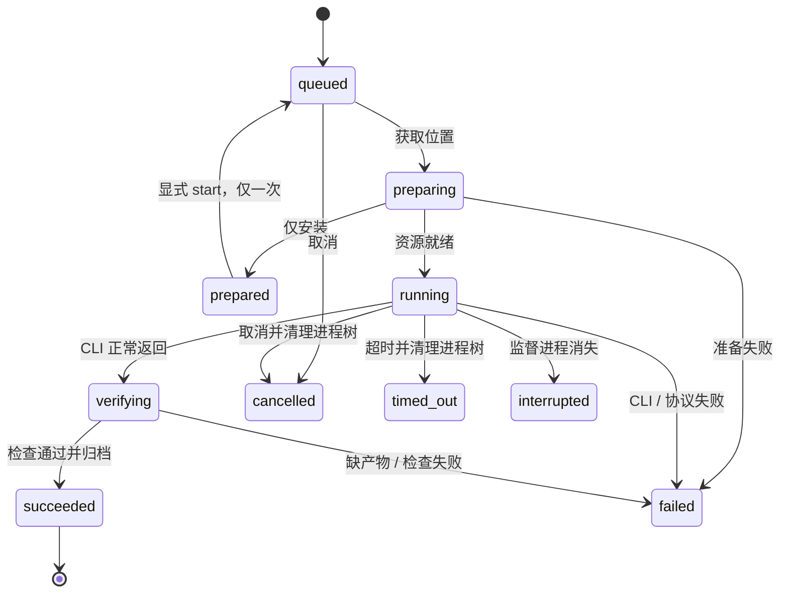
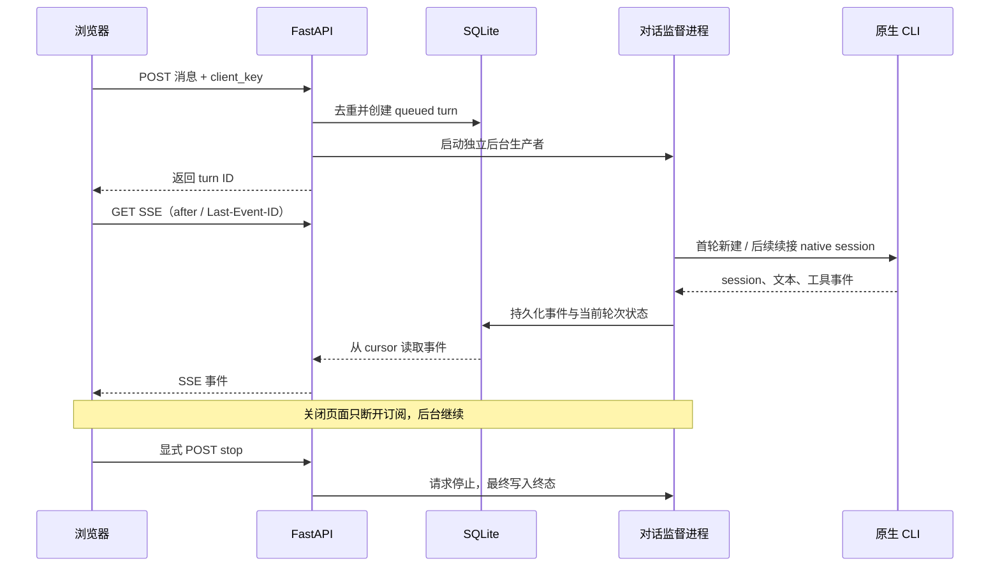

# Agent Base 项目设计书

版本：0.1.0 初版基线 · 更新日期：2026-11-05 · 实际验收平台：macOS

2026-11-10 补充：已增加 [本地 Agent 导出指南](export-guild.md)、[entrypoint 与结构化汇报契约](RepoContract.md)。下文原验收表保留初版记录，新功能测试与真实 dsh 结果见 [VALIDATION.md](VALIDATION.md)。用户隔离设计暂缓实施。

本文描述**已经实现的系统**；未实现项集中列在文末 TODO。入口文档见 [README](README.md)，安装步骤见 [Installation.md](Installation.md)，内网切换见 [CodeAgent 迁移指南](CODEAGENT_MIGRATION.md)。

## 1. 项目目标与运行方式

Agent Base 把一个 Git 仓库变成可以安装、调度和对话的 Agent。仓库提供 `AGENTS.md`、安装清单、skills、MCP 和可选产物检查；用户通过 Admin Agent、网页、CLI 或 cron 发起工作。Python 基座负责资源、生命周期和交付，CLI 负责模型推理、工具循环与原生上下文。

目前外网运行时是 DeepSeek Harness CLI，简称 dsh。模型请求从 CLI 发出，没有在 Python 中实现 OpenAI-compatible 模型 API，也没有引入 LangGraph 或第二套 Agent 循环。这样能够使用 CLI 持续演进的工具和上下文能力，同时由基座保留执行控制和可核对的结果。

| 使用方式 | 生命周期 | 适合的工作 |
| --- | --- | --- |
| Admin Agent | 多轮原生会话，使用管理 MCP | 安装仓库、注册工作、查询/取消任务、管理 repo 服务 |
| 仓库任务 Run | 每次独立工作区与 session，完成后验证/归档 | cron、Web 触发、批处理、需要独立交付检查的任务 |
| 仓库网页对话 | 每个对话保持工作区和 session，每条消息是一轮 | 探索问题、连续追问、调用所属 repo 的工具 |

系统面向本人或团队维护的可信仓库，采用目录、进程、配置与资源发现隔离。当前没有操作系统沙箱、多用户账号或跨机器集群调度。

## 2. 已完成界面

下图来自真实 dsh 验收：财务 Agent 读取固定 skill，通过常驻 MCP 完成计算、写出报告，再在下一轮依靠原生会话回答追问。截图中的模型文字属于对话内容；任务是否通过独立检查，应以基座的 `verification` 为准。



手机布局提供 Agent 抽屉、历史与输入区，中文输入法确认候选字时不会误发送。



截图已作为文档资产入库；原始运行日志、对话数据库与本机凭据不入库。

## 3. 总体架构



网页静态资源由 FastAPI 同进程提供，生产启动不需要 Vite、CDN、Redis 或额外 Node Web 服务。Node 仍是 dsh CLI 的运行依赖。SQLite 保存队列、任务、安装、对话与事件，文件系统保存仓库检出、原生 session、日志和交付物。

### 3.1 模块职责

| 模块 | 责任 |
| --- | --- |
| `config.py`、`cli.py` | 本机配置、model/effort 校验、命令入口 |
| `package.py` | 清单解析、路径/参数展开、资源与执行约定 |
| `store.py` | SQLite 状态、原子领取、事件与幂等约束 |
| `service.py`、`processes.py` | Run 准备、执行、超时/取消、进程树清理、验证归档 |
| `scheduler.py` | 工作定义、cron、触发记录、队列派发与恢复 |
| `repositories.py` | repo 身份、版本安装、固定 skills、服务生命周期 |
| `repo_server.py` | 每个安装版本的常驻 MCP 网关、上游连接与工具执行 |
| `repo_runtime.py` | 资源清单、所属 namespace 的 prompt 与 dsh 挂载配置 |
| `engines.py` | CLI 命令、环境、dsh patch 与输出解析；CodeAgent 基础入口 |
| `admin.py`、`mcp_server.py` | Admin 原生对话、管理 MCP、v1 业务工具桥接 |
| `conversations.py` | 网页对话、原生 session 续接、事件持久化、文件范围 |
| `web.py`、`frontend/` | JSON API、SSE、工作台和 React 对话台 |
| `path_lint.py` | AGENTS/skill 文档与组装 prompt 的绝对路径检查 |

以上模块位于 `src/agent_base/`；当前 CLI 适配逻辑仍分布在若干调用方，统一 RuntimeAdapter 是下一阶段重构项。

## 4. Repo 安装协议与共享资源

### 4.1 声明格式

新仓库使用 `schema_version: 2`。机器配置可以放在根 `agent.yaml`，也可以放在 `Installation.md` 或 `installation.md` 中唯一的 `agent-base-install` 围栏块，不能同时提供两份机器配置。Markdown 正文用于说明，不会被解释成 shell 安装脚本。

示意配置如下，完整可运行版本见 [finance 示例](examples/repo-resources/finance/Installation.md)：

````markdown
```agent-base-install
schema_version: 2
package: {name: finance-agent, version: 0.1.0}
task:
  default: 读取 analysis skill，调用 domain MCP 并生成报告。
skills:
  - name: analysis
    path: skills/analysis
mcp:
  servers:
    - id: domain
      transport: stdio
      argv: ["${runtime.python}", "${package.root}/mcp/domain_server.py"]
      timeout_seconds: 20
completion:
  artifacts:
    - path: artifacts/report.json
      min_bytes: 10
```
````

清单还支持初始化 `installation.steps`、`uv.lock` 环境、本地 JSON stdio 工具、HTTP MCP 和独立 `completion.checks`。凭据用 `{from_env: ENV_NAME}` 引用，不写入清单。旧 `schema_version: 1` 保留每次任务安装的兼容行为；长期共享资源应使用 v2。

### 4.2 身份、版本与安装生命周期

- `repo_id`：规范化 origin 的 SHA-256 前 16 位；本地路径和远程 URL 是不同来源身份，SSH/HTTPS 别名目前不会自动合并。
- `installation_id`：repo_id、固定 commit 和规范化 manifest 的摘要前 24 位。
- `namespace`：`repo_<repo_id>`，同一 repo 不同安装版本使用相同逻辑 namespace，但网关、进程和资源目录按 installation_id 分开。
- 同一安装版本的实例共享 skills、依赖环境和 MCP；新 commit 生成新安装，不覆盖正在使用的旧版本。



安装锁防止并发重复初始化。环境在最终安装路径创建，避免移动 venv 导致解释器路径失效。技能通过实例内固定链接指向安装副本；不会每轮重写、重新安装或换一套技能。

### 4.3 调用链与隔离边界



实例只挂载所属安装网关，`.agent/resources.json` 只列出所属资源。`read_skill` 的可选值来自本安装，业务 MCP 工具展平为 `<server_id>__<tool_name>`。每个任务保留独立的 CLI home、工作目录和上下文；项目根标记限制原生指令向父目录搜索。

网关使用本地 Bearer token，并核对 `X-Agent-Run` 对应的活动 Run 与 installation_id；据此选择工具执行的工作区。上游 MCP 在安装后保持连接，同一 server 的共享会话调用串行化；不同任务共享这一服务状态，业务 MCP 应自行处理共享数据和事务语义。

这是资源发现与执行路由隔离，符合“可以感知其他 repo，但只使用自己资源”的要求。CLI 的全局插件、宿主机文件与网络不属于硬隔离范围；目录和 venv 不能阻挡恶意代码。提示词约束不作为权限系统。

### 4.4 MCP 故障处理

| 情况 | 当前行为 |
| --- | --- |
| 首次连接失败 | 安装/准备失败，保留日志；不伪造“工具已可用” |
| 一次工具返回错误 | 向 Agent 返回错误与事件，允许其根据任务处理 |
| 工具调用超时 | 本次调用失败；不自动重放可能已有副作用的操作 |
| 上游失活 | 网关检查健康；常驻调度器定期执行恢复检查 |
| 恢复失败 | 30/60/120 秒退避，达到三次失败限制后待人工处理 |
| 显式停止资源 | 关闭自动恢复；显式 start 重置恢复计数 |
| 单个任务取消/超时 | 停止该任务进程树，保留共享网关和 MCP |
| 外部 HTTP MCP 服务宕机 | 管理连接与错误，不负责重启外部服务器 |

健康探测约每 5 秒进行，调度器恢复检查约每 15 秒进行。停止 `serve`/`worker` 后常驻服务可继续运行，但没有调度器就没有周期恢复检查。每次挂载也会检查服务。

当前只代理 MCP 工具调用，没有实现完整 resources、prompts、sampling、OAuth 或业务级断路器。恢复服务不代表可以重试已经发出的业务动作。

## 5. 调度、目录与任务生命周期

### 5.1 Work、Trigger、Run

`Work` 保存可重复执行的工作定义；`Trigger` 记录一次 Web/CLI/Admin/cron 触发及幂等结果；`Run` 是一次实际执行。工作可暂停/恢复、指定时区、超时、输入来源和 overlap 策略。



默认全局并发为 2，配置范围 1–32，等待队列上限 100。SQLite 原子领取用于同机多调度器竞争；排队任务未派发时不创建 CLI 进程。默认 overlap=skip，已有活动运行时记录 skipped_overlap；也可 allow。cron 停机期间错过的触发合并处理，暂停后的恢复只面向未来，不修改宿主机 crontab。

### 5.2 状态与恢复



图中突出主路径；取消、超时、中断也可能发生在其他执行阶段。PID 与出生时间共同判断进程身份，防止 PID 重用造成误杀。未派发 queued 项在重启后继续排队；已派发但结果未知的执行归为 interrupted，不自动重跑。这样避免重复外部副作用，但不承诺任意业务操作 exactly-once。

### 5.3 数据布局与输入副本

```text
agent-base/
  agent-base.toml                 本机配置，不入库
  .agent-base/                   本机状态，不入库
    repos/<repo-id>/installations/<installation-id>/
      source/                    固定提交、AGENTS、skills、工具
      ...                        环境、收据、服务日志与鉴权文件
    runs/<run-id>/               运行日志、结果、封存产物
    workspaces/<run-id>/         独立临时工作区
      input/                    输入副本
      .agent/resources.json     所属资源目录
      .agent/skills/            固定 skill 链接
      artifacts/                本次交付
    conversations/<id>/         持久对话工作区、CLI home、各轮日志
```

输入复制跳过常见 Git、环境和缓存目录，拒绝符号链接；上限为 256 MiB / 10,000 个条目。复制不会修改源目录。成功任务把声明产物封存到 Run 目录后清理临时工作区；失败、超时和中断保留现场供排查。数据库保留实际目录位置，因此 `.agent-base` 不是可直接跨机器拷贝使用的便携状态包。

### 5.4 完成的定义

| verification | 含义 | 不能据此推断 |
| --- | --- | --- |
| `checks_passed` | CLI 正常返回、声明产物通过范围/大小检查、冻结检查脚本退出成功 | 任意业务结论都正确 |
| `structural_only` | CLI 正常返回，完成声明的结构检查，没有独立检查脚本 | 已做业务校验 |
| `conversation_only` | 网页本轮 CLI 正常返回有效输出 | repo 默认工作已执行、completion checks 已通过 |

任务产物限定在受管工作区，单文件上限 64 MiB，并记录大小和 SHA-256。验证脚本使用冻结副本，避免工作区中的修改替换验收标准。模型说“完成”只是文本，不能覆盖上述状态与检查。

## 6. 网页多轮会话

网页对话台使用 React、react-markdown、remark-gfm 和本地事件适配器。左侧是 Admin 与所有 ready 安装版本以及历史；消息区提供 Markdown、代码、工具状态、参数/结果展开、复制和产物下载。新建会话可以选 model/effort，已有会话保存创建时设置。



同一会话同时只能有一轮活动消息；不同会话可以并发，活动/排队轮次总量上限 32。repo 每轮关联一个 Run，使用全局仓库执行位置和所属 MCP 的 Run 上下文。Admin 不占仓库位置，避免仓库繁忙时管理员无法管理它们。

CLI 原生 session、home 和工作区按会话保持。Python 保存网页历史，但不会每轮把整个网页历史重新拼接发给模型。消息 client_key 重试返回原轮次，同 key 不同文本拒绝；SSE 重连只读事件，不触发新的推理。监督进程消失会记录 interrupted，不自动重发用户消息。

默认不渲染原始 HTML、不自动加载外部图片，不展示原生 thinking。会话产物仅允许在 artifacts 范围内下载。认证 token 通过请求 header 发送，页面只在内存保存。当前归档保留数据，不提供会话删除、文件上传、多模态输入或编辑分支。

主要接口与前端实践来源见 [WebChat.md](WebChat.md)。工作调度接口与 CLI 示例见 [Scheduling.md](Scheduling.md)。

## 7. 提示词、凭据与发布边界

AGENTS 和 skill Markdown 只能使用相对路径。安装前后扫描这些文档及 skill 引用的 Markdown，v2 组装 prompt 后再检查；覆盖常见 POSIX、Windows 盘符、UNC、HOME 和 file URI 写法。HTTP URL 与正常相对路径允许通过。

```sh
.venv/bin/python scripts/check_prompt_paths.py .
```

这是静态检查，不能识别运行时任意代码动态生成的路径，也不能控制 CLI 自动生成的环境说明。基座配置、进程 cwd、MCP 挂载和日志可以包含机器绝对路径；这些路径不应复制到 AGENTS/skill 指令中。

CLI 通过已有环境获得模型认证；本地业务工具会过滤名称含 API_KEY/TOKEN/SECRET/PASSWORD 的环境变量，外部 MCP 用明确的 from_env 引用。这个名称过滤不是恶意代码防护。CLI 自己的账户配置、企业审计与权限机制仍然有效。

Web 默认绑定 loopback，限制 Host 与跨 Origin 写请求，可使用 `AGENT_BASE_WEB_TOKEN`。这是本机管理面；公网服务和多租户身份权限需要另行设计。

Git 只发布源码、锁文件、静态前端、示例和审阅过的文档截图。本机配置、模型凭据、原生 session、业务输入/产物和日志不发布。Git 使用与离线迁移见 [GIT_GUIDE.md](GIT_GUIDE.md)。

## 8. 技术基线与已知限制

| 项目 | 当前选择 |
| --- | --- |
| Python | 3.11+，uv.lock 锁定依赖 |
| Web / 调度 | FastAPI、Uvicorn、croniter、SQLite WAL |
| MCP | 官方 Python SDK，stdio 与 Streamable HTTP |
| 外网 CLI | npm 锁文件中的 `@deepseek-ai/dsh@0.2.1-rc.5` |
| CLI 安装 | 项目本地 `.runtime/dsh/`，Node.js 24.9+ |
| 前端 | React、Vite；构建文件随 Python 项目提交 |
| 状态存储 | 单机 SQLite + 文件系统，不依赖远程数据库 |
| Windows | 有包装器和进程处理代码，尚未真机验收；浏览器测试启动脚本仍偏向 POSIX |
| CodeAgent | 基础 print 入口，完整任务资源和多轮对话尚待内网适配 |

固定 dsh 发布版的 final 事件没有新的 reason 字段，当前以退出码、唯一 session/final 组合判断协议成功，记录 `legacy_final_exit_code`，不伪造 finish_reason。原生插件可能把某些加载失败视为 warning，因此安装收据不代替实际工具调用验收。

目前没有操作系统级资源配额、自动清理历史/失效安装、远程 MCP OAuth、分布式执行、自动业务重试或跨引擎原生历史迁移。

## 9. 验收依据与复现入口

下表是 2026-11-05 已完成工作的验收记录，不代表每个新环境已经验证。详细记录见 [VALIDATION.md](VALIDATION.md)。

| 层次 | 已完成结果 | 是否调用真实模型 |
| --- | --- | --- |
| Python 集成测试 | 48 项通过；含真实 Git、管理/业务 MCP、队列、故障和会话 | 否，模型侧使用 fake CLI |
| Playwright Chrome | 4 项通过；历史、刷新、工具/下载/停止、手机/中文输入 | 否，使用独立 fake CLI 服务 |
| 初始 Admin → Run | 真实管理 MCP、业务 MCP、产物独立检查通过 | 是，dsh |
| Web / cron / 超时 | 真实 HTTP 触发、实际分钟 cron、5 秒超时清理通过 | 是，dsh |
| 三 repo / 四实例 | finance 两并发共享 MCP；inventory/research 资源独立 | 是，dsh |
| 网页七轮调用 | Admin 记忆/管理、三 repo 工具、财务追问、SSE 断开继续 | 是，dsh |
| 固定资源 | init 次数为 1、skill hash/inode 稳定、MCP boot_id 稳定 | 是，结合实际进程检查 |

不需要凭据的复现：

```sh
uv sync --frozen
.venv/bin/python -m pytest -q
.venv/bin/python scripts/check_prompt_paths.py .
cd frontend
npm ci
# 未安装浏览器时先执行：npx playwright install chromium
npx playwright test
```

真实模型复现需先按安装文档配置凭据并启动服务，创建演示仓库，再运行 `validate_scheduler.py`、`validate_resources.py`、`validate_chat.py`。这些脚本会执行真实任务和产生费用；操作顺序见各专题文档。原始本机收据在忽略目录，Git 副本只携带说明和筛选后的截图。

## 10. TODO：完成情况与后续能力

以下勾选表示已实现且有上述对应验证；未勾选表示后续工作。优先级用于后续排期，不表示本次已经实现。

### 已完成

- [x] **CLI 推理接入**：dsh 原生循环；支持指定 model 与 effort，无 Python 模型 API。
- [x] **Admin Agent**：根 AGENTS、管理 MCP、原生多轮会话、后台任务管理。
- [x] **仓库执行**：固定 Git SHA、独立工作区、安装/运行分离、冻结验证与产物哈希。
- [x] **调度器**：持久队列、全局并发、Web/CLI/Admin/cron、时区、幂等与 overlap 策略。
- [x] **生命周期**：超时、取消、进程树清理、心跳与中断恢复判断、失败现场保留。
- [x] **输入副本**：目录复制、文件/体积限制、成功清理、源工作区不变。
- [x] **v2 安装协议**：Installation.md/agent.yaml、安装锁、初始化一次、版本复用。
- [x] **共享资源**：固定 skills、每安装版本常驻 MCP、任务结束不停止服务。
- [x] **资源路由**：所属 namespace、read_skill、Run 上下文、每个 repo 独立发现清单。
- [x] **MCP 运维**：健康检查、有限退避恢复、显式启停、工具错误与超时回执。
- [x] **提示词路径检查**：AGENTS、skills Markdown、组装 prompt；提供独立脚本。
- [x] **网页对话**：Admin + 所有 ready 安装、历史、工具卡片、产物下载、手机布局。
- [x] **对话可靠性**：原生 session 续接、消息幂等、每会话互斥、SSE 重放、显式停止。
- [x] **验证基线**：48 Python 测试、4 浏览器测试、真实 dsh 多链路验收。
- [x] **迁移准备**：设计书、CodeAgent 迁移指南、配置模板、Git 忽略与离线交接说明。

### 下一阶段

- [ ] **P0 · RuntimeAdapter**：抽出能力声明、命令/环境、资源挂载、事件与 session 统一接口。
- [ ] **P0 · CodeAgent 现场探测**：固定版本，核实 headless、model/effort、MCP、会话与权限参数。
- [ ] **P0 · CodeAgent 完整接入**：管理/业务 MCP、常驻网关挂载、Admin 与网页续接、真实验收。
- [ ] **P0 · 内网依赖交付**：目标平台 uv/npm 镜像或离线缓存、企业 CA/代理、安装复现。
- [ ] **P1 · 平台验收**：Windows/Linux 真机、目标 CLI 包装器和进程树清理。
- [ ] **P1 · 运维完善**：状态备份/恢复流程、历史与安装回收、日志脱敏与轮转、服务级监控。
- [ ] **P1 · 扩展接口**：远程 MCP/OAuth 的实际服务验收；按需求扩展 resources/prompts。
- [ ] **P1 · 发布自动化**：CI、依赖升级兼容矩阵、构建与发布流程、项目许可证选择。
- [ ] **P2 · 更强隔离**：仅在接入不可信仓库或多人部署时增加容器、身份权限和配额。
- [ ] **P2 · 产品扩展**：文件上传、多模态、编辑分支、分页检索、明确的数据删除策略。
- [ ] **P2 · 多机调度**：远程 worker、分布式存储/租约；保持未知结果不自动重跑。
