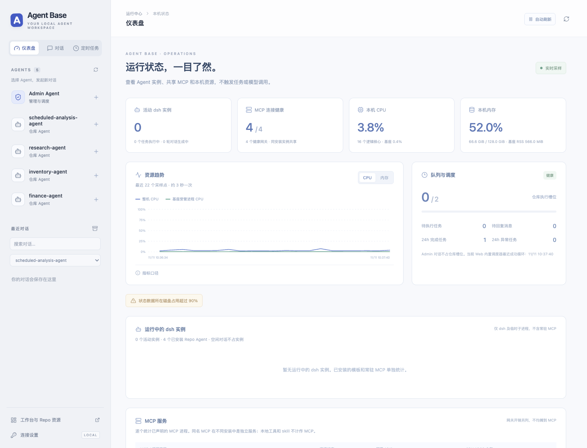
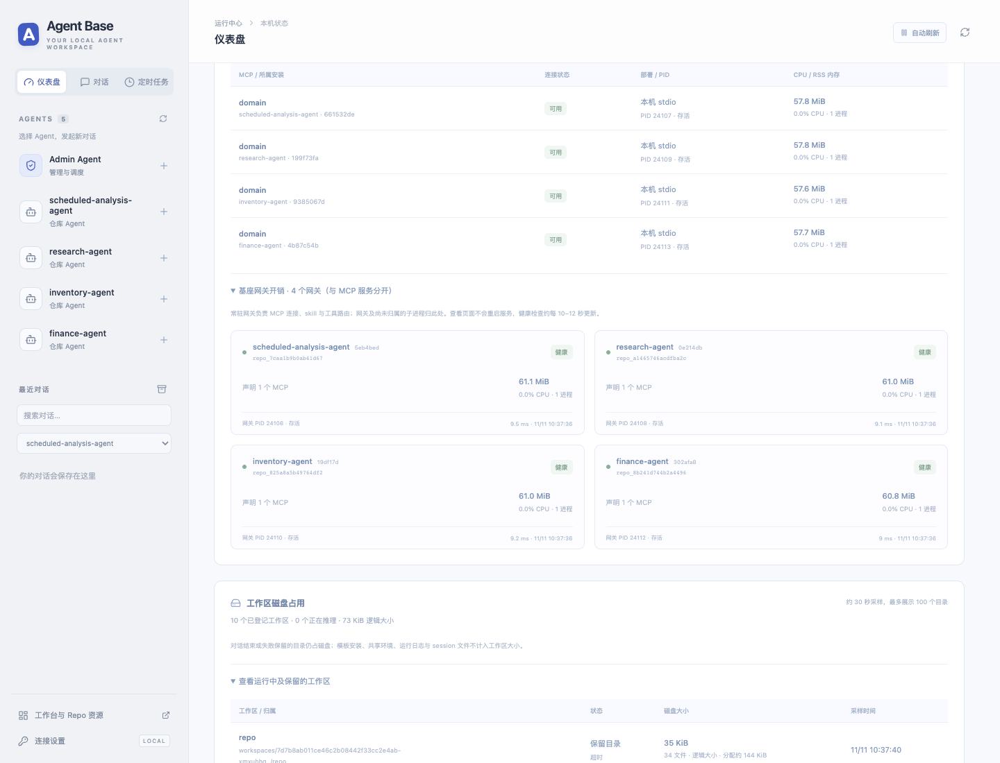
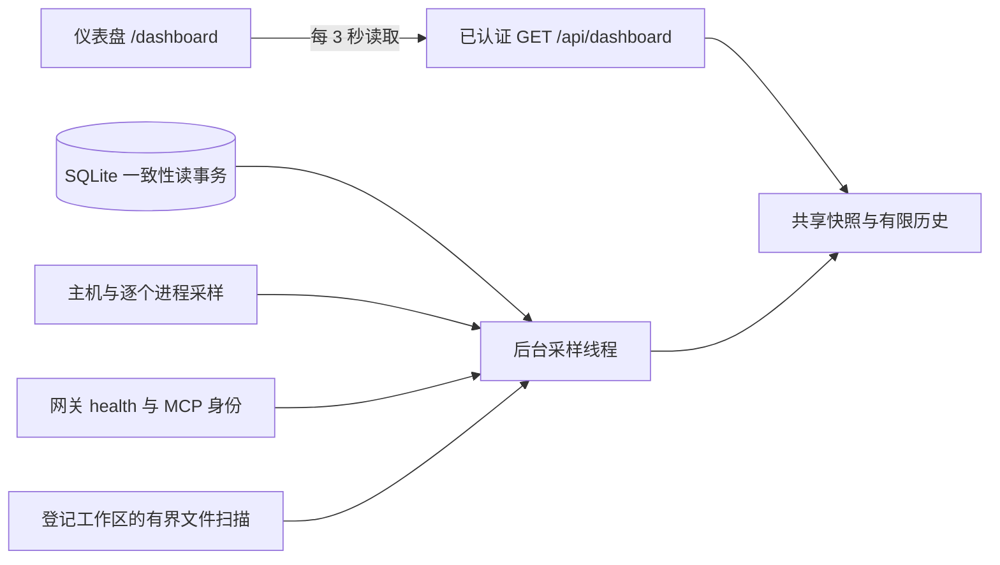
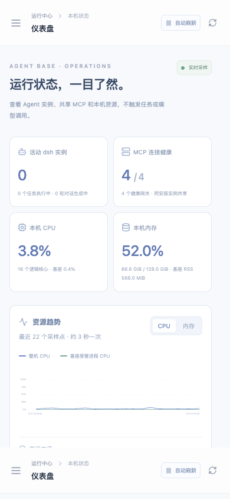

# 本地运行仪表盘

启动 `agent-base serve --port 8765` 后打开 <http://127.0.0.1:8765/dashboard>，或点击侧栏的“仪表盘”。对话、定时任务和仪表盘共用连接 Token；切换页面不会停止任务或回复。

## 三类资源分别统计

| 区域 | 统计对象 | 不包含的内容 |
| --- | --- | --- |
| 运行中的 dsh 实例 | 每个实际存活的 dsh 调用：所属 Agent、实例 ID、来源、PID、CPU、RSS 和实例工作区大小 | 已安装模板、空闲对话、排队/安装/验证进程、常驻 MCP 和监督器 |
| MCP 服务 | Installation 中每个 MCP 声明所对应的实际服务进程及其子进程，逐个展示 CPU、RSS、PID、连接状态 | 网关开销；不把同一安装的总内存平均分给 MCP |
| 基座网关开销 | 每个常驻网关及尚不能准确归属的子进程，折叠独立展示健康、资源、声明数量和恢复次数 | 已准确归属到 MCP 服务的进程；不会加到 dsh 实例上 |

实例数按 PID 与进程出生时间核对；同一网页对话关联的 Run 不重复计数。实例资源包含该 dsh 的临时工具子进程。这里监测的是基座启动的 dsh，任意从系统其他终端启动的 CLI 不在范围内。

MCP 列表保留所属安装名称用来辨别资源身份，但每个服务都有自己的统计行。相同 `domain` 名称在两个安装中代表两个独立服务。`write_report` 等本地工具、`analysis` 等 skill 不算上游 MCP，也不要求各自常驻一个进程。安装可以声明 0、1 或多个 MCP。

本机四个演示安装恰好各声明一个 `domain` stdio MCP，旧版约 118.9 MiB 是每个安装的“网关约 61 MiB + 上游 MCP 约 58 MiB”合计。新页面将两者拆开，空闲时的 dsh 实例表为空。不同业务安装的服务数量和资源不会照搬这个演示数值。

新网关在逐个打开 stdio 连接时登记进程身份。已有网关没有元数据时，只在本机子进程与该声明命令唯一匹配时归属，**不要求重启 MCP**。多个服务命令相同、进程包装不明或权限不足时显示未知，资源保留在网关未归属部分；不猜测或均摊。远程 HTTP MCP 展示连接状态，但本机无法测量远端 CPU/内存。

## 实例工作区与磁盘

“工作区磁盘占用”同时保留活动和结束后留下的目录。当前没有 dsh，并不表示对话目录和失败现场不占硬盘。成功后已清理的目录不继续作为保留目录展示；采样缓存最多可能延迟约 30 秒反映文件变化。

- **逻辑大小**：实际目录内普通文件的大小，涵盖复制的模板、存在的 Git 文件、输入及生成产物。同一目录内的硬链接按 inode 去重；符号链接不跟随，因此不重复累计外部共享 skills、环境或模板。
- **分配空间估算**：平台支持 `st_blocks` 时按分配块计算，仅作为近似参考；文件系统共享块、写时复制和压缩会影响实际独占物理空间。
- **采样范围**：只扫描登记在基座状态目录内的工作区，输出相对路径。运行日志、原生 session 文件、安装模板、共享环境和归档目录不包含在工作区大小中；整机磁盘容量另列。
- **采样成本**：大小缓存 30 秒，每轮最多扫描 8 个目录，每目录最多 20,000 个条目或约 100ms。达到限额/读取失败显示部分扫描的下限，排队等待扫描显示未知，不填零。
- **清单范围**：最多登记最近 200 个业务 Run、200 个网页会话、200 个 Admin CLI 工作区，另保证活动 Run/对话进入清单；页面最多展示 100 个工作区。超出历史范围会显式提示，不能当作所有历史存储的精确总量。

## 其余指标

| 区域 | 内容与口径 |
| --- | --- |
| 本机资源 | 系统可见的 CPU、内存、逻辑核心，以及基座所有受管进程 CPU/RSS 小计。 |
| 资源趋势 | 整机/基座 CPU 与整机内存；约每 3 秒采样，最近 120 点，通常约 6 分钟。重启 Web 后重新积累。 |
| 队列与调度 | 仓库执行槽位、排队任务/消息、最近 24 小时业务任务完成/异常数、当前 Web 内置调度器心跳。Repo 对话占仓库槽位，Admin 对话不占。 |
| 异常与存储 | 最近失败/超时/中断记录，可打开对话或报告；状态目录所在磁盘可用容量、SQLite/WAL/SHM 总大小、最近 5 个待触发计划。 |

业务任务统计排除了网页对话关联的 Run。准备、验证阶段可能占据槽位，但没有正在推理的 dsh，因此“执行中任务数”和“活动实例数”不一定相等。空闲 session 的磁盘历史不算活动实例。

CPU 使用整机容量口径：100% 表示全部逻辑核心满载，单个核心满载在 16 核机器上约为 6.25%。本机内存使用 `(total - available) / total`；RSS 是进程驻留内存之和，共享页可能重复，并非独占物理内存。本机内存不能与 RSS 小计相减推算其他应用用量。

全局受管总计包含 Web、监督器、dsh、网关和本机 MCP，按 PID/出生时间去重；嵌套启动时归属最近的已登记进程。容器内可见的系统范围取决于部署配置，当前没有 cgroup 配额归一化。

Admin CLI 在每轮开始时原子登记 PID/出生时间，结束时移除；升级前已经启动的 Admin CLI 需重启后才能登记。调度健康只表示当前 Web 内置调度器，不代替外部 worker 的全局心跳。

## 只读采样与可靠性

多个浏览器读取同一份后台快照。MCP 检查只读取本机网关的 `/health`，继承原有认证，不调用业务工具或模型。健康结果至少缓存 10 秒，通常约 10–12 秒更新，每轮最多并发检查 8 个安装；进程身份/端点变化使缓存失效。网关存活和连接健康分别判断，连接状态不能证明远程模型在线或业务结果正确。

恢复仍由原有资源管理器负责，查看页面不会启动、重装、重启或停止 MCP。手动刷新只读快照，暂停刷新只影响当前浏览器。

采样失败保留上次快照并提示；超过 12 秒显示过期。首次 CPU 没有两个差分点时显示“采样中”；权限不足、不可读和归属不明保留未知/近似标识。API 沿用 Host 与可选 Bearer 校验，不返回命令行、环境、凭据、原始提示词或完整本机配置。

## 手机与验证

自动测试覆盖实例与 MCP 独立归属、0/1/2 个服务、相同命令的不同服务、旧网关兼容、远端资源未知、工作区真实文件/链接/缓存/扫描上限、鉴权和手机布局。模型侧使用 fake CLI，MCP 为真实本机测试进程。完整记录见 [VALIDATION.md](VALIDATION.md)。
