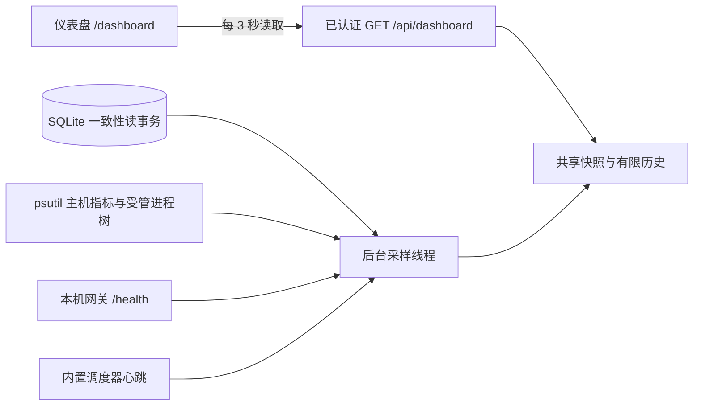

# 本地运行仪表盘

启动 `agent-base serve --port 8765` 后打开 <http://127.0.0.1:8765/dashboard>，或点击侧栏的“仪表盘”。对话、定时任务和仪表盘共用连接 Token；切换页面不会停止正在执行的任务或回复。

这张截图来自本机现有服务的只读检查，展示 4 个已安装 Repo Agent、4 个健康 MCP 连接和 0 个活动推理实例。空闲时 MCP 仍常驻，所以 Agent 行仍有资源占用。截图中的数值只代表采样当时的状态。

## 展示内容

| 区域 | 内容与口径 |
| --- | --- |
| 活动 Agent 实例 | 正在执行的原生 CLI 调用；按 PID 和进程出生时间核对，同一 Run 的网页对话不重复计数。空闲会话、排队任务和 MCP 不算推理实例。 |
| MCP 连接健康 | 声明的上游 MCP 中已连接的数量，以及健康网关数量。按安装版本展示命名空间、PID、上游状态、健康端点延迟、恢复尝试和资源占用。分母含已停用安装的声明。 |
| 本机资源 | 服务所在系统可见的 CPU、内存、逻辑核心、磁盘容量；展示基座受管进程的 CPU 与 RSS 小计。 |
| 资源趋势 | 整机与基座 CPU，以及整机内存。后台约每 3 秒采样，保留最近 120 个点，通常约 6 分钟；重启 Web 后重新积累。 |
| Agent 明细 | 按安装版本列出实例、任务、对话、等待数及资源；Admin 单列。保存的网页对话数含归档，和当前实例数分开。 |
| 队列与调度 | 仓库执行槽位、排队任务/消息、最近 24 小时业务任务完成与异常数、当前 Web 内置调度器心跳。Repo 对话占仓库槽位，Admin 对话不占。 |
| 异常与存储 | 最近失败/超时/中断记录，可打开对话或执行报告；状态目录所在磁盘可用空间、SQLite/WAL/SHM 总大小、最近 5 个待触发计划。 |

业务任务的统计排除了网页对话关联的 Run；对话按轮次单独统计。一个业务任务在准备或验证阶段可能占据槽位，但没有正在推理的 CLI，因此“执行中任务数”和“活动实例数”不一定相等。

## 数据如何取得

多个浏览器读取同一份后台快照，不会各自创建采样线程。MCP 健康检查只读取基座本机网关的 `/health`，继承现有认证；不调用业务工具或模型。每个安装的健康结果缓存至少 10 秒，通常约 10–12 秒更新；每轮最多并发检查 8 个安装，较多安装时按最久未检查者优先。进程身份或端点改变会使缓存失效。手动刷新只读取当前快照。

网关进程存在和上游连接健康分别判断：进程缺失显示“未运行”，进程仍在但健康检查失败显示“健康异常”；停用、安装中和等待检查也有独立状态。这里展示的是网关已持有的连接状态，不能证明远程模型可用或业务结果正确。恢复仍由原有资源管理器负责，查看仪表盘不会启动、重装、重启或停止 MCP。

采样异常会保留上次快照，并显示采样失败/延迟；超过 12 秒的快照标为过期。首次 CPU 没有两个差分点时显示“采样中”。权限不足、进程退出或不可读指标保留未知/近似标识，不把未知伪装成零。暂停自动刷新只暂停当前页面读取，后台仍采样。

## CPU、内存和范围

- CPU 使用整机容量口径：100% 表示全部逻辑核心满载。一个核心满载在 16 核机器上约为 6.25%，因此与某些按单核计数的系统工具不同。
- 受管资源包含当前 Web、任务/对话监督进程、原生 CLI、所属 MCP 网关和可读取的子进程。按 PID 与出生时间去重；嵌套启动时归属最近的已登记进程，避免 Admin 和其提交的任务重复累计。
- Agent 行汇总该安装的任务、对话和共享 MCP；MCP 卡片仅统计网关及其子进程；全局总计包含 Web 等公共服务。MCP 卡片已经包含在所属 Agent 行中，不能再相加。
- RSS 是进程驻留页相加，共享页可能重复计算，不是独占物理内存。本机内存使用 `(total - available) / total`，因此也不能直接和 RSS 小计相减推算“其他应用”。读取不完整时标为近似。
- 远程 HTTP MCP 的远端 CPU/内存无法由本机采集；这里只计本机网关资源。容器内看到的系统范围取决于部署配置，当前没有 cgroup 配额归一化。
- 磁盘数值是状态目录所在文件系统的容量，数据库大小是 SQLite 主文件与 WAL/SHM 文件之和，不是所有工作区和产物的递归体积。

原生实例覆盖基座管理的 Run、网页对话和新版 `agent-base admin`。Admin CLI 在每轮开始时原子登记 PID/出生时间，结束时移除；空闲终端不算实例。升级前已经启动的 Admin CLI 需重新启动才能登记。未通过基座启动的任意系统 CLI 不在监测范围。调度健康只表示当前 Web 进程内的调度器，不代替外部 worker 的全局心跳。

API 沿用现有 Host 与可选 Bearer 校验，返回筛选过的指标，不返回进程命令行、环境变量、凭据、原始任务提示词或完整本机配置。原始采样异常仅进入本地服务日志。

## 手机与验证

手机页面使用双列概览、可滚动表格和侧栏抽屉。自动回归为 92 项 Python 测试、12 项 Playwright 浏览器测试；覆盖 MCP 状态与缓存、PID 复用、资源去重、对话计数、Admin CLI、鉴权、异常快照和手机布局。模型侧使用 fake CLI，MCP 为真实本机测试进程。

本机真实服务只读验收确认 4 个 MCP 连接健康，已有 MCP 的 boot_id 均未变化，任务和对话轮次数没有增加。本功能验证不需要启动模型推理。详细历史见 [VALIDATION.md](VALIDATION.md)。
