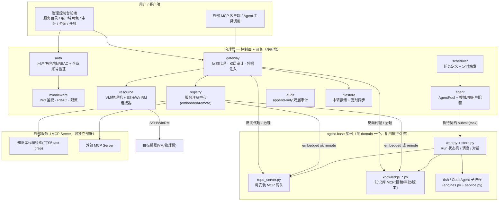

# 治理层设计（多用户分权分域 · 网关 · 执行编排）

> 状态：设计草案 v0.2（待评审）
> 更新日期：2026-11-18
> 定位：本文设计 agent-base 的「治理层」——把当前单用户执行基座补足为多用户分权分域的治理平台，并列出需要实现的点与需要融合的地方。
> 前置文档（本仓库）：`DESIGN.md`（执行基座基线）、`USER_ISOLATION_DESIGN.md`（多用户隔离草案，已搁置）、`RepoContract.md`（执行契约）、`KNOWLEDGE_BASE_DESIGN.md`、`Knowledge.md`

---

## 0. 摘要（TL;DR）

1. **关系定位**：治理层不是取代 agent-base，而是补足它缺失的「多租户控制面 + 网关治理」。agent-base 作为**每域（workspace）一个的执行引擎**被原样复用；治理层在它之上新建 `auth / gateway / registry / resource / agent-pool / audit / filestore / 治理控制台`，把 agent-base 已搁置的 `USER_ISOLATION_DESIGN.md` 真正落地。
2. **三个关键裁决**：
   - **身份统一**：agent-base 的 `workspace_id` ↔ 治理层的 `domain_id`，首版 1:1 映射，不在 domain 之下再叠一层 workspace。
   - **执行不重造**：Agent 执行、Run 状态机、每安装 MCP 网关、知识库、调度状态机全部复用 agent-base；治理层只新增治理语义（RBAC/审计/配额/注册/资源）。
   - **网关双层不合并**：agent-base 每安装网关（绑定 Run/installation 做工作区路由）与治理层中央网关（分权分域/审计/限流）职责正交，经服务注册表对接。
3. **交付原则**：所有跨层交互走 **MCP/HTTP 接口 + 明确的契约**，不 `import` 对端内部实现；每个模块单一职责、依赖单向，达到高内聚低耦合。

---

## 1. 关系定位与设计目标

### 1.1 为什么是「补充」而不是「重写」

agent-base 已实现并真实验证的闭环：`repo 安装 → 每安装常驻 MCP 网关 → 调度 → 网页对话 → 知识库 → 仪表盘`（`DESIGN.md §2–§6`）。它明确「当前没有多用户账号」并把多用户隔离搁置（`DESIGN.md §1`、`USER_ISOLATION_DESIGN.md`）。治理层需要的能力——CLI Agent、调度、知识库、MCP、SQLite——agent-base 已具备；治理层真正要新增的集中在 agent-base 完全没有的多用户/网关/治理语义上。

因此正确的补足方式是：**agent-base 保持执行基座定位不变，治理层作为前置治理入口收口多用户**。这既避免在 agent-base 内部做「每张表加归属列 + 每个 API 加过滤」的大改造（`USER_ISOLATION_DESIGN.md §3.1` 已把它列为规模化演进方案而非首版），又让自建精力聚焦在真正的新增价值上。

### 1.2 设计目标

| 目标 | 落地方式 |
|---|---|
| 多用户分权分域 | 治理层 `auth` + `gateway`，`domain_id` 贯穿，data 层域过滤（§4） |
| 唯一收口 + 严格双层审计 | 治理层 `gateway` 反向代理 + `audit`，`trace_id` 关联（§7.5） |
| 能力外部化、双模部署 | 治理层 `registry` 的 `ServiceClient(embedded/remote)`，知识库/MCP/文件中转作为可注册服务 |
| 复用执行能力 | agent-base 实例内 spawn CLI、Run 状态机、冻结验证、产物归档，经「执行契约」被治理层编排 |
| 高内聚低耦合 | 见 §3（模块归属）与 §8（落地规则） |

### 1.3 高内聚低耦合原则（先立规则，全文遵循）

- **高内聚**：一个模块只对一个「变化原因」负责（单一职责）；把「执行状态机」和「治理审计」这类正交职责拆到不同模块，禁止塞进一个类/一张表。
- **低耦合**：模块间只通过「稳定接口」交互，接口是 MCP/HTTP 契约或控制面 API，绝不 `import` 对端内部实现（呼应 agent-base `DESIGN.md §4.3` 资源发现隔离）。
- **依赖单向**：治理层 → agent-base 实例（只经控制面 API/注册表）；agent-base 实例 → 上游服务（只经 MCP/HTTP）。禁止 agent-base 反向依赖治理层内部代码。
- **身份单一来源**：身份由 `gateway` 校验并签发，实例只「消费 + 二次校验 workspace 绑定」，不透传用户 token 给 CLI/MCP（`USER_ISOLATION_DESIGN.md §4.2`）。

---

## 2. 目标架构

**分层说明**：

- **治理层**：唯一对外收口，承载「身份、分权分域、网关代理、双层审计、服务注册、资源对接、执行配额」。全部是 agent-base 没有的净新增。
- **agent-base 实例**：每个 `domain`（workspace）一个，继续承担「安装、Run 状态机、每安装 MCP 网关、知识库、CLI spawn、验证归档」。对外不直接暴露（保持 loopback/内部可达）。
- **外部服务**：知识库代码检索、外部 MCP 以 MCP/HTTP 暴露，经注册表接入，可同机（embedded）可跨机（remote）。

---

## 3. 模块划分与归属（高内聚）

### 3.1 三档归属

| 档 | 含义 | 处理 |
|---|---|---|
| **A. 治理层净新增** | agent-base 完全没有的能力 | 新建，只依赖自身与「跨层接口」 |
| **B. agent-base 复用** | agent-base 已实现并验证的能力 | 基本不动，只暴露/接上「跨层接口」 |
| **C. agent-base 需改造** | 已实现但缺归属/身份/配额的部分 | 最小化改造，遵循 `USER_ISOLATION_DESIGN.md §9` 实施拆分 |

### 3.2 模块表（职责单一 + 对外接口）

**A 档 —— 治理层净新增模块**

| 模块 | 单一职责（高内聚） | 对外接口 |
|---|---|---|
| `auth` | 身份与授权：用户/角色/权限/域数据模型、登录（本地密码/API key + 企业内网账号验证）、JWT 签发/吊销、TOTP、防爆破、域切换 | `/auth/*`、身份注入依赖 |
| `middleware` | 请求横切：JWT 鉴权、RBAC、限流、审计落库 | 请求管道（FastAPI 依赖） |
| `gateway` | 统一收口：反向代理 MCP（inspect envelope、不终结）、路由、凭据注入、双层审计 | `POST /gateway/call` + 反代路径 |
| `registry` | 服务目录与传输解析：`service/service_tool/service_check`、`server.json` schema、`ServiceClient(embedded/remote)`、健康检查 | `/registry/*` |
| `resource` | 目标机器资源：VM/物理机注册 + SSH/WinRM/虚拟化 API 连接器 + 健康检查 | `/resources/*` |
| `agent` | 执行编排与配额：AgentPool（全局/域信号量、优先级队列、满队列 429、超时强杀） | `submit(task)` 执行契约 |
| `scheduler`(治理层侧) | 定时触发源：任务定义 + cron/interval + 域归属 + 幂等 + 退避 | `/tasks/*`，触发后经契约投递 |
| `audit` | 合规审计：append-only `audit_log`、数据分级、outcome 枚举、参数脱敏四档、`trace_id` 关联 | `/audit` 只读查询 |
| `filestore` | 文件中转：原子写入、分片上传、断点续传、幂等去重、失败重试队列、定时同步 | MCP/HTTP |
| `core` | 横切基础设施：配置、structlog、`/metrics`、`/health`、异常、凭据 vault | 全局 |
| 治理控制台前端 | 治理界面：服务目录、用户/域/角色、审计查询、资源列表、任务定义 | 控制面 API |

**B 档 —— agent-base 复用模块（基本不动）**

| agent-base 模块 | 复用为 | 对接点 |
|---|---|---|
| `service.py` + `processes.py` | 执行引擎 + Run 生命周期（准备/运行/验证/归档、超时/取消/进程树清理） | 执行契约（§7.4） |
| `repositories.py` + `package.py` | repo 安装协议（schema_version:2）、repo/installation 身份、常驻服务生命周期 | 实例注册（§7.2） |
| `repo_server.py` + `repo_runtime.py` | 每安装 MCP 网关（Bearer + Run 绑定 + 上游聚合） | 服务注册（§7.3）、网关反代（§7.6） |
| `scheduler.py` + `schedules.py` | Run 状态机 + 持久队列 + overlap/幂等/重启接续 | 触发投递（§7.4） |
| `conversations.py` | 网页多轮会话、native session 续接 | 身份注入（§7.7） |
| `knowledge_*.py` | 知识库 MCP（namespace/投稿/审批/不可变版本/渐进读取/范围凭证） | 服务注册（§7.3）、知识接口（§7.8） |
| `dashboard.py` | 只读运行仪表盘（主机/进程/队列/MCP 采样） | 实例内视图 / 全局监控采集 |
| `engines.py` | CLI 适配（dsh/CodeAgent）——即 `RuntimeAdapter` 落点 | 环境/凭据注入（§7.10） |

**C 档 —— agent-base 需改造模块（最小化）**

| agent-base 模块 | 现状 | 改造 |
|---|---|---|
| `web.py::authorize` | 可选单个 `WEB_TOKEN`，未设即开放 | 改为消费治理层签发的身份（`user_id/workspace_id`），注入 `request.state`；`WEB_TOKEN` 降级为「治理层↔实例」内部服务认证 |
| `store.py` | 业务表无归属列 | 按 `USER_ISOLATION_DESIGN.md §5.1` 走「每 workspace 独立实例 + 物理分库」，首版**不加全表归属列**；跨实例引用只经 `workspace_id` 契约 |
| `repositories.py` / `repo_server.py` | repo_id/namespace 按 origin 全局去重；token 静态 | 安装根/namespace 加入 workspace 维度；`run_context` 增加 workspace 绑定校验链 |
| `engines.py::runtime_environment` | 以整个宿主 `os.environ` 为基线 | 改为基础允许列表 + 每租户凭据注入（§7.10） |
| `conversations.py` | `targets/list` 枚举所有 ready 安装 | 实例内列表；由入口保证调用方只能到自己的实例（§7.7） |
| `knowledge.py` | `bindings.actor ∈ {admin, repo:<sha16>}` | 建立 `workspace_id ↔ namespace` 映射；actor 升级为 `ws_<id>:repo_<sha16>`（§7.8） |

---

## 4. 身份与域映射（workspace_id ↔ domain_id）

**融合裁决**：把 agent-base 的 `workspace_id` 映射为治理层的 `domain_id`（首版 1:1），agent-base 实例 = 「一个 domain 的执行实例」。

| 概念 | agent-base | 治理层 | 关系 |
|---|---|---|---|
| 隔离/配额最小边界 | `workspace_id`（`USER_ISOLATION_DESIGN.md §1、§5.2`） | `domain_id`（§4 数据模型） | **1:1 映射** |
| 资源身份 | `(workspace_id, installation_id)` | `domain_id` 贯穿所有业务表 | 实例注册时绑定（§7.2） |

**理由**：治理层的 domain 语义（隔离与配额最小边界）与 agent-base 的 workspace 几乎一致。首版不做「domain 之下再叠 workspace」，也不让治理层直接接管 agent-base 的 `installation_id/conversation_id` 命名（`USER_ISOLATION_DESIGN.md §5.2` 明确「不能脱离 workspace 路由」）。未来「团队空间」在 domain 上加 `parent_id` 扩展，不改变首版映射。

### 4.1 分权分域数据模型（治理层新建，要点）

- **域（domain）**：扁平单层租户，隔离与配额最小边界；`domain_id` 强制贯穿所有业务表，查询一律经「域过滤」，SQL 不带域条件即报错（防漏写）。
- **用户（user）**：可属多域；`person`（自然人，密码 + 可选 TOTP + 企业内网账号验证）与 `service`（机器/服务账号，API key 或长期 JWT，禁 Web 登录）两类。
- **角色（role）/ 权限（permission）**：`resource.action` 命名；内置 `platform_admin / auditor / domain_admin / developer / viewer / service_runner` 六角色；`user_role`（域内授权，可按组收窄）+ `user_permission`（单权限覆盖，allow/deny）两层，**deny 优先**。
- **资源分组（group）**：域内 service/agent 分组，权限按组授予——同组归一、新成员自动继承，避免逐实例配权限。
- **认证**：JWT（access 20min / refresh 8h，claims 只放身份不放完整权限，DB 为权威）、服务端吊销、防爆破锁定、`X-Domain-Id` 定域切换。

---

## 5. 重叠能力融合矩阵（裁决表）

| 能力 | agent-base 现状 | 治理层设计 | 裁决 | 理由 |
|---|---|---|---|---|
| Agent 执行 | 已实现并真实验证（dsh 子进程、Run 生命周期、冻结验证、产物哈希、超时/取消/进程树清理） | 执行编排（子进程封装 + stream-json）+ AgentPool（并发/配额/队列/429） | **复用执行引擎，只新建编排层（Pool/配额/提交契约）** | 执行是已验证存量资产，重造违背「复用不重造」原则；治理层缺的是「按域配额/满队列拒绝」治理语义 |
| MCP 网关 | 每安装一个常驻网关（Bearer + `X-Agent-Run` 绑定 + 上游聚合） | 厚网关（反向代理 + envelope inspect + RBAC/审计/限流） | **双层网关，不合并进程** | 职责正交：agent-base 网关绑 Run/installation 做工作区路由；治理层网关做分权分域/审计/限流。经注册表对接 |
| 调度 | 持久调度器（Work/Trigger/Run、croniter、FIFO、overlap、幂等、重启接续） | 任务定义 + cron/interval + 域归属 + 幂等 + 退避 | **接口融合：治理层管「任务定义+定时触发+域归属」，触发后经契约投递；Run 状态机归 agent-base** | agent-base 队列/状态机已实现验证；治理层的「按域任务目录、域归属、优先级」是净新增，二者分层不同 |
| 知识库 | namespace=业务项目、repo 绑定、FTS5 trigram、投稿/审批/不可变版本、范围凭证 | 外部 MCP 服务，FTS5 + ast-grep + Vector 预留（代码仓问答定位） | **复用 agent-base 知识库 MCP；治理层净新增「代码结构化检索 + Vector 预留」** | 检索对象不同（文档 vs 代码）可共存；agent-base 的治理部分（投稿/审批/版本）正是治理层缺的 |
| 存储 | 单机 `runs.sqlite`（无归属列）+ 独立 `knowledge.sqlite` | 控制面库（SQLAlchemy async + Alembic，全表 domain_id） | **分离，不合并单库** | `USER_ISOLATION §5.1` 落地：控制面与用户数据分离；合并单库会触发全表过滤大改造 |
| 前端 | React 对话台/工作台/仪表盘/知识库，单用户本机 | 「服务目录 + 访问入口」治理控制台 | **接口融合：治理层前端=治理控制台；agent-base 前端=实例内工作台，经控制面 API + workspace 路由内嵌** | 功能重叠少；可复用应用壳/导航模式，不复用单用户认证模型 |
| 鉴权 | 可选单 `WEB_TOKEN`、loopback + TrustedHost + Origin 防护 | JWT + RBAC + 分域 + 企业账号验证 + 服务账号 API key + TOTP | **治理层重造（净新增）；agent-base `WEB_TOKEN` 降级为实例间内部认证** | agent-base 鉴权无法承载多用户；`USER_ISOLATION §4.2` 已规划「入口+实例双重校验」 |
| 审计 | 业务事件流（events/conversation_events）+ 知识库 kb_audit_events；无 trace_id、无 append-only 治理审计 | 双层审计 audit_log（trace_id 关联、append-only、分级/outcome/脱敏） | **治理层重造治理审计；agent-base events 保留为「执行明细事件源」，补 trace_id 接入** | agent-base events 是状态机事件非合规审计；复用方向是「事件源」不是「审计库」 |

---

## 6. 需实现的点（净新增清单，分阶段）

> 编号 `I-x` 表示「实现点」。A/B/C 档归属见 §3。

### 阶段 1：骨架与身份（先打通「治理层 ↔ 执行层」的耦合面）

- **I-1** FastAPI 骨架 + `core`（配置/config.toml 分层、structlog、`/health`/`/ready`/`/metrics`、统一异常体 `{"error":{code,message,trace_id}}`）。
- **I-2** 数据层：SQLAlchemy 2.0 async + Alembic（SQLite 起步），domain/user/role/permission/group 全表带 `domain_id`，ORM 域过滤强制。
- **I-3** `auth` 主体：用户/角色/权限/域 CRUD、JWT 签发/刷新/吊销、服务账号 API key、TOTP、防爆破、域切换（`X-Domain-Id`）。
- **I-4** **企业内网账号验证接入**：凭据状态判定（读加密凭据文件 → missing/unreadable/expired/invalid/authorized）+ 身份回查（工号 → 真实身份）→ 首次自动建号（初始低权 `viewer`）→ 管理员复核提权。存 token 不存密码、access-only 投影。落地为 auth 的一个登录后端。

  **已实现（2026-11-18）**——落地为「OSS token 透传回查」：平台不碰密码，只把 OSS 签发的 token 透传给 OSS 换身份，再按工号映射/建号、签发平台 JWT（密码只在 OSS 侧校验，平台存工号不存密码）。
  - 文件：`governance/oss.py`（`OssAuth.verify(token)` → `{w3account, department, region}`，经 `POST {endpoint}/auth/getUserDetail` + `X-Auth-Token`）、`governance/service.py::login_with_oss`（回查 → `get_user_by_w3account` → 首次 `_auto_provision` 建低权 `viewer` → 审计 → 签发 JWT）、`governance/web.py`（`POST /api/v1/auth/oss`，入参 `{token}`）、`governance/store.py`（`users.huawei_w3account` 唯一索引列 + `get_user_by_w3account`）、`config.py`（`[oss] endpoint`，或环境变量 `AGENT_BASE_OSS_ENDPOINT`）。
  - 验证：`mocks/oss.py` 提供本地模拟 OSS REST（`/auth/login` 工号+密码换 token、`/auth/getUserDetail` 凭 `X-Auth-Token` 回查工号/部门/区域、`/health`），`python -m agent_base oss-mock --port 8890` 启动；演示工号 `w000001/w000002/w000003`（密码 `demo-pass-1/2/3`）。
  - 语义：首次自动建号为域内 `viewer`；停用/锁定复用既有账号状态；「管理员复核提权」走 I-3 的 grant 接口（本次未新增独立复核流）。
- **I-5** 实例注册 / 发现：`workspace_id ↔ domain_id ↔ 实例` 绑定 + 实例元数据（内部 endpoint、健康、引擎版本、配额）；agent-base 侧把固定 workspace_id 写入实例元数据、拒绝切换 data root（`USER_ISOLATION_DESIGN.md §5.1`）。
- **I-6** 身份注入：治理层验 JWT 后向实例传可信身份 `(user_id, workspace_id, role/scope, 有效期)`，实例二次校验；实例间独立服务 token，用户 token 不透传 CLI/MCP。

### 阶段 2：网关与执行编排（核心价值）

- **I-7** `gateway` 厚网关：反向代理 MCP（inspect JSON-RPC/SSE envelope、不终结会话）、路由、凭据注入、request/response hook（可 mutate/reject）、`POST /gateway/call`。
- **I-8** `middleware`：JWT 鉴权、RBAC（deny-wins + 组级收窄）、限流（路径 tier × 身份 + lockout + 豁免端点）。
- **I-9** `agent` AgentPool：全局信号量 + 按域信号量（每域 1–2）+ 按用户限流 + 优先级 FIFO + 满队列 429/503 + 超时强杀；**不直接 spawn**，经「执行契约」投递到 agent-base 实例（§7.4）。
- **I-10** 执行契约：`submit(task)` 入参 = `(domain_id, installation/agent 定义, 参数, 优先级, 超时, trace_id, 可信身份)`，返回 run_id + 状态流；复用 agent-base `schemas/agent-report-v1.schema.json` 作为结构化结果基线。
- **I-11** `scheduler`(治理层侧)：任务定义 + agent_task/task_run（带 domain_id）+ 幂等检查 + 退避重试；触发后经契约投递，Run 状态机继续归 agent-base。
- **I-12** `audit`：append-only `audit_log` + 数据分级 + outcome 枚举 + 参数脱敏四档 + `trace_id` 关联双层（网关级 + Agent 级）。

### 阶段 3：能力外部化与资源（补齐 agent-base 没有的能力）

- **I-13** `registry`：service/service_tool/service_check、`server.json` schema、`ServiceClient(embedded/remote)`、健康检查；把 agent-base 的 repo_server（每安装）与 knowledge MCP（集中）注册进来。
- **I-14** `resource`：VM/物理机注册 + SSH/WinRM/虚拟化 API 连接器 + 健康检查。
- **I-15** `filestore`：原子写入、分片上传、断点续传、幂等去重、失败重试队列、定时同步。
- **I-16** 知识库代码结构化检索：ast-grep/ripgrep 后端 + 代码仓索引 + VectorBackend 预留，作为注册表里的独立 knowledge 服务或 agent-base 知识库的可插拔后端。
- **I-17** 治理控制台前端：服务目录、用户/域/角色管理、审计查询、资源列表、任务定义（§7.11）。

### 阶段 4：交付与运维

- **I-18** 凭据 vault：存 token 不存密码、access-only 投影、加密落库、环境变量注入（绝不进 argv/日志）。
- **I-19** 部署/备份/迁移：NSSM Windows 服务、SQLite `.backup` + robocopy、RPO/RTO、Alembic 迁移、恢复演练。
- **I-20** agent-base 侧最小改造（C 档 §3.2 六项）：authorize 消费身份、workspace 绑定、运行时环境白名单、对话/知识库归属过滤。

---

## 7. 需融合的地方（跨层接口，低耦合边界）

> 编号 `S-x` 表示「融合接缝」。每条定义「接口契约 + 两端职责 + 低耦合要点」。这 11 条就是「需要融合的地方」的具体落点。

### S-1 控制面 API

- **契约**：`/api/v1/*`（auth/registry/gateway/agents/tasks/resources/audit），统一错误体 + 响应头 `X-Trace-Id`。
- **两端**：治理层实现全套；agent-base **不**实现这套 API，只作为被控实例。
- **低耦合**：agent-base 对控制面无依赖，二者只靠 `S-2`（实例注册）与 `S-4`（执行契约）关联。

### S-2 实例注册 / 发现

- **契约**：`workspace_id ↔ domain_id ↔ 实例` 绑定；实例元数据 = 内部 endpoint、健康、引擎版本、配额；对齐官方 MCP `server.json` 的 transport 枚举（stdio/streamable-http/sse）。
- **两端**：治理层 `registry` 存实例端点与健康；agent-base 把固定 workspace_id 写入实例元数据并拒绝切换 data root。
- **低耦合**：注册表只存「如何找到实例」，不 import agent-base 内部；实例自报健康，治理层探测。

### S-3 服务注册表 schema

- **契约**：`service`（transport=embedded|remote、endpoint、group_id、domain_id）+ `service_tool`（工具清单）。
- **两端**：agent-base 的 repo_server（每安装）与 knowledge MCP（集中）都是可注册服务；工具清单经 `service_tool` 或 `server/discover` 暴露。
- **低耦合**：服务 = MCP endpoint，不 import 内部实现；embedded 也走 MCP 接口（边界纪律）。

### S-4 Agent 执行契约

- **契约**：`submit(task)` → run_id + 状态流；入参含 `domain_id/installation/参数/优先级/超时/trace_id/可信身份`；结构化结果复用 agent-base `schemas/agent-report-v1.schema.json`（`RepoContract.md`）。
- **两端**：治理层 `agent` Pool 编排 + 配额；agent-base 实例内监督进程 spawn CLI + Run 状态机 + 冻结验证 + 产物归档。
- **低耦合**：治理层不直接 spawn CLI（除非 remote worker 场景），避免破坏 agent-base 的工作区/环境/验证闭环（`USER_ISOLATION §6.3`）；「超时强杀/stream-json/结构化输出」由 agent-base `RuntimeAdapter`（P0）吸收。

### S-5 审计 trace_id 传播

- **契约**：治理层生成 `trace_id` → 注入子进程环境/执行请求 → agent-base 的 `events`、工具事件、`kb_audit_events` 携带同一 `trace_id` → 治理层 `audit_log` 关联双层。
- **两端**：治理层生成并落 `audit_log`；agent-base 把 trace_id 透传到事件源（不建审计库）。
- **低耦合**：明确定义 trace_id 字段名与传播载体（header / 环境变量 / JSON-RPC meta），两端只约定字符串，不约定实现。

### S-6 网关反代 / 治理

- **契约**：治理层 `gateway` 对注册服务做反向代理 + envelope inspect（request/response hook、凭据注入、审计）；服务端点 = agent-base 每安装 repo_server 或 knowledge MCP。
- **两端**：治理层反向代理（不终结 MCP、不重建 session）；agent-base 网关继续绑 `X-Agent-Run`/installation 做工作区路由。
- **低耦合**：首版不让中央网关直接选 workspace（`USER_ISOLATION §6.1` 要求共享代理「绑定 workspace/installation/Run/有效期/用途」且 token 分离）；agent-base 网关的 Bearer token 只作为「治理层↔实例」内部凭据。

### S-7 鉴权 / 身份注入

- **契约**：治理层验 JWT → 实例传可信身份 `(user_id, workspace_id, role/scope, 有效期)`；实例二次校验 workspace 绑定；实例间独立服务 token。
- **两端**：治理层 `auth/middleware` 签发；agent-base `web.py::authorize` 消费 + 二次校验。
- **低耦合**：用户 token 不进入 CLI/MCP 环境；agent-base 前端 `api()` 已按 `Bearer` 传头，改造面小。

### S-8 知识库服务接口

- **契约**：保留 `knowledge_catalog/search/read/submit/submission_get/submission_list` 工具契约 + 范围凭证注入 + 绑定 schema（`KNOWLEDGE_BASE_DESIGN.md §6`）。
- **两端**：治理层经注册表接入，domain 归属由注册表 + 注入身份提供；namespace 归属留在 agent-base 服务内部。
- **低耦合**：禁止用 domain 替代 namespace（破坏跨 repo 项目绑定），也禁止用 namespace 替代 domain（破坏分权分域）——二者是正交维度，知识库归属同时带 `(domain_id, namespace_id)`。

### S-9 存储边界与备份

- **契约**：控制面库（Alembic）与实例库（runs.sqlite / knowledge.sqlite）物理分离；跨库引用只经 `workspace_id/domain_id` 契约；备份统一走 SQLite `.backup`。
- **两端**：治理层管控制面库；agent-base 管实例库。
- **低耦合**：这是 `USER_ISOLATION §5.1`「控制面与用户数据分离」的落地；避免单库 + 全表过滤的大改造。

### S-10 配置 / 密钥注入

- **契约**：环境允许列表 + 凭据注入点（`variables`/`isSecret`，对齐官方 `server.json`）；密钥只走环境变量/密钥文件，不入 argv/日志/DB 明文。
- **两端**：治理层 `core` vault 存 token/access-only 投影；agent-base `engines.py::runtime_environment` 改为白名单 + 每租户注入。
- **低耦合**：把「平台登录 secret、其他用户凭据、全局控制权限」从 CLI/MCP 环境中移除（`USER_ISOLATION §6.3`）。

### S-11 前端路由接缝

- **契约**：治理层控制台经控制面 API 生成服务目录，按 workspace 路由到实例 UI（受保护内嵌）；统一导航与会话。
- **两端**：治理层控制台（治理页）；agent-base 工作台（执行页，loopback/内部可达，不直接暴露）。
- **低耦合**：agent-base 前端认证降级为实例内部会话；`serve` 仍写死 loopback + TrustedHost + Origin 防护，对外只暴露治理层网关（`USER_ISOLATION §9`）。

---

## 8. 高内聚低耦合落地规则（硬约束）

1. **依赖方向单向**：治理层 → 实例（控制面 API/注册表/契约）；实例 → 上游（MCP/HTTP）。发现反向依赖（agent-base import 治理层内部）即视为设计错误。
2. **接口即契约，不 import 实现**：跨模块只经 MCP/HTTP 契约或控制面 API；任何「为了省事直接 import 对端类」都是耦合债。
3. **单一职责判据**：一个模块只能有一个变化原因——「执行状态机」与「治理审计」分离；「调度触发」与「Run 状态机」分离；「namespace（内容归属）」与「domain（访问权限）」分离。
4. **身份单一来源**：身份只在 gateway 校验签发；实例只消费 + 二次校验 workspace 绑定；CLI/MCP 永不见用户 token。
5. **trace_id 唯一关联键**：所有网关级/Agent 级事件携带同一 trace_id，作为双层审计与跨层排障的唯一主键。
6. **控制面与数据分离**：治理表（domain/user/role/audit）与执行表（runs/events/conversations）物理分库，不合并。
7. **配置外部化 + 凭据不落明文**：transport 切换靠注册表运行时热更新，零代码改动；密钥只走环境/密钥文件。

---

## 9. 分阶段实施计划

| 阶段 | 内容 | 验收边界 |
|---|---|---|
| **P1 耦合面打通** | I-1~I-6（骨架、数据层、auth、企业账号验证接入、实例注册、身份注入） | 单域单实例：登录 → 鉴权 → 路由到自己的实例 → 消费身份；企业工号登录映射低权 viewer |
| **P2 网关与编排** | I-7~I-12（厚网关、middleware、AgentPool、执行契约、治理层调度、审计） | 双用户：A/B 各域独立提交 Agent、网关双层审计可回溯、满队列 429、按域配额生效 |
| **P3 能力外部化** | I-13~I-17（registry、resource、filestore、代码检索、治理控制台） | 知识库/MCP 以 embedded/remote 接入、资源健康、文件同步、治理页可用 |
| **P4 交付运维** | I-18~I-20（vault、部署备份、agent-base 六项最小改造） | 双用户故障注入、备份恢复演练、agent-base 改造项回归（`USER_ISOLATION §11` 验收清单） |

> 依赖关系：P1 是 P2 的前提（身份与实例路由）；S-1/S-2/S-4/S-5/S-7 这五条接缝决定「治理层 vs 执行层」的耦合面，应最先定型；其余接缝（S-3/S-8/S-9/S-10/S-11）可并行或后置。

---

## 10. 风险与缓解

| 风险 | 影响 | 缓解 |
|---|---|---|
| 网关成关键路径/单点 | 单点故障拖垮全平台 | 双层网关职责分离，网关无 Run 状态；NSSM 自愈 + 健康检查 + 监控告警 |
| 执行契约过度耦合 | 治理层与 agent-base 互相拖累演进 | 契约冻结为「submit/状态流/trace_id/结构化结果」，两端独立版本演进（§7.4） |
| 企业账号验证后端异常风格不一致 | 接入 FastAPI 时错误码/异常不统一 | I-4 统一异常/错误码规范；保留验证门面，仅在 auth 边界归一 |
| 实例内凭据串味（宿主环境继承） | 多租户下凭据泄露 | S-10：环境白名单 + 每租户注入 + 名称过滤；`USER_ISOLATION §6.3` |
| 知识库 domain/namespace 混淆 | 分权分域或跨 repo 绑定被破坏 | S-8：明确 `(domain_id, namespace_id)` 双维，禁止互相替代 |
| 单库合并诱惑 | 触发全表过滤大改造 | S-9：物理分库，首版不做单库多租户（`USER_ISOLATION §3.1` 定位为演进方案） |
| 审计写放大（每请求一 DB write） | 高并发性能瓶颈 | 先写 JSONL 再异步落库，评估「直接写 DB vs 异步」开关 |
| Windows 真机未验收 | DPAPI/进程树/服务化不确定 | P4 增加 Windows 真机验证与 CodeAgent 内网探测（`DESIGN.md §10 P0`） |

---

## 11. 待确认项（不阻塞本设计，影响排期）

1. 平台是否允许用户提交自己的 repo，还是只安装平台审核的模板？（影响 S-4 执行契约的安装来源与 `workspace_source` 暴露面）
2. 目标内网执行平台是否允许容器？CodeAgent 能否在其中完成本人登录？（`USER_ISOLATION §12`，影响 agent-base 实例部署形态）
3. 模型与外部 MCP 用每用户账号，还是有明确组织服务账号？（影响 S-10 凭据 vault 与「网关代持凭据」边界）
4. `registry` 是否直接复用官方 MCP `server.json` 的 `variables/isSecret` 作为凭据注入点，还是自建更简 schema？（影响 S-3/S-10 字段对齐）

---

## 附：直接可复用的 agent-base 存量（集成排期参考）

- 执行/生命周期全套（dsh 引擎、Run 状态机、工作区、冻结验证、产物哈希、超时/取消/进程树清理）——`DESIGN.md §3–§6`。
- 安装协议 schema_version:2、repo/installation 身份、常驻 MCP 网关与恢复——`DESIGN.md §4`。
- 持久调度器（Work/Trigger/Run、幂等、overlap、重启接续）——`DESIGN.md §5`。
- 知识库核心首版（namespace/绑定/版本/投稿审批/渐进披露/范围凭证/管理页）——`Knowledge.md`、`KNOWLEDGE_BASE_DESIGN.md`。
- 多用户隔离设计草案（部署架构、身份传播、数据分离、配额、迁移、验收清单）——`USER_ISOLATION_DESIGN.md` 全篇，是本治理层设计最直接可引用的蓝图。
