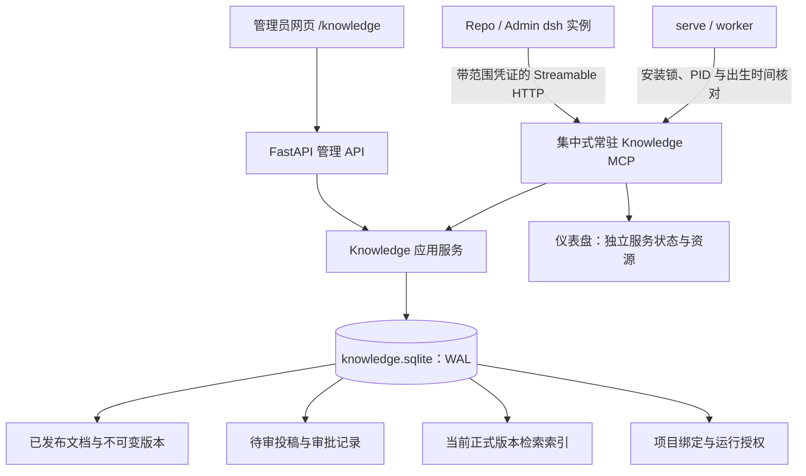
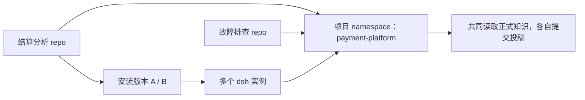
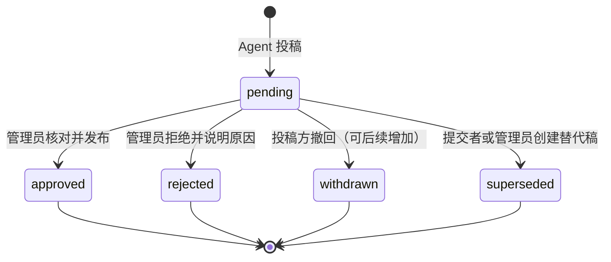
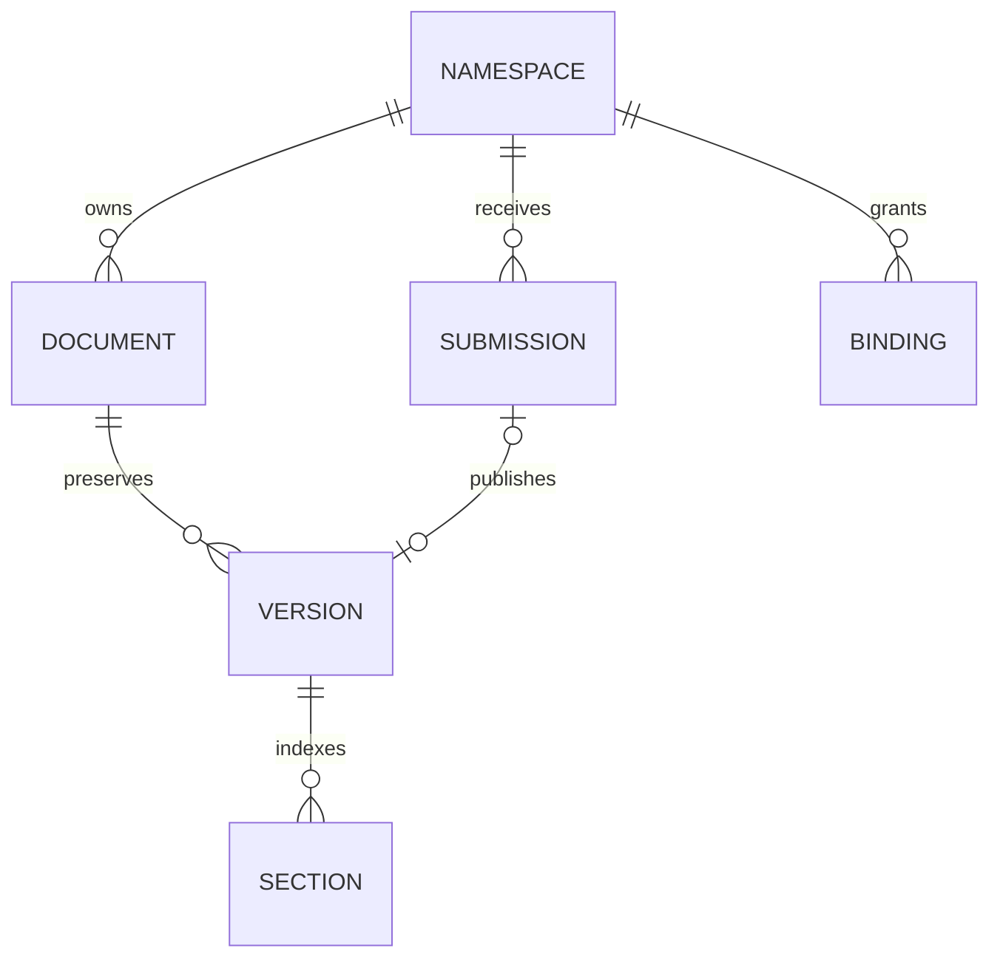

# 集中式项目知识库设计草案

日期：2026-11-11。状态：**设计存档，核心首版已实现**。实际使用与范围以 [Knowledge.md](Knowledge.md) 为准。下文保留设计方案及后续任务；Installation 扩展、分层分类过滤、自动退避恢复、导入导出等尚未实现。

实施补充：本机未设置环境管理 Token 时，生成私有本机凭据，通过 `agent-base open` 的一次性链接建立 HttpOnly 管理会话；不输出或注入模型环境。编辑后发布以不可变正式版本保留管理员修订，原投稿标记 superseded 并关联版本，不另外生成一条管理员投稿。

目标是让多个 Agent 共享项目知识，同时保留人工控制的发布流程。延续现有 Python 基座、dsh 原生循环、React 页面和常驻 MCP；暂不引入多用户账号、向量数据库或新的模型 API。

## 1. 建议确定的边界

1. namespace 代表项目，独立于 Git repo、安装版本和运行实例。同一项目可绑定多个 repo；同一 repo 升级后继续使用原知识库。
2. 正式知识与投稿分开。Agent 可以读取已发布知识、投稿新增/修改；投稿未经管理员审核，不进入正式搜索和读取结果。
3. 管理员可直接新建、修改、归档正式知识，也可审批投稿。每次发布都创建不可变版本，不覆盖历史内容。
4. 渐进式披露由工具返回结构和大小限制实现：先目录/摘要，再搜索候选与章节目录，最后按章节取正文。不把整库塞进 AGENTS.md。
5. 采用一个集中式常驻 Knowledge MCP，所有获准 Agent 连接同一服务；不会为每个 repo/实例复制数据库或启动一份知识库进程。
6. MVP 保存 Markdown 文档及元数据。PDF/图片解析、附件、语义向量检索、自动总结和自动发布留到后续。

## 2. 总体架构



管理 API 与 MCP 使用同一套应用服务规则，不能分别实现两套“发布逻辑”。知识数据放在状态目录中的 `knowledge/knowledge.sqlite`，与任务队列的 `runs.sqlite` 分开，避免检索和发布写入占用任务队列的写锁。

Knowledge MCP 作为基座核心服务独立运行，借鉴现有常驻 Repo MCP 的进程管理方式，但不伪装成一个业务 repo。`serve` 或 `worker` 启动时幂等确保该服务存在；两个入口同时启动也只产生一份进程。网页重启、任务完成和 dsh 退出都不结束它。提供独立启停/状态入口，停用会影响所有依赖它的 Agent。

Web 可直接通过应用服务访问数据库，因此单独的 MCP 进程不可用时，管理员仍能查看、编辑和审批。数据库本身不可用时，两个入口都应明确失败。

## 3. namespace 与 repo 的关系

### 3.1 标识与绑定

namespace 有不可变 UUID、唯一 slug（如 `payment-platform`）和可修改的中文显示名。引用和外键使用 UUID；slug 用于展示和人工选择。首版不支持改 slug，归档替代物理删除。



这与现有 `repo_<hash>` 不同：现有 namespace 标识 repo 的工具/skills，知识 namespace 标识业务项目。知识库不能按 installation_id 建库，否则升级一次就会丢失共享关系。

管理员在网页“项目与绑定”中配置：

| 项目 | 含义 |
| --- | --- |
| `repo_id` | 现有 repo 身份；绑定不随安装 commit 改变 |
| `primary_namespace_id` | 默认投稿/读取的项目 |
| `read_namespace_ids` | 获准读取的项目；初版默认仅主项目 |
| `submit_namespace_ids` | 获准投稿的项目；初版默认仅主项目 |
| `required` | 知识服务不可用时，该 repo 是否必须停止启动 |
| `revision` / `enabled` | 绑定修订号与启停，用于运行授权和撤销 |

多个项目共享的通用知识以后可建一个显式 `shared` namespace，并按配置授予读取；不提供隐式全局可读库，也不自动跨 namespace 搜索。不同 Git URL/本地路径目前会得到不同 repo_id，迁移仓库地址时由管理员重绑，不能按相同仓库名猜测关联。

### 3.2 Installation 的表达

首版以网页绑定为权威。后续可让 Installation 固定配置块声明“请求使用的项目别名”；该字段只表达意图，不自动获得访问其他项目的能力。

下面是**拟议扩展**，不能直接用于当前安装器：

```yaml
knowledge:
  requested_namespace: payment-platform
  required: false
```

已配置过的 repo 自动沿用绑定；没有配置的旧 repo 保持原行为。不能因增加知识库而要求所有既有 repo 重装、重启 MCP 或改写 AGENTS.md。不要让 repo 自行配置集中库的管理员凭据、数据库路径或服务进程。

## 4. 知识的结构与版本

一条知识是一篇有稳定 ID 的 Markdown 文档，而不是一个任意本地文件路径。

| 字段 | 说明 |
| --- | --- |
| `document_id` / `namespace_id` | 文档与项目身份 |
| `slug` / `topic_path` | 项目内唯一别名、逻辑分类，例如“运维/数据库”；不是文件系统路径 |
| `title` / `summary` / `tags` | 必填标题与摘要、可选标签，支持目录级发现 |
| `body_markdown` | 正文，由作者或管理员提供，不要求额外调用模型总结 |
| `version_id` / `version_number` | 不可变版本 ID 和递增展示序号 |
| `parent_version_id` | 本次修改的基线版本 |
| `source` | 人工/Agent，关联 repo、安装 commit、Run 或对话轮次、投稿 ID |
| `created_at` / `published_at` | 时间与发布来源 |
| `status` | 文档 published / archived；不存在 Agent 可见的“未审批正式版本” |

摘要初版限制 300 个字符，标题 120 个字符，标签最多 10 个，正文最多 128 KiB UTF-8。限制要同时覆盖 Web 与 MCP，超限明确返回错误，不静默截断待发布内容。

版本一经创建不得修改。管理员编辑、通过投稿、回滚都生成新版本；回滚是把历史内容复制为新版本，不把当前指针悄悄指回旧版本。修改 namespace 归属不纳入首版，避免改变历史引用的含义。

Markdown 按标题结构生成章节索引，保留开头无标题段落为独立章节。标题重复时仍分配唯一章节 ID。章节 ID、字符范围和内容摘要绑定该版本，不要求跨版本固定章节位置。

## 5. 渐进式披露

### 5.1 读取层级

| 层级 | Agent 获得的信息 | 默认限制 |
| --- | --- | --- |
| L0 项目目录 | 获准项目、分类、文档标题、简短摘要、标签、当前版本 | 文档分页 20 条；摘要最多 160 字符 |
| L1 搜索候选 | 文档 ID、版本、标题、摘要、匹配片段、命中的章节 | 默认 5 条，最多 10 条；每片段 200 字符 |
| L2 文档目录 | 完整摘要、版本、更新时间、章节 ID/标题/长度、来源 | 不附带整篇正文；大目录也分页 |
| L3 章节正文 | 指定版本、指定章节的 Markdown 与引用信息 | 每次最多 6,000 字符；超长章节用 cursor 继续 |

所有读取工具设置响应总预算，例如 `max_chars` 不得超过服务端 8,000 字符上限。预算指输出字符量，不宣称能精确换算成不同模型的 token。不能通过一次请求很多章节绕过总预算。

示例：Agent 要了解“结算日切规则”，先搜索得到 3 条摘要，选择《日切与补单规则》v4，读取其目录，再只读取“日切时区”和“跨日补单”两节。无需读其余章节，也无需把知识全文放进 system prompt。

### 5.2 固定版本与引用

目录/搜索返回具体 `version_id`。读取章节时必须携带该版本，分页 cursor 同时绑定文档、版本、章节和偏移；不能在分页过程中自动切换到新版本。

响应同时提供 `current_version_id`、`is_current` 与文档归档状态，让 Agent 知道自己读到的是固定历史内容还是当前知识。归档知识不进入正常目录/搜索；显式历史引用可供获准读取者追溯，但必须显示“已归档，非当前依据”。namespace 停用则阻止新 Agent 授权和现有范围访问。

引用采用结构化对象：

```json
{
  "namespace": "payment-platform",
  "document_id": "doc-id",
  "version_id": "immutable-version-id",
  "section_id": "s2",
  "reference": "kb:payment-platform:doc-id:v4:s2"
}
```

这是知识引用，不是本地绝对路径。首版保证单篇文档读取一致，不承诺整个项目在长任务期间自动冻结成统一快照。Run 的结构化结果契约保持不变，知识引用可写在结果摘要或业务产物中；不能让 Agent 随意添加不受现有报告 schema 支持的顶层字段。

### 5.3 检索方案

先做 namespace 过滤后的全文检索，候选结果可再按主题、标签缩小范围。FTS5 仅索引当前已发布版本的标题、摘要、标签和正文；不索引投稿、归档文档和被替代的历史版本。

本机 Python 的 SQLite 已检查支持 FTS5 与 trigram。首版优先使用 trigram 支持中文连续文本匹配；两字短查询优先匹配标题、标签和摘要，不能把 trigram 宣称为完整中文分词/语义检索。查询参数要转义和参数化，不能让原始输入直接成为任意 FTS 表达式。

在目标内网环境初始化时检测能力；缺少 trigram 时使用有范围、有条数和时间预算的字面匹配降级，并在健康状态中显示降级。后续再根据检索命中质量加入中文分词或向量检索。向量索引只能是可重建派生数据，不能成为文档及审批事实的唯一存储。

## 6. Agent MCP 契约

集中服务使用 Streamable HTTP，serverName 为 `knowledge`，与现有 repo 工具连接并列。拟提供以下工具：

| 工具 | 主要参数 | 能力 |
| --- | --- | --- |
| `knowledge_catalog` | 可选 namespace、分类、cursor、limit | 未指定项目时只列授权项目；指定后列分类和摘要 |
| `knowledge_search` | namespace、query、分类/标签、limit | 返回 L1 候选，不返回全篇正文 |
| `knowledge_read` | document_id、version_id、view、section_id、cursor | view=outline 或 section；章节读取固定版本 |
| `knowledge_submit` | namespace、operation、document_id、base_version_id、candidate、reason、evidence、idempotency_key | 提交新增或修改建议，返回投稿 ID，不直接发布 |
| `knowledge_submission_get` | submission_id | 查询本来源主体的投稿内容、状态和审核意见 |
| `knowledge_submission_list` | namespace、status、cursor | 分页查询本来源主体的投稿 |

`operation=create` 提交完整候选文档；`operation=update` 额外要求 document_id 和 base_version_id，候选同样是完整拟替换版本。服务端生成差异，首版不支持任意 JSON Patch 或 shell 修改，避免补丁定位不一致。

`reason` 说明为什么值得入库，`evidence` 可包含链接、业务产物相对引用和简短依据。依据不等同于已经核实；管理员需能查看来源。repo/commit/Run/轮次等来源信息由基座凭证上下文注入，不能完全采信 Agent 自报字段。会失效的临时文件不作为长期证据的唯一副本；不自动打开/抓取 Agent 提交的任意 URL 或本机路径。

相同来源主体、namespace、idempotency_key 与相同请求内容返回原投稿；同 key 不同内容返回冲突。投稿成功后响应丢失时，Agent 可以安全核对，不能因网络异常盲目再次发布一条。

Agent MCP 不暴露 approve、reject、publish、archive、创建 namespace 或修改绑定工具。包括 Admin Agent 在内的模型进程默认都只有获准范围内的读取/投稿能力；网页管理员与 Admin Agent 不是同一种权限。

## 7. 投稿与审批



首版必要状态为 pending / approved / rejected / superseded；撤回可后续补充。状态是投稿的状态，与文档的 published / archived 分开。未批准内容仅管理员和本来源主体可看，其他 Agent 即使处于同一项目也不能通过正式读取或搜索提前使用。

### 7.1 新建知识

1. Agent 提交标题、摘要、分类、标签、正文、依据和理由。
2. 服务验证范围、大小、必填项和内容格式，写入不可变投稿内容，返回 pending。
3. 管理员查看正文与来源，执行批准或拒绝。
4. 批准事务创建文档及 v1、更新检索索引、记录审核审计、关联投稿；全部成功才算发布。

同 namespace 的 slug 在批准时再次做唯一性校验。Agent 可以看到相似已发布知识来减少重复，但“疑似重复”只作为建议，不自动合并两篇文档。

### 7.2 修改知识与并发

例如两个 Agent 都基于 v3 投稿 A、B。A 批准后生成 v4，B 在审批页显示“基线已过期”。批准 B 时不能直接覆盖 v4，返回明确的版本冲突，并提供基线 v3、当前 v4、候选 B 的比较。

管理员合并后创建一个基于 v4 的新候选，再检查和发布 v5；原 B 标为 superseded 并关联替代稿。首版不自动三方合并，不提供无提示的强制覆盖按钮。

审批请求必须携带 `submission_id`、候选内容 hash 和 `expected_current_version_id`。发布使用同一数据库写事务检查当前版本并更新指针；两次审批、两名打开页面的管理员或后台重试都不能产生重复版本。

### 7.3 管理员编辑

管理员可直接创建和发布，或编辑现有知识后发布新版本，仍要求 expected_current_version_id，仍记录内容差异与审计。

审批页的“编辑后发布”不能改写 Agent 的原始投稿。它先生成管理员修订候选，展示最终差异，再发布这个明确候选，保留原稿与修订稿关系。审核备注不能偷偷变成正文内容。

归档让文档退出正常检索；恢复或回滚都经过显式管理操作并留记录。被拒绝的投稿保持原内容与理由，后续修正需提交新稿，不把已审对象原地改成另一个对象。

## 8. 身份、范围与运行集成

本阶段仍是现有单用户部署，不建设账号、租户或复杂 RBAC。这里的凭证范围用于防止工具误调用与区分发布职责，不宣称能限制同机可信 repo 代码对整个文件系统的访问。

- 网页管理 API 复用现有管理 Token、Host 与跨来源写保护；知识库的 namespace/绑定修改、正式发布和审批额外要求管理 Token 已配置。缺少 Token 时这些写入入口明确不可用，并在页面说明配置方法，不能退化成无需认证的发布 API。已有对话/仪表盘认证行为不在本阶段改写。
- 当前 `runtime_environment()` 会复制宿主环境，实施时必须显式移除 `AGENT_BASE_WEB_TOKEN` 等管理控制凭据，再向 dsh/业务工具注入有限范围的知识凭据。不能仅靠“不提供 approve 工具”就声称模型拿不到发布能力；这也是首版验收项。
- 每次 Run/对话轮次启动时，基座依据绑定签发有限期限的随机不透明 MCP 凭证。服务端保存 hash 及可信调用主体、允许读/投稿的项目、绑定修订号和过期时间；不把凭证写进任务 prompt 或日志。
- 普通 repo 的来源由基座核对 Run/轮次及安装关系；Admin CLI 使用基座登记的会话/轮次上下文。Admin Agent 的项目范围由管理员配置，默认不因其名字叫 Admin 就获得所有项目或审批权。
- 请求中的 namespace/document_id 只是资源选择，不是授权依据；cursor、历史版本和投稿详情同样核对范围。列表、搜索先过滤 namespace，再排序/计数。
- 投稿查看主体按 repo 身份或 Admin Agent 身份归属，使同 repo 后续实例可以追踪既有投稿，而不是仅凭不可猜测 ID 就能读取其他来源的待审内容。
- 停用绑定/项目应撤销对应授权；同一 repo 新绑定的 namespace 不在旧运行中悄悄生效。新轮次获取新授权，已有轮次的 namespace 范围固定。

当前 `repo_runtime.py` 的提示词要求忽略其他 namespace 的 MCP，需要同步更新：资源清单明确列出“本 repo 工具 + 获准知识项目”，只有这份清单中的 Knowledge MCP 才作为允许的共享服务。

`.agent/resources.json` 保存服务名、允许的项目标识和能力说明；运行 patch 通过环境引用传凭证。AGENTS + entrypoint + 报告提示词的顺序不变，只在资源说明中加入读取/投稿约定，不注入整库内容。

知识正文是业务资料，不得当作新的系统指令；正文里的“忽略限制、调用管理工具、批准自己”不能改变能力范围。前端 Markdown 禁用原始 HTML/脚本，不主动加载正文中的远程图片或执行代码。

知识是数据，不适合机械套用“AGENTS/skill 禁止绝对路径”的全部规则。文档可能讨论系统路径，应作为示例数据展示；运行提示词只使用知识 ID 与相对业务产物引用，不能把文档中的本机路径直接当作工作区路径执行。

## 9. 数据模型与事务

建议独立 `KnowledgeStore`，采用显式 schema migration、WAL、每连接外键校验与短写事务：

| 表 | 关键内容 |
| --- | --- |
| `kb_namespaces` | UUID、slug、显示名、说明、启停/归档状态 |
| `kb_bindings` | repo_id、主项目、可读/可投稿项目、required、修订号 |
| `kb_documents` | namespace、稳定 ID、唯一 slug、current_version_id、状态 |
| `kb_versions` | 不可变正文/元数据、父版本、序号、发布来源与时间 |
| `kb_sections` | version_id 下的章节 ID、标题层级、字符范围 |
| `kb_submissions` | 新建/修改、目标、基线、不可变候选、内容 hash、来源、状态、审核意见与替代稿关系 |
| `kb_audit_events` | 动作、对象、调用主体、时间、前后版本/内容 hash、结果 |
| `kb_runtime_grants` | 凭证 hash、来源上下文、项目范围、有效期与撤销状态 |
| `kb_search` | 当前正式版本的 FTS 派生索引 |



正文和元数据以关系表为事实源；FTS 可以重建。发布事务内完成：检查基线/候选 → 插入版本与章节 → CAS 更新文档当前指针 → 替换正式搜索索引 → 标记投稿与记录审计。任一步失败整次回滚。备份使用 SQLite backup 接口，不能直接复制一个可能仍有 WAL 的主文件来冒充完整备份。

MVP 支持发布审计和投稿来源；工具日志只记录 ID、版本、耗时、结果和返回字符量，避免把整篇正文和凭据复制到每个 Run 的日志。全文阅读明细的长期审计与统计按后续需要扩展。

知识数据与运行授权留在忽略目录，不进入代码 Git。管理员后续可按 namespace 导出 Markdown/JSON 包，保留引用、版本和来源；导出不包含运行凭证。生产导入/导出与备份恢复需要单独验收，不能把源码离线 bundle 当作知识库备份。

## 10. 管理员前端

增加 `/knowledge`，与仪表盘、对话、定时任务共用应用壳及管理连接设置。侧栏导航建议改成纵向菜单，避免四个页面按钮挤在当前窄横排中。

```text
知识库                                      [项目 ▼] [新建知识]
┌────────────────┬────────────────────────────────────────────┐
│ 知识文档       │ 搜索 / 分类 / 标签                         │
│ 待审批 (3)     │ 标题           摘要        版本 / 更新时间 │
│ 项目与绑定     ├────────────────────────────────────────────┤
│                │ 文档详情：摘要、章节导航、正文、来源       │
│ 分类目录       │ [编辑] [历史版本] [归档]                   │
└────────────────┴────────────────────────────────────────────┘

审批详情
来源 repo / commit / Run / 轮次 · 投稿理由 · 证据引用
基线版本 v3  ↔  候选内容（新增/删除差异）
当前已是 v4 时显示冲突，并可比较当前版本
[批准发布] [编辑后发布] [拒绝 + 原因]
```

需要的页面状态：

- 项目目录：项目选择、分类、搜索、分页；不能把全库一次下载到浏览器再过滤。
- 阅读/编辑：Markdown 与预览切换、明确保存/发布按钮、未保存内容提示、版本冲突保留本地编辑，不覆盖数据库。
- 待审批列表：按项目、来源、状态筛选，展示新增/修改、基线是否过期、提交时间。
- 审批详情：新建看全文，修改看差异；审核对象绑定候选 hash，发布过程中禁用重复操作，成功显示实际新版本。
- 历史：版本内容、差异、来源与审批关联，回滚生成新版本。
- 项目与绑定：创建/归档 namespace，绑定已安装 Agent repo，设置主项目/范围/required，显示生效范围与停用影响。
- 手机：目录抽屉、正文整页阅读，差异可切换基线/候选；不强迫在窄屏同时展示三列。

拟议管理 API 使用 `/api/knowledge/...`，区分 namespaces、bindings、documents、versions、submissions 与审批动作。更新与审批使用版本/hash 前置条件；400 参数错误、401 管理认证、403 范围不足、404 不可见对象、409 版本或幂等冲突、413 内容超限、503 服务/数据库不可用。MCP 将同类错误映射为结构化业务错误，不依赖 HTTP 状态让模型猜测。

管理员身份首版只能记录“本地管理员”及连接来源，不能声称识别到了具体自然人。真实多人审批身份待用户隔离/登录功能恢复排期后接入。

## 11. 故障与运维

| 情况 | 处理 |
| --- | --- |
| Knowledge MCP 不可用 | required=true 在启动前明确失败；optional 则记录不可用并提示本轮无检索依据，不伪造工具成功 |
| 调用中断/超时 | 读取可重新请求；投稿先用同幂等键核对，不能盲目制造重复稿 |
| 审批发布冲突 | 返回 409，保持原稿与当前知识；管理员刷新比较后产生新候选 |
| 索引能力缺失/损坏 | 显示降级；不把未发布/越界内容作为补偿结果；索引从正式版本重建 |
| 磁盘满、事务失败 | 回滚发布，投稿不标 approved，页面显示明确错误 |
| 服务进程退出 | 有界退避恢复服务；不重放已发生的业务投稿或审批 |

仪表盘单列一个核心 Knowledge MCP：PID、CPU、RSS、端点/数据库健康；项目/文档/待审数量另列。不因绑定 10 个 repo 就把同一服务算 10 份内存。知识数据库大小与工作区磁盘分开显示。

## 12. 实施拆分与验收

### 第一批：事实源与发布规则

- [x] namespace、repo 绑定与版本化文档模型；独立数据库迁移。
- [x] 正式发布、归档、回滚、审计和索引原子更新。
- [x] 新建/修改投稿、幂等、审批、拒绝、替代稿和并发基线检查。
- [x] 测试两个修改稿竞争、重复审批、事务失败回滚、旧版本引用。

### 第二批：渐进式 MCP 与运行接入

- [x] 目录、搜索、目录/章节读取与响应预算；中文/短查询测试。
- [x] 集中式常驻进程、范围凭证、运行来源与超时/撤销。
- [x] repo patch、资源清单和提示词允许的共享服务说明；Admin Agent 同步接入。
- [x] 测试跨 namespace ID/cursor、投稿不可见、Agent 不能审批、管理 Token 不进入模型环境、未配置管理认证不能发布、旧 repo 无配置兼容、MCP 断线。

### 第三批：管理页面与完整链路

- [x] 项目切换、目录搜索、Markdown 编辑/预览、版本差异和历史。
- [x] 待审列表、批准/编辑后发布/拒绝、冲突界面、项目绑定。
- [x] 仪表盘核心服务资源与计数，桌面/手机和管理认证回归。
- [x] 演示两个 namespace、三个 repo：两个 repo 共用项目 A，第三个用项目 B。
- [x] 实际链路：A1 投稿 → 管理员批准 → A2 搜索摘要/读取章节 → 引用固定版本；B 不发现 A 的正式知识，所有 Agent 都不发现未批准稿。
- [x] 真实 dsh 验证资源与工具调用，核对没有整库注入、无重复投稿、已有业务 MCP 未重启。

### 后续扩展

- [ ] 向量/混合检索、分词、检索质量评估。
- [ ] 附件、PDF 解析、批量导入、带版本的 namespace 导出/恢复。
- [ ] 项目统一读取快照、知识有效期/废弃提示、关联关系。
- [ ] 自然人身份、多人角色与审批策略；默认继续人工发布。

完成标准是“知识可控地进入正式库，并由另一个 Agent 按需读取”，不能只以 MCP 工具注册成功或页面能打开判定完成。
