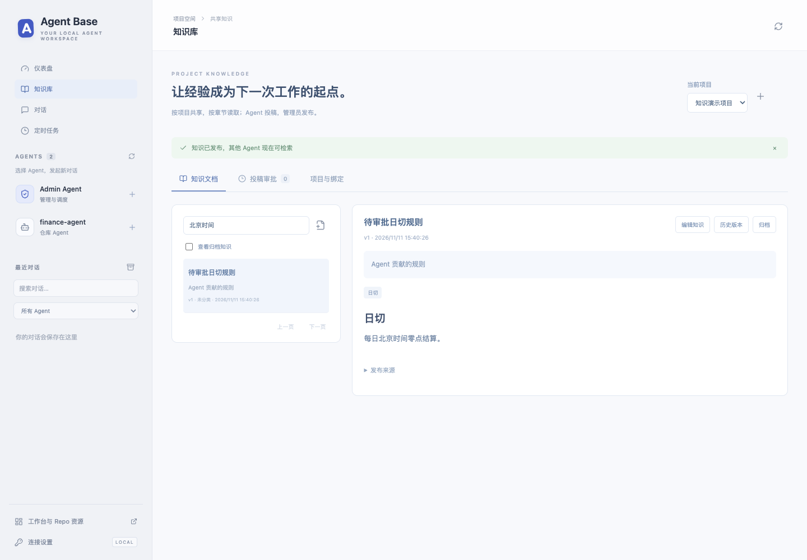
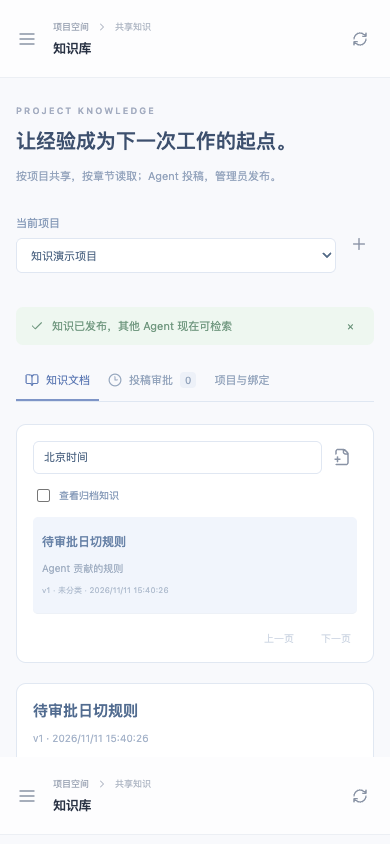

# 项目知识库与主页导航

主页为 <http://127.0.0.1:8765/>，自动进入仪表盘。左侧纵向导航连接仪表盘、知识库、对话和定时任务；点击 Agent Base 标志返回主页。原工作台迁到 `/workbench`，保留任务/资源管理 API；旧 `/chat`、`/cron`、`/dashboard` 链接继续可用。

## 管理员开始使用

```sh
.venv/bin/agent-base serve --port 8765
# 另一个本机终端：
.venv/bin/agent-base open --port 8765
```

`open` 打开知识库的一次性管理连接，120 秒内有效、只能使用一次。页面消费链接后清除地址中的临时信息，建立仅知识管理 API 可用的 HttpOnly / SameSite=Strict 会话，12 小时有效。命令不输出凭据。如果使用另一浏览器或会话过期，重新执行 open。

已设置 `AGENT_BASE_WEB_TOKEN` 时，也可沿用侧栏连接设置。未设置时，基座在忽略状态目录生成权限为 0600 的本机知识管理凭据，不修改已有网页的可选认证行为。未建立管理连接时可浏览正式知识；投稿详情、绑定与所有写入/审批均要求管理认证。



1. 点击项目旁的加号创建 namespace，填写稳定项目标识和显示名。
2. 在“知识文档”新建知识，填写标题、摘要和 Markdown 正文并发布。
3. 在“项目与绑定”选择已安装 Agent repo 或 Admin Agent，设置主项目、可读项目、可投稿项目，再保存绑定。
4. 下一次任务/对话轮次自动挂载共享 Knowledge MCP；不需重装 repo 或重启已有业务 MCP。
5. Agent 的新增和修改进入“投稿审批”。查看来源、依据和新增/删除差异，批准、编辑后发布或填写原因拒绝。

namespace 与安装版本分开，一个项目可以绑定多个 repo。相同 repo 的所有安装/实例共享绑定。更改绑定使旧的范围凭证失效，新一轮获取新范围；默认不授予任何 repo 或 Admin Agent 跨项目权限。

## Agent 如何使用

| 工具 | 行为 |
| --- | --- |
| `knowledge_catalog` | 先列获准项目，再列正式知识摘要 |
| `knowledge_search` | 在指定项目搜索候选，返回固定版本、短摘要/片段 |
| `knowledge_read` | 先读 outline，再用 section_id 读取 section，长章节用 cursor 继续 |
| `knowledge_submit` | 新增/修改投稿，不直接发布；修改指定基线版本 |
| `knowledge_submission_get` | 读取本来源主体投稿的状态、摘要与审核意见 |
| `knowledge_submission_list` | 分页查看本来源主体的投稿 |

工具通过真实 Streamable HTTP MCP 提供，模型请求仍由 dsh CLI 发出。原生 CLI 的 session/上下文管理保持原方式；正文按需读取，不全量注入提示词。当前只有长期安装的 repo 和 Admin 支持配置绑定；旧 v1 未长期安装的 Run 不自动接入。

每次工具返回最多 8,000 个序列化字符，章节正文每次最多 6,000 个字符；目录、搜索、章节都可分页。引用使用 `kb:namespace-id:document-id:vN:section-id`，不使用临时工作区路径。章节游标绑定版本，读取过程中正式知识更新也不会把后续片段切到新版。

读取只发现正式知识。Agent 无审批/发布工具，待审稿仅管理员和本 repo 来源主体可查看。正文是资料，不是新的系统指令；网页不执行原始 HTML，也不自动加载远程图片。

## 版本和审批

发布、编辑、回滚都产生新版本，历史内容不可变。管理员可以归档文档使其退出搜索，也可以从历史或归档内容恢复为新版本。

两个投稿基于同一版本时，先发布的产生新版本；后一个审批返回冲突，不覆盖已有修改。页面显示基线与当前内容，管理员合并后发布。普通批准固定原稿的基线与内容 hash；编辑后发布保留原稿，将管理员修订写为新版本并把原稿标为 superseded。拒绝必须填写理由。

正文、章节、当前版本指针、检索索引、审批结果和审计在同一个 SQLite 写事务中更新。失败整体回滚；投稿幂等键重复时返回原记录，同键不同内容报冲突。

## 运行与故障

`serve` / `worker` 幂等确保同一个集中式 Knowledge MCP 运行，Web 重启和任务结束不停止它。仪表盘“核心共享服务”只统计它一次，不按 repo 累计内存。

```sh
.venv/bin/agent-base knowledge status
.venv/bin/agent-base knowledge start
.venv/bin/agent-base knowledge stop
.venv/bin/agent-base knowledge restart
```

服务停用或不可用时，绑定 required=true 的新调用会明确失败；optional 则提示本轮无法检索知识。活跃授权按绑定修订号、期限、所属进程和任务/轮次状态核对。管理员 Token 从 dsh 运行环境剔除，模型只获取读/投稿凭证。

当前服务异常不会自动盲目重启，提供显式 restart；进程已退出时 ensure 可重新启动。不会自动重放投稿或审批。网页直接使用同一应用服务访问知识数据，因此 MCP 单独停机时仍能管理知识。

## 存储与范围

状态保存在 `knowledge/knowledge.sqlite`，独立于任务数据库，使用 WAL 和外键。正式版本正文为 Markdown，当前版本支持 FTS5 trigram 全文检索；两字查询优先标题/摘要/标签。目标环境缺少 trigram 时降级为字面匹配，状态中标注 literal；不宣称具备语义检索。

当前支持标题、摘要、分类字符串、标签和最多 128 KiB 的 Markdown 正文。首版没有附件、PDF 自动解析、向量库、自动总结、自然人账号、批量导入导出或 namespace 整体快照。现有同机可信 repo 不构成操作系统安全沙箱。

拟议 Installation 中 knowledge 字段仍未启用；以管理页面配置为权威。服务迁移时复制源码并不能迁移知识数据，应停写后使用 SQLite backup 接口备份/恢复数据库；不能只复制有活动 WAL 的主文件。源码离线 bundle 不包含知识、会话或凭据。



设计依据见 [KNOWLEDGE_BASE_DESIGN.md](KNOWLEDGE_BASE_DESIGN.md)，验证记录见 [VALIDATION.md](VALIDATION.md)。
