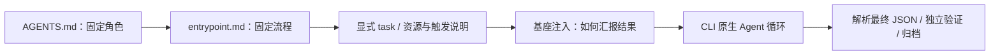

# Repo 引入与无人值守运行契约

更新日期：2026-11-10。本文对应已实现的 entrypoint 与结构化汇报功能；用户隔离暂不实施。

## 文件职责

| 文件 | 作用 |
| --- | --- |
| AGENTS.md | 必需；角色、长期规则与能力边界 |
| Installation.md 或 agent.yaml | 安装、skills/MCP/tools 与 completion 检查；机器配置来源唯一 |
| entrypoint.md | 推荐；根目录小写文件名，无人值守默认工作流程 |
| skills 中的 SKILL.md | 具体能力与使用说明，由清单声明 |

导出已有本地 Agent 见 [export-guild.md](export-guild.md)。Installation v2 保持同一安装版本固定 skills/环境和常驻 MCP 的机制，不因执行 entrypoint 每次重装资源。

entrypoint 必须非空、UTF-8、大小不超过 128 KiB，使用相对路径；目录、越界符号链接及含绝对路径的入口会被拒绝。它与 AGENTS 和 skill 一样纳入路径检查，冻结到安装源后使用。修改原始文件不会改变已安装版本；更新并提交 repo 后重新安装新版本。

## 什么时候执行入口

所有一次性仓库 Run 都走无人值守契约，包括 CLI run/start、Admin 提交、Web 工作触发、cron。`install` / `repo install` 只准备资源，不执行入口，也不要求生成最终报告。

网页与 Admin 的正常多轮对话不会自动执行 entrypoint，不强制每条回复输出 JSON。若 Admin 调用 submit_run 创建后台仓库任务，该 Run 会应用本契约。

任务解析顺序：

1. 有 entrypoint：始终加入入口；显式 task 作为本次补充参数。不再自动附加 task.default。
2. 无 entrypoint：使用显式 task，未提供时回退到 task.default。
3. 三者都没有：在准备阶段明确失败，不让模型猜任务。只安装仍然允许。

entrypoint 里应明确输入来源、执行步骤、产物和缺失输入时的行为，不要求等待真人回复。工作触发会生成 activation.json，其中包含 source/key/payload；有输入副本时位于 input。触发数据是任务参数，不应被视为新的系统权限。

## Prompt 组合



入口来自冻结的 repo，最后的汇报说明来自基座代码，每次启动时注入。不要把报告 schema 复制进 AGENTS、entrypoint 或 skill。旧 v1 仓库仍在 prompt 中加载 skill 文本，v2 使用所属 namespace 的固定 skill 清单；最终汇报要求均位于 prompt 尾部。

Run 目录中的 `prompt.txt` 保存实际 prompt；`prompt-contract.json` 保存 AGENTS、entrypoint 和实际 prompt 的 SHA-256、入口文件名及报告契约版本。v2 新安装收据也记录 AGENTS/entrypoint 摘要。既有已安装版本缺少新增收据字段时仍可运行，以本次 prompt-contract 为准。

## Agent 最终回复

CLI 仍输出原生 NDJSON/文本协议；基座只要求其**最终回复的 text** 是一个 JSON 对象，不带 Markdown 围栏或前后解释。不是让工具事件、过程日志也变成这个对象。

```json
{
  "schema_version": 1,
  "status": "completed",
  "summary": "完成三个服务的指标汇总。",
  "artifacts": [
    {"path": "artifacts/report.json", "description": "业务汇总结果"}
  ],
  "checks": [
    {"name": "读取报告核对输入总数", "status": "passed", "details": "与本次输入一致"}
  ],
  "issues": [],
  "next_steps": []
}
```

正式 schema 由基座提供：[agent-report-v1.schema.json](src/agent_base/schemas/agent-report-v1.schema.json)。字段全部必需，数组可以为空，不允许额外字段；报告文本上限 256 KiB。`description` 和检查的 `details` 可选。

| status | 含义 | Run 结果 |
| --- | --- | --- |
| completed | Agent 自报工作完成 | 继续独立检查；全部通过才 succeeded |
| partial | 只完成部分工作 | failed，保留自报状态与工作区 |
| blocked | 缺输入、能力或授权，需外部处理 | failed，保留所需信息，不等待交互 |
| failed | Agent 自报执行失败 | failed，不自动重试 |

`checks[].status` 为 passed、failed 或 not_run。completed 但自报有 failed 检查会被拒绝。Agent 不能把 status 写成 succeeded，也不能自行设置基座 verification。

格式错误、重复 JSON 字段、非有限数字、额外文本、字段/schema 不匹配均判定失败，不尝试静默提取其中一个 JSON 或自动重试模型。

## 产物与可信验证

自报 artifacts 路径必须位于 `artifacts/` 下，使用普通相对路径；不允许绝对路径、反斜杠、越界/符号链接逃逸或重复条目。completed 报告中列出的文件必须真实存在且不超过单文件 64 MiB。

最终归档包含两部分的并集：

- 清单 completion.artifacts 声明的产物，继续按 required/min_bytes 检查。
- Agent 最终报告额外声明的交付文件，作为实际存在的必需产物核对并归档。

额外自报文件不能绕过原清单产物要求。基座为实际归档文件记录 relative_path、受管路径、大小和 SHA-256，成功清理临时工作区后仍可访问。失败和部分完成保留工作区，不将未验证文件伪装成成功交付。

Agent 自报 passed 只保存在 agent_report.checks，不能提升可信验证等级。基座实际执行的冻结 completion.checks 全部通过时才标记 checks_passed；没有独立检查时仍是 structural_only。格式解析、执行失败或检查未完成时为 not_verified。

## 基座执行报告

每个结束的一次性 Run 在自己的运行目录生成 `report.json`，与业务文件 `artifacts/report.json` 是两份不同文件。其内容由 Python 生成，包含：

```json
{
  "schema_version": 1,
  "run_id": "由基座生成",
  "status": "succeeded",
  "agent_report": {
    "schema_version": 1,
    "status": "completed",
    "summary": "实际业务结果",
    "artifacts": [],
    "checks": [],
    "issues": [],
    "next_steps": []
  },
  "verification": "checks_passed",
  "artifacts": [],
  "error": null,
  "session_id": "CLI 原生会话 ID 或 null",
  "installation_id": null,
  "activation": null,
  "started_at": 0,
  "finished_at": 0
}
```

上例只示意结构，actual artifacts/timing/session 由实际运行决定。成功的 Run 继续保留原 `result.json`；status API 的 result.agent_report 提供解析后的 Agent 报告，result.report_path 指向基座执行报告。

超时、取消、启动失败或监督进程中断也能生成基座报告。没有获得有效 Agent 最终回复时 agent_report 为 null，不能编造其意见。中断清理由恢复检查触发；历史已结束 Run 在查询时可补生成执行收据，旧文本不会自动转换成新的 Agent JSON 报告。

HTTP 读取接口：

```text
GET /api/runs/{run_id}/report
```

沿用现有 API 的认证规则；活动任务、仅安装和网页对话的 Run 返回 409，因为它们没有本契约下的最终执行报告。缺失 Run 按现有错误处理返回。重读报告不产生模型调用。

## 兼容与试运行

旧 repo 不需要为报告手工增加文件或清单字段：新版本会在实际 Run 启动时注入汇报要求。**最终回复格式已经强化**，不会把旧自然语言回复静默当作契约成功；更换基座后，应先用原模型/CLI 试运行一次，确认其遵守 JSON 最终回复要求。

CodeAgent 的基本 print 路径也解析同一 Agent 最终报告，但它的 MCP/Admin/连续会话限制保持不变；这里没有声称完成内网适配。

可运行例子：[hello 入口](examples/hello-agent/entrypoint.md)、[cron 入口](examples/scheduled-agent/entrypoint.md)、[finance 入口](examples/repo-resources/finance/entrypoint.md)。已有生成到本机忽略目录的演示 Git repo 不会自动覆盖；需要重新生成到新目录或显式更新其提交并安装，才能使用新版入口。

测试覆盖：entrypoint 单独启动、附加 task、旧默认任务、cron、准备后启动、冻结源、v2 常驻服务、交互会话不注入入口、非法入口/报告、产物归档、blocked、超时/取消及报告 HTTP 接口。自动测试使用 fake CLI 和真实本地 MCP；另有一次真实 dsh 的 entrypoint → MCP → 产物检查 → JSON 汇报验收通过，见 [VALIDATION.md](VALIDATION.md)。CodeAgent 内网验收仍未完成。
