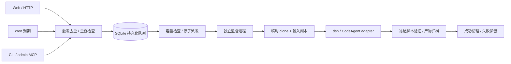

# 工作调度与会话生命周期

`Work` 是可重复触发的工作定义，包含仓库/ref、任务、model/effort、输入工作区路径、执行时限、cron/时区及重叠策略。`Trigger` 是一次触发请求；`Run` 是实际执行；`Session` 是这个 Run 内 CLI 创建的会话。多次触发不会共享模型上下文。

已安装的 v2 repo 会绑定 installation_id，复用固定 skills、环境和常驻 MCP；队列运行不重新安装资源。下文每 Run clone/冻结/安装步骤主要描述 v1 兼容路径。v2 的安装和挂载差异见 [RepoInstallation.md](RepoInstallation.md)。



## 最短启动流程

在 `agent-base` 项目目录、已有模型凭据的终端中执行：

```sh
uv sync --frozen
.venv/bin/python scripts/create_scheduled_demo.py
.venv/bin/agent-base work register metrics-demo "$PWD/.demo/scheduled/repo" \
  --workspace-source "$PWD/.demo/scheduled/source" \
  --timeout-seconds 120 --model deepseek-flash --effort high
.venv/bin/agent-base serve --port 8765
```

打开 <http://127.0.0.1:8765>，点击 `metrics-demo` 的“立即运行”，在详情中查看状态、session 和实际产物路径。`create_scheduled_demo.py` 保留已有目录；重复使用本机已有 demo 时不用重新创建。工作名唯一，重复注册会报错。

页面提供已注册工作的触发、取消和运行查看。注册工作可以使用 CLI、`POST /api/works` 或 admin MCP 的 `register_work`。`serve` 同时启动 Web 和调度线程；只要后台调度、无需 Web 时用 `agent-base worker`。这些进程应由部署环境的服务管理器常驻。仅运行 admin 对话或登记工作不会自动启动常驻调度器。

已有本地 demo 实测结果见 [VALIDATION.md](VALIDATION.md)。

## cron 与手动触发

例如每天上海时间 09:00 执行：

```sh
agent-base work register daily-metrics /absolute/path/to/git-repo \
  --workspace-source /absolute/path/to/input-data \
  --cron '0 9 * * *' --timezone Asia/Shanghai --timeout-seconds 600
agent-base work list
agent-base work trigger daily-metrics --key manual-2026-11-05 \
  --payload '{"period":"2026-11-05"}'
agent-base work triggers daily-metrics
agent-base work pause daily-metrics
agent-base work resume daily-metrics
```

cron 为五段表达式，注册时计算下一时刻并持久化。调度器每 0.5 秒检查到期工作，触发记录和推进 `next_due` 在同一 SQLite 事务中完成；多个同机调度器竞争不会重复触发同一个时刻。首次注册只安排未来时刻。停机后将错过的多个时刻合并成一次触发，payload 含原计划时刻与合并截止时刻；不逐条重放历史。暂停不取消已接受的运行；恢复从当前时间计算下一时刻，不补暂停期间的任务。

默认 `overlap=skip`：同一工作尚有 queued/preparing/running/verifying 时，新 key 会留下 `skipped_overlap` 记录，没有新 Run。`--overlap allow` 允许重叠，仍受全局并发限制。首版没有“同一工作逐次串行补跑”的策略。

如果采用宿主机系统 cron，可让系统定时执行 `agent-base work trigger`，同时常驻 `worker` 或 `serve`；此时不要再给同一工作配置内置 cron。程序不会修改 crontab。

## HTTP 接入

```sh
curl -X POST http://127.0.0.1:8765/api/works/metrics-demo/trigger \
  -H 'Content-Type: application/json' \
  -H 'Idempotency-Key: frontend-request-001' \
  -d '{"payload":{"period":"2026-11-05"}}'
```

HTTP 202 表示触发请求已持久化；响应含 `run_id`、`disposition` 和 `duplicate`。`skipped_overlap` 没有 run_id。前端应为一次逻辑操作生成 key，在网络重试时复用；同一工作与 key 返回原触发结果，已有 payload 不会被覆盖。失败后复用 key 也不会重试执行，确认需要重跑后使用新 key。不传 key 则每次请求视为新触发。

| 接口 | 用途 |
| --- | --- |
| `POST /api/works` | 注册不可变工作定义；请求字段与 CLI register 相同，使用下划线 |
| `GET /api/works` | 工作定义、启停状态及 next_due |
| `POST /api/works/{name}/trigger` | 触发，body 为 `{"payload":{...}}` |
| `POST /api/works/{name}/pause`、`resume` | 暂停/恢复新触发 |
| `GET /api/works/{name}/triggers` | 最近 100 次触发，包括重复策略中的跳过记录 |
| `GET /api/runs`、`GET /api/runs/{id}` | 最近运行、session、deadline、heartbeat、结果 |
| `GET /api/runs/{id}/events?after=0` | 分页事件流，每页最多 200 条，按 seq 继续 |
| `POST /api/runs/{id}/cancel` | 取消未派发任务，或请求正在执行的监督进程取消 |

OpenAPI 文档在 `/docs`。只监听 `127.0.0.1`，限制 Host，并拒绝跨 Origin 写请求。可在启动前设置 `AGENT_BASE_WEB_TOKEN`，API 则要求 `Authorization: Bearer ...`，页面有密码输入框，不持久化 token。当前是可信用户的本机管理入口；不直接开放公网。

## 一次执行如何展开

1. Trigger 原子去重、检查重叠与队列容量，然后创建未派发 Run。不为排队中的工作启动进程。最大待执行队列为 100；容量不足返回错误，没有接受该触发。
2. Dispatcher 先恢复状态，再按 FIFO 检查全局 `queue.max_concurrent`，原子预留派发位置。每个派发 Run 启动独立监督进程；旧的直接 `run/install` 命令仍兼容原有立即启动监督进程的行为，并与新队列共享活动并发上限。
3. 领取执行位置后开始计时。在 `.agent-base/workspaces/<run-id>-<随机后缀>/repo` clone 仓库并检出固定 commit，将显式 `workspace_source` 复制到 `input/`，写入 `activation.json`。Git 代码仅包含提交内容，未提交代码不会被 clone；外部输入在**开始执行时**复制。需在登记时固定代码版本可传 commit SHA；默认 ref=HEAD 是每次开始执行时解析。
4. 复制后的 `input` 是本次输入；运行不写回源目录。源目录应由业务侧保持复制期间一致，普通文件复制不是文件系统事务快照。忽略 `.git/.venv/node_modules/.env/.env.*` 等目录与文件，拒绝符号链接及特殊文件，上限 256 MiB / 10000 条目。仓库不能预占 `input/`（提供外部输入时）或 `activation.json`。
5. 冻结 AGENTS、工具、技能和检查脚本，每次安装独立依赖环境；暂不共享安装缓存环境或长寿命 workspace。runtime/model/effort 在入队时快照，按本次选择生成 CLI patch。
6. 为每次 Run 创建独立 DSH_HOME，启动 headless CLI；其 opening event 出现时立即保存 session_id，运行中即可查看。CLI 管理工具循环和任务内上下文；Python 负责进程、心跳、deadline、最终事件和验证，不跨 Run 续接 session。
7. CLI 正常返回且输出有效后进入 verifying，执行冻结检查、归档声明产物及 SHA-256，再删除成功的临时目录并标为 succeeded。归档、日志、冻结 package 和 DSH_HOME 仍保留在持久运行目录。`result.workspace_retained=false` 表示原工作区路径已清理；清理失败会记录事件并如实标记 retained。

状态正常路径：`queued → preparing → running → verifying → succeeded`。`started_at`/`deadline` 在出队后设置，排队时间不计入执行时限；有效时限取工作 timeout 与仓库 wall_timeout 的较小值，覆盖准备、安装、推理及验证。进程运行期间约每秒写 heartbeat。`session_status` 记录 not_started/starting/running/finished，异常时记 failed/timed_out/cancelled/interrupted。

`activation.json` 示例：

```json
{
  "work_id": "metrics-demo",
  "source": "web",
  "key": "frontend-request-001",
  "payload": {"period": "2026-11-05"},
  "at": 1793845560.0
}
```

## 结束、超时与重启

| 情况 | 行为 |
| --- | --- |
| 正常完成 | 原生输出有效 + 产物/检查通过，归档后 succeeded，清理临时工作区 |
| 执行失败/验证失败 | failed，保留工作区和日志 |
| 超出 deadline | 结束受管 CLI/命令进程组，timed_out，保留已发现 session 和现场 |
| 排队时取消 | 未派发的任务立即 cancelled，不创建工作区 |
| 执行中取消 | 监督进程停止当前命令及进程组，收尾后 cancelled；API 取消响应可能尚未到终态 |
| Web/worker 重启 | 已运行的独立监督进程继续；未派发队列持久保留，恢复后出队 |
| 监督进程消失/主机重启 | 对照 PID+进程出生时间，清理已知子进程，记 interrupted，不自动重试 |
| 派发时崩溃 | 预留后还没完成启动也记 interrupted，避免把不确定的执行再次运行 |

触发入队去重不保证外部业务副作用 exactly-once。需要调用支付、写业务库等操作的 Agent，应把业务幂等 key 继续传给下游。未知结果、失败和超时都不会自动重试。

部署范围是**单机、共享本地 SQLite**，支持同机多个调度器竞争；跨机 worker、分布式租约、容器隔离、磁盘配额、失败现场定期回收和运行断点恢复尚未实现。日志与失败现场需运维按保留策略清理。目录/venv 隔离不能替代不可信代码沙箱。

## 验证

```sh
.venv/bin/pytest -q
# 另一个终端先启动 serve，且已有 demo 和有效模型凭据：
.venv/bin/python scripts/validate_scheduler.py
```

真实验收通过本机 HTTP 注册/触发，等待真实墙钟分钟 cron，运行 dsh 与业务 MCP；检查两份指标报告、独立 session、5 秒超时、CLI 退出、源目录不变和成功临时目录删除。验收用 cron 第一次触发后即暂停，finally 也会尝试暂停；验收命令若被强制杀死，需用 `work list/pause` 核对。

实现采用 [FastAPI lifespan](https://fastapi.tiangolo.com/advanced/events/) 启停调度线程，使用 [croniter](https://github.com/pallets-eco/croniter) 解析带时区的 cron。核心代码为 [scheduler.py](src/agent_base/scheduler.py)、[service.py](src/agent_base/service.py)、[web.py](src/agent_base/web.py)。
