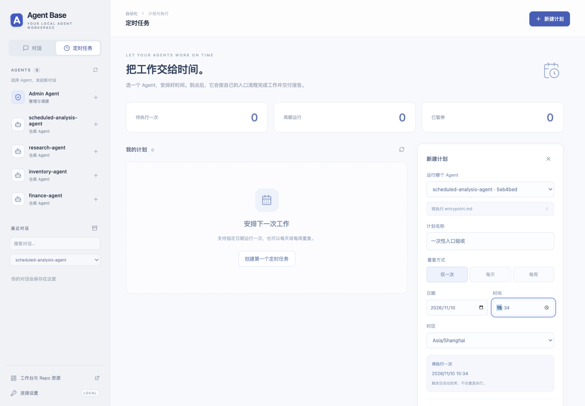
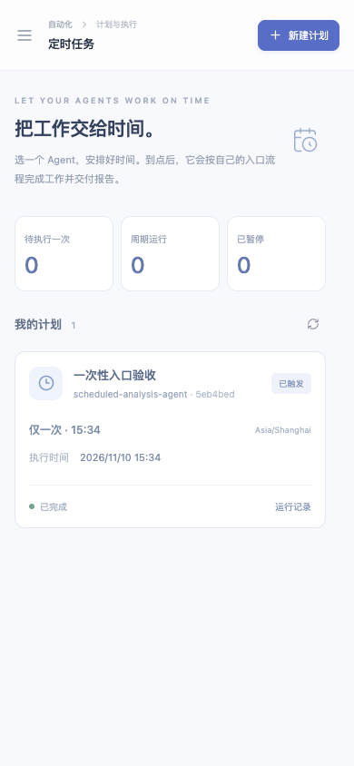
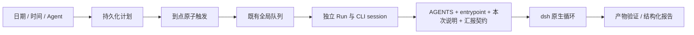

# 图形化定时任务与 Agent 对话入口

更新日期：2026-11-10。

## 对话从 Agent 列表开始

打开 `/chat`，先在左侧 AGENTS 中选择 Agent，再输入新对话的第一条消息。Agent 行右侧的加号就是新对话入口；不再有沿用当前 Agent 的全局“新建对话”按钮。Cmd/Ctrl+K 用于定位 Agent 列表，手机上会打开侧栏。

最近对话默认显示所有 Agent，并标注其名称。筛选框可按 Agent 过滤，搜索同时匹配对话标题与 Agent 名称；筛选不会切换当前对话，也不会取消生成。归档历史使用相同规则。

网页历史由 Python/SQLite 保存；模型会话、任务内上下文与压缩由 dsh 原生 Agent 循环管理。每个对话使用独立的工作区、DSH_HOME 和原生 session ID，后续消息由 CLI 续接，Python 不把全部网页历史逐轮重新发送。

## 定时页面

从左侧“定时任务”进入 `/cron`，与聊天页共用当前页面内存中的认证 token。刷新或独立打开时，若服务要求认证，需要重新填写 token。





创建计划时选择 Agent、名称、重复方式、时间和时区。支持“仅一次 / 每天 / 每周”，每周可选择多个星期。更多设置提供补充说明、模型、推理强度和执行超时。页面预览一次性执行时间或接下来的三次周期时间。

可调度目标必须是已安装、启用且提供 `entrypoint.md` 的 Repo 版本，列表会展示 commit。旧安装没有入口时仍可聊天或通过旧工作接口运行，但不能在此新建定时计划；请补充入口、提交并安装新版本。Admin Agent 本身不是定时目标。

服务器按所选 IANA 时区解释日期和时间，不依赖浏览器所在时区。过去时间、错误时区、空星期选择会被拒绝；一次性计划对夏令时导致的不存在/歧义时间也会报错。

## 触发、暂停与结果



计划绑定 installation_id 与固定 Git SHA，不跟随远端分支自动更新。一次性计划使用真实 run_at 时间戳，不用缺少年份的 cron 表达式模拟。接受触发后，在同一数据库事务内停用并清空 next_due；页面显示“已触发”，实际 Run 的排队/运行/完成状态单独显示。

已触发的一次性计划不能恢复或自动重放；想再次执行需创建新计划。暂停的一次性计划只有在未触发且目标时间仍在未来时可以恢复。服务临时停机但计划未暂停，恢复后会补触发一次。周期任务沿用原有停机合并、overlap=skip 和恢复后面向未来的规则。

每次运行经过现有队列、并发、超时、取消和冻结验证，同安装版本仍共享固定 skills 与常驻 MCP。不会创建操作系统 crontab。服务必须常驻，关闭浏览器不影响调度。修改计划的 Agent/时间，可先暂停原计划再新建，避免改变已入队任务。

“运行记录”展示最近 20 次执行。结束后可查看基座状态、verification、Agent 汇报摘要和完整 JSON。Agent 的 completed 不等于基座 succeeded，只有独立检查实际通过才是 checks_passed。详细报告契约见 [RepoContract.md](RepoContract.md)。

## API 与实现

| 接口 | 作用 |
| --- | --- |
| `GET /api/schedules/catalog` | 安装版本、入口摘要、可用状态与默认模型 |
| `POST /api/schedules/preview` | 校验和时间预览，不创建任务 |
| `POST /api/schedules` | 创建固定安装版本的计划 |
| `GET /api/schedules` | 计划和最新 Run 状态 |
| `POST /api/schedules/{id}/pause`、`resume` | 暂停/恢复 |
| `GET /api/schedules/{id}/runs` | 最近 20 次执行 |
| `GET /api/runs/{id}/report` | 已有执行报告 |

```json
{
  "agent_id": "已安装的 installation_id",
  "title": "每周财务汇总",
  "frequency": "weekly",
  "time": "09:30",
  "timezone": "Asia/Shanghai",
  "weekdays": [1, 3, 5],
  "task": "可选的补充说明",
  "timeout_seconds": 1800
}
```

星期日为 0，星期一至六为 1–6。仅一次使用 frequency=once，另提供 date（YYYY-MM-DD）。主要实现位于 `schedules.py`、原 `scheduler.py` 和 `CronPage.jsx`；复用 works/触发表，无需新数据库。所有接口沿用现有认证、Host 和跨 Origin 写请求限制。

浏览器测试中的 fixture 时钟辅助接口只存在于 `scripts/serve_chat_fixture.py`，不属于生产应用。页面静态资源随 Python 项目提交，不访问外部 CDN。
