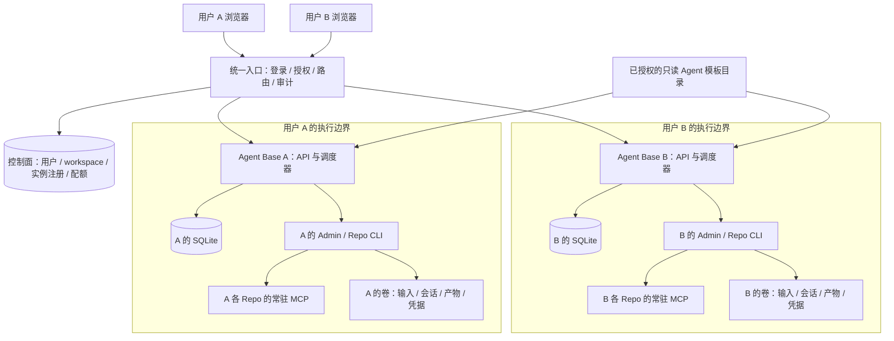
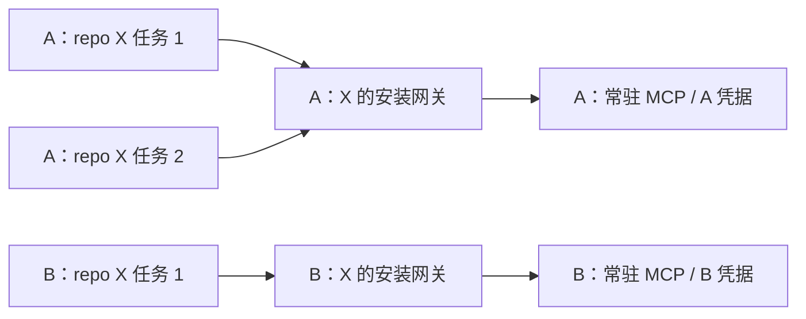

# 用户隔离设计草案

日期：2026-11-09 · 状态：**2026-11-10 起暂缓实施，保留设计供后续参考**

基于当前 Agent Base 的单用户实现，设计多用户之间的身份、数据、执行与资源隔离。本次不修改运行逻辑、数据库或服务，不启动隔离环境，也不自动提交或推送。

已确认的共享方式：**共享 Agent 模板，每个用户独立运行资源与数据。** 同一用户的 repo 之间继续采用现有资源发现约束。跨用户共享可变业务状态不作为本阶段能力。规模暂按小团队设计。

## 1. 结论与隔离单位

第一阶段采用 **统一登录入口 + 每个用户独立 Agent Base 实例 + 用户级执行边界**。一个实例包含自己的数据库、调度器、Admin Agent、Repo 安装、原生 CLI 会话和常驻 MCP。

引入 `workspace_id` 作为资源所有者，首版一个用户对应一个私人 workspace。`user_id` 表示操作者，`workspace_id` 表示数据和运行资源的归属；当前按一对一实现，暂不开放多人共享 workspace。以后需要团队空间时，再加入成员授权和私人会话规则。

此前“同 repo 的实例共享 skills/MCP”的规则调整为：

> **同 workspace + 同 repo + 同安装版本，共享固定 skills、安装环境和常驻 MCP；不同 workspace 默认独立。**

不以 prompt 中“不要访问其他用户”作为用户隔离机制。身份授权保护 API，执行边界保护 CLI、初始化脚本和 MCP 的文件/网络访问。

## 2. 当前实现的差距

| 当前代码 | 现状 | 多用户时的风险或改造点 |
| --- | --- | --- |
| `web.py::authorize` | 可选单个 WEB_TOKEN，只验证是否持有 | 不能识别不同用户，也不能检查资源归属 |
| `store.py` | 单库保存所有 Run、工作、安装、对话 | 业务对象没有用户/workspace 所有者 |
| `conversations.py::targets/list` | 枚举所有 ready 安装和对话 | 接入多个用户后会直接混合展示 |
| `repositories.py` | origin 决定 repo_id，同一安装全局复用 | 同 repo 的跨用户 MCP、环境和状态可能混在一起 |
| `repo_server.py` | 安装 token + 活动 Run/安装匹配 | 尚无用户/workspace 的身份链 |
| `engines.py::runtime_environment` | 以整个宿主环境为基础构造 CLI 环境 | 平台或其他用户的凭据不能放在同一继承环境里 |
| Admin 管理 MCP | 管理当前配置数据库中的全部资源 | 单库多用户模式下可能越权查询、取消或停止服务 |
| `workspace_source` / 本地 repo 路径 | 可以指定本机实际目录 | 多用户 API 不能允许任意宿主路径作为输入 |
| 进程/venv/工作目录 | 同宿主账户下的逻辑分离 | 任意 CLI 命令和 repo 脚本仍可能读取同账户文件 |

当前原生 CLI 会话目录分开、提示词路径检查、Repo namespace 都可以保留，但它们没有构成跨用户安全边界。

## 3. 推荐部署架构



这里的“实例”是长期服务，不是每条消息创建一个容器。用户离线、页面关闭、某个任务结束，都不会默认停止其共享 MCP。需要保持 MCP 常驻的用户空间，不启用默认的闲置休眠；以后若增加休眠，应明确服务会停止、唤醒后重启的语义变化。

### 3.1 为什么首版选择独立实例

| 路径 | 改造量与特点 | 首版选择 |
| --- | --- | --- |
| 一个进程/一张全局库，加所有查询的 workspace 过滤 | 需要同时改造每个 API、管理 MCP、后台进程和恢复路径；执行隔离仍需另外实现 | 留作规模化演进方案 |
| 每用户一个 Agent Base 实例 | 复用现有队列、SQLite、Run 和资源复用机制，用户间故障与状态更容易分开 | **采用** |
| 每个任务一个完全独立环境，资源不持久 | 临时任务边界明确，但会改变常驻 MCP 与固定 skills 的运行方式 | 不作为本阶段的运行单位 |

独立实例仍需要实例自身的 workspace 绑定、入口授权和系统级隔离；仅更换 storage.root 或端口不是完成隔离。

### 3.2 执行边界的落地方式

首选在支持的服务器平台为每个 workspace 配置一个独立容器，使用非特权用户、私有数据卷、独立网络与资源限制。代码/基础镜像可以共用，只挂载这个用户的数据和必要凭据，不挂载宿主根目录、其他用户卷、控制面数据库或容器管理 socket。

容器管理由可信的外部 provisioner 执行，Agent 和 repo 内的命令没有创建容器、修改挂载或提升平台权限的能力。容器网络需要实际配置东西向访问限制，不能假设不同容器天然无法通过网络互访。容器的隔离依赖命名空间、配置与宿主安全，不能作为“任意恶意代码绝对无法逃逸”的承诺；高风险陌生仓库可升级为独立 VM。[Docker 官方安全说明](https://docs.docker.com/engine/security/)

如果内网 CodeAgent 无法在容器内完成认证或运行，可使用每用户独立 OS 服务账户，配置文件 ACL、独立 HOME、进程限制和网络规则；必要时直接使用每用户 VM/专属执行机。这个后备方案要实测凭据存储和本机服务可见性，不能退化为同一账户下增加几个目录。

第一阶段不额外要求同一用户内每个 repo 之间进行硬隔离；这与现有“可感知其他 repo，但使用自己的资源”的要求保持一致。

## 4. 登录、授权与身份传播

### 4.1 身份入口

优先对接已有企业登录；支持 OIDC 时使用已有 IdP，在平台映射为稳定的 user_id。OIDC 身份使用经过验证的 issuer 与 subject 绑定，不能以邮箱或可修改的显示名作为唯一所有者标识。[OpenID Connect 身份与 Claims](https://openid.net/specs/openid-connect-core-1_0.html#IDToken)

浏览器使用平台会话；Cookie 方式应配置 Secure/HttpOnly、合适的 SameSite 和写请求 CSRF 防护。用户 API 凭据绑定 user/workspace/scope。平台凭据、OIDC 管理 secret 和用户模型凭据是不同类型，不混用。

### 4.2 请求链

```text
已验证的平台登录
  → 当前 user_id
  → 验证允许使用的 workspace_id
  → 选择注册表中该 workspace 的固定实例
  → 实例验证调用身份与自身 workspace 绑定
  → 使用本实例的安装、Run、对话与文件
```

浏览器传的 workspace_id 只能作为选择项，必须经过服务端授权；不能把 `X-User-ID`、MCP 参数或模型生成的 JSON 直接当可信身份。入口清除外部伪造的内部身份 header，再通过受保护连接和 workspace 绑定的服务认证调用实例。实例端口不直接暴露给用户或其他 workspace。

OWASP 强调租户上下文应来自可信身份，随机 ID 也不能替代资源授权；这里的入口与实例双重校验据此设计。[OWASP 多租户上下文规则](https://cheatsheetseries.owasp.org/cheatsheets/Multi_Tenant_Security_Cheat_Sheet.html#1-tenant-identification-context-management)

SSE 建立连接时验证身份；会话撤销后，网关在有界时间内重新校验并断开订阅。登出不默认取消已经授权执行的工作。用户被禁用则阻止新消息和新调度，取消待执行项，并按平台停用策略处理活动任务和 MCP；工具副作用仍可能已经发生，不自动补偿或重跑。

### 4.3 不能遗漏的入口

同一授权规则覆盖列表、详情、事件/SSE、下载、停止、Repo 启停、cron 注册和触发，以及 CLI/Admin 管理 MCP。仅保护网页路由会留下后台绕过路径。

对其他用户资源的猜测访问统一按不存在处理；不会通过错误信息泄漏另一个 workspace 的目录、模型配置或安装名称。

## 5. 数据、Repo 与目录模型

### 5.1 控制面与用户数据分离

| 位置 | 保存内容 | 对执行中 CLI 的可见性 |
| --- | --- | --- |
| 控制面 | user、workspace 绑定、实例注册、配额、授权版本、基础审计 | 不挂载，不下发管理凭据 |
| 用户实例数据库 | 本用户安装、工作、Run、对话、事件 | 仅位于本用户边界；跨 repo 硬隔离暂不承诺 |
| 用户数据卷 | 仓库安装、固定 skills、session、工作区、产物 | 仅当前用户可见 |
| 凭据区域 | 当前用户的 CLI、Git、MCP 凭据 | 仅按实际运行需要挂载/注入 |
| 公共目录 | 经授权发布、版本固定的只读 Agent 模板 | 只读；不含用户数据或认证 |

实例必须把固定 workspace_id 写入实例元数据，校验配置/数据卷与身份匹配，禁止通过任意请求切换 data root。首版不必立即在现有每张业务表中重复加入 workspace_id，因为库已按 workspace 物理分开；控制面和跨进程请求必须携带归属。

如未来统一数据库，则所有业务表、事件、关联关系、列表/更新/删除与后台恢复都加入 workspace 约束；复合外键防止跨 workspace 关联。幂等键按 workspace+work 或 workspace+conversation 定义，缓存键和对象存储前缀同样带归属。这个演进不与首版独立实例混作一套已实现方案。

### 5.2 安装与 namespace

保留本实例内现有 repo_id、installation_id 计算，平台全局引用统一使用：

```text
资源身份 = (workspace_id, installation_id)
Repo 身份 = (workspace_id, repo_id)
对话身份 = (workspace_id, conversation_id)
```

同一个 origin/commit 在 A、B 两个实例中可能得到相同的安装 ID，这是允许的，因为不能脱离 workspace 路由。需要全局日志名或统一工具发现名时，使用符合目标 CLI 名称长度限制的 workspace+repo 摘要；摘要仅用于命名，不作为授权。

目录示意如下，真实宿主位置由平台管理，不写入 AGENTS 或 skill：

```text
platform/
  control/                         身份、实例注册与配额
  workspaces/<workspace-id>/
    config/                        本 workspace 的基座配置
    credentials/                   CLI/Git/MCP 的用户级凭据
    data/
      runs.sqlite
      repos/<repo-id>/installations/<installation-id>/
      runs/<run-id>/
      workspaces/<run-id>/
      conversations/<conversation-id>/
```

挂载时只提供当前 workspace 的必要部分。用户选择输入使用受管 input/dataset ID，由实例解析到自身目录；不能继续把任意宿主 workspace_source 或本地 repo 路径暴露为多用户能力。符号链接、解压路径和目录穿越检查继续保留。

### 5.3 Agent 共享矩阵

| 资源 | 同一用户多个实例 | 不同用户 |
| --- | --- | --- |
| AGENTS、skill、工具源码的固定版本 | 同安装共享 | 可作为明确授权的只读模板共享 |
| 初始化产物、安装环境 | 同安装共享 | 默认各自初始化；不共享可写 venv |
| 常驻 MCP 进程/上游连接 | 同安装共享 | 默认独立进程和连接 |
| CLI home/session、对话、输入与产物 | 每任务/对话按现有规则独立 | 完全分开 |
| Git/模型/MCP 认证 | 按用户配置和资源需要选择 | 默认不共享 |
| 下载缓存/基础镜像 | 可复用 | 仅在公开或已授权、不可变、无 secret 时共享 |

“发布 Agent”只发布经过授权的模板和版本，不复制发布者的安装目录、初始化输出、MCP token、登录状态或对话。接收者用自己的授权和凭据进行安装。私有 repo 缓存不能因知道 hash 就向其他用户开放。

## 6. MCP、skills 与账号隔离

### 6.1 默认保持常驻，但归属用户



同用户任务取消/超时不停止其共享 MCP。A 停止自己的安装服务，只影响 A 的实例；B 的同名安装继续工作。各 workspace 的健康探测、恢复次数、token 与服务端点分别管理。

网关继续检查 Run 活动状态与安装匹配，并增加 workspace 绑定。若以后网关或代理移到共享进程，必须验证可信服务身份/受约束的调用授权，绑定 workspace、installation、Run、有效期和用途；不能只凭客户端传入的 X-Agent-Run 选择工作区。共享代理的 token 与用户登录 token 分开，不把跨用户管理密钥交给 CLI。

本机端口不属于用户边界。不同用户不能凭知道 loopback 端口访问对方 MCP，也不能借 MCP URL/工具请求访问平台元数据、容器管理面或其他用户实例。网络策略与外部 MCP 连接权限需要实测。

### 6.2 外部数据隔离是独立条件

独立 MCP 进程如果仍用同一个数据库管理员账号、同一个共享文件目录或同一个第三方个人 token，可能仍能读取相同业务数据。因此需要同时选择：

- 每用户独立凭据和数据范围；这是默认方案。
- 或者使用真正支持用户/workspace 授权的多租户外部 MCP，由服务端按可信调用身份过滤。

不在业务参数中让模型自行填写 tenant_id 来控制授权。不把 MCP 会话的可变“当前用户”全局切换后供多个用户共用。

只有明确无用户状态、无私有凭据的公共工具，或通过专项多租户验收的服务，才可以跨用户共享 MCP。现有 domain 示例没有这种跨用户契约，不能直接提升为公共多租户 MCP。

### 6.3 CLI 与凭据

dsh 的 DSH_HOME、DSH_AGENTS_HOME 按 workspace/会话归属；CodeAgent 的认证目录、原生状态和继承认证环境也按用户选择。CodeAgent 是否支持容器登录、系统凭据存储与多用户并发，必须内网现场验证，不能只改一个目录变量就声明隔离完成。

子进程环境改为基础允许列表 + 明确的当前用户/当前资源注入，不再继承平台完整 os.environ。平台登录 secret、其他用户凭据、全局容器控制权限不出现在 CLI/MCP 环境或挂载中。名称过滤和日志脱敏只能作为辅助。

若多个用户确实共享一个模型服务账号，它是平台级模型接入策略，不能冒充各自 CodeAgent 本人登录。需要按用户限流/审计，优先由受控凭据代理承接；目标 CLI 无法安全代理时，应先限制功能或改用专属账号。

## 7. Admin Agent 的权限

每个用户都有自己的 Admin Agent，可以安装和管理自己的 repo、工作、对话与 MCP。界面可以仍显示 Admin Agent，但职责应说明“管理当前用户的空间”。

| 角色 | 可操作范围 |
| --- | --- |
| 用户 Admin Agent | 当前 workspace 内的安装、运行、状态、取消、服务启停 |
| 普通 Repo Agent | 本任务声明的资源；不自动挂载用户管理 MCP |
| 平台运维管理员 | 实例生命周期、配额、健康、明确的运维操作 |

平台级管理接口不挂到用户 Admin Agent。底层权限检查由代码和运行边界执行，AGENTS 中的说明只帮助模型正确使用工具。平台运维界面默认展示状态与元数据，不默认浏览用户对话；授权排障访问单独记录审计。

## 8. 调度、配额与用户停用

每个 workspace 继续使用自己的持久队列、FIFO、cron、幂等记录与 Run 恢复。cron 归属 workspace/创建者，不依赖浏览器仍登录；派发时检查 workspace 和账号状态、凭据有效性及当前策略，不能永久继承创建时的权限。

首版先为每个长期实例分配静态预算：活动 CLI 上限、等待队列上限、CPU/内存/PID、存储、MCP 进程数和安装数。新增 workspace 时按总预算准入，避免每用户都设置并发 2 后无限叠加。限制磁盘也要覆盖日志、CLI home、依赖缓存和失败保留目录。

当前 Admin 不占仓库执行位置；多用户时仍可保留查询通路，但要有 Admin 轮次独立上限，避免绕过模型/进程配额。常驻 MCP 不占任务位置，但要计入长期资源预算。

用户较多后再引入统一动态调度：workspace 间轮转，内部保持 FIFO，采用租约/心跳回收全局执行位置。领取后的执行器异常仍标 interrupted，不因回收额度自动重放未知结果。

用户停用流程先禁止新调用和 cron 派发，处理排队/活动任务，再停止本用户 MCP、撤销凭据并按保留策略封存数据。不能直接删除活动数据卷；恢复、导出和删除操作均绑定 workspace，避免影响其他用户。

## 9. 现有代码的实施拆分（尚未开发）

| 阶段 | 内容 | 验收边界 |
| --- | --- | --- |
| A：最小双用户实例 | 两个固定 workspace、独立配置/数据库/卷、固定用户路由 | 不迁移生产数据；用 fake CLI 和示例验证归属 |
| B：执行与网络边界 | 用户容器或 OS 账户、卷/网络限制、环境允许列表、凭据注入 | CLI/初始化/MCP 都不能读到另一用户数据 |
| C：统一登录入口 | 用户与 workspace 绑定、代理认证、SSE/下载/写接口、会话撤销 | 所有入口和后台路径按同一归属处理 |
| D：安装与 Admin | 模板发布授权、安装归属、用户 Admin、MCP 绑定与启停 | 同用户复用、跨用户独立、外部账号权限正确 |
| E：上线管理 | 配额、停用、备份/删除、审计、CodeAgent 真机验收 | 双用户故障注入与迁移演练通过 |

模块工作量：

- 新增身份入口、workspace 注册和可信实例管理；均不接受用户指定任意执行镜像/挂载。
- `config.py` / `store.py`：实例固定身份、数据目录匹配与控制面分离。
- `web.py` / 前端：用户身份、受授权实例路由、受管输入 ID、SSE/下载认证。
- `cli.py` / 服务入口：可部署的内部监听或本地受控代理；不能直接暴露当前 localhost 管理服务。
- `repositories.py` / `repo_server.py`：workspace 绑定、凭据解析、共享边界与网络限制。
- `engines.py` / `processes.py`：环境允许列表、用户级运行边界、CodeAgent 登录/状态位置。
- `scheduler.py` / 后台监督：派发归属、账户状态、静态额度，后续再做全局租约。
- `admin.py` / `mcp_server.py`：用户作用域、平台工具分离，避免绕过 Web 身份检查。

目前 `serve` 写死 loopback，Host/Origin 也面向本机。容器化统一入口需要设计受保护的内部连接、可信代理与 Host/Origin/CSRF 处理，不能只把监听地址改成 0.0.0.0。

## 10. 旧实例迁移

先备份并暂停新派发，再把当前单用户实例明确绑定给原维护者的私人 workspace；不猜测历史对象属于哪个新用户。现有 repo/MCP、会话、原生 session 与数据整体归这个 workspace。

若只是原地绑定且身份/路径未变，可保留现有安装关系；若移动到容器/新目录，数据库、venv、CLI 原生状态中可能含旧路径，优先重装 repo 并按实际支持情况迁移历史/产物，不承诺原生 session 自动续接。旧 MCP 和新实例不能同时用同一可写安装目录。

先保留原单用户模式可回退，在两个测试用户完成验收后再切换真实入口。代码回退不撤销已执行的外部业务操作。

## 11. 设计验收清单

以下均为计划，当前没有执行多用户验收：

- [ ] A/B 使用相同 repo、相同工作名、相同 client_key，可独立安装和执行。
- [ ] 同用户两个任务复用 MCP/skills；跨用户 MCP PID/boot_id、凭据和存储独立。
- [ ] A 猜到 B 的对话/Run/安装 ID，也不能读取、停止、归档、下载或订阅事件。
- [ ] A 在 repo、初始化脚本、MCP 中尝试读 B 的卷、平台环境或元数据库，实际不可访问。
- [ ] A 不可通过网络直接访问 B 的 API/MCP，或利用可控 MCP URL 进入管理网络。
- [ ] A 停止安装服务、耗尽额度或运行超时，不停止 B 的 MCP，不占满 B 的预算。
- [ ] 外部业务数据源使用各自授权；独立进程但共享管理员账号的情形不会误判为隔离通过。
- [ ] cron 在用户退出页面后仍按授权运行；账号停用后不再派发新任务。
- [ ] SSE 重连/历史/下载遵守同一身份和撤销策略，不能用旧链接绕过授权。
- [ ] CodeAgent 目标平台确认认证状态、原生 session、并发与进程树清理的归属。
- [ ] 用户导出、备份恢复、停用和删除只影响目标 workspace。

## 12. 本阶段设计决定与待确认项

已确认：共享 Agent 模板，每个用户独立运行资源与数据，同用户同安装继续共享 skills/MCP。

建议的落地选择：私人 workspace；每用户独立实例；跨用户执行边界；先静态预算，后全局动态调度。部署方式与认证细节仍需结合内网条件确认。

实施前需要确认：

1. 平台是否允许用户提交自己的 repo，还是只安装平台审核的模板？
2. 目标内网执行平台是否允许容器，CodeAgent 能否在其中完成本人登录？
3. 模型和外部 MCP 使用每用户账号，还是有明确的组织服务账号？
本阶段不增加跨用户共享同一业务 MCP 实例的能力。以上待确认项影响部署和凭据方案，不改变已经确定的共享边界。
