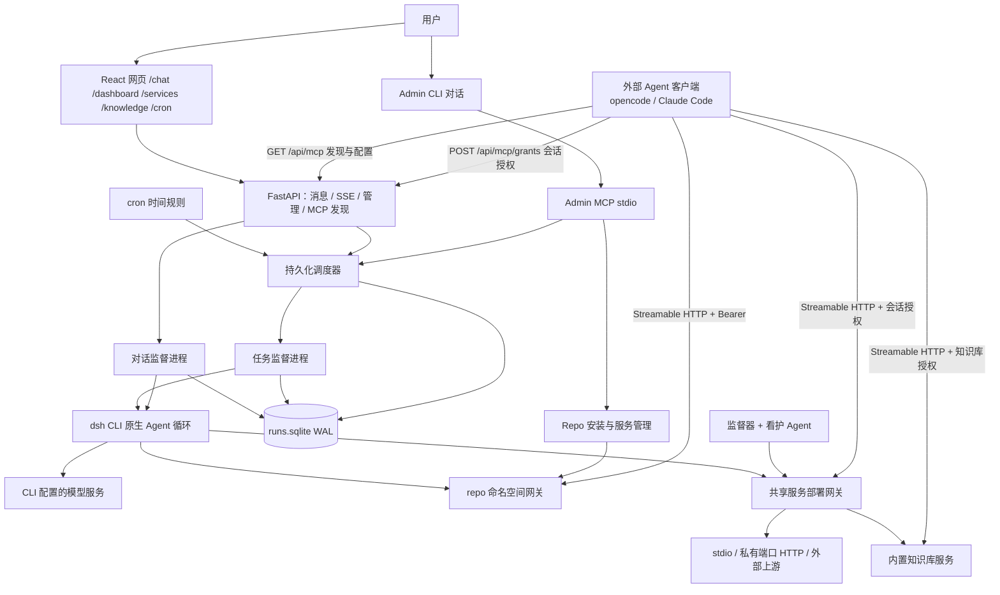

# Agent Base 系统设计总纲

版本：1.0 · 整合日期：2026-11-17 · 维护约定：本文是项目**唯一权威设计文档**

> **文档定位**：本文整合并取代历史上的六份设计文档（第一阶段设计书、第二阶段托管设计、MCP 发现与托管愿景、
> 项目立项草稿、知识库设计、用户隔离草案），是项目唯一权威设计文档。原文已从工作区删除以保持单一事实来源，
> 需要追溯时从 Git 历史检索（删除前路径：`docs/DESIGN.md`、`docs/PHASE_2_MANAGED_MCP_DESIGN.md`、
> `docs/MCP_DISCOVERY_HOSTING_DESIGN.md`、`docs/PROJECT_DESIGN_DRAFT.md`、`docs/KNOWLEDGE_BASE_DESIGN.md`、
> `docs/USER_ISOLATION_DESIGN.md`）。
>
> 阅读路径：本文回答"系统是什么、为什么这样设计、边界在哪里、接下来做什么"；具体操作步骤在各专题文档，
> 见 [文档索引](README.md)。验收证据在 [VALIDATION.md](VALIDATION.md)，工单在 `tickets/`（不入 Git）。
>
> **变更约定**：涉及架构、授权模型、数据模型或新子系统的改动，先在本文对应章节补充或修订设计，
> 再进入实现；实现与设计有差异时，在实现验收后回写本文。不新开平行的设计文档。

## 1. 项目定位与运行方式

Agent Base（AI Host）把一个 Git 仓库变成可以安装、调度和对话的 Agent。仓库提供 `AGENTS.md`、安装清单、skills、MCP 和可选产物检查；Python 基座负责资源、生命周期和交付；CLI 运行时（外网为 DeepSeek Harness，简称 dsh）负责模型推理、工具循环与原生上下文。

更远的立项愿景（个人 AI 能力沉淀为团队共享服务、多用户权限与额度治理）不在当前实现范围内；当前停留在**可信团队、单机、单用户**边界。

| 使用方式 | 生命周期 | 适合的工作 |
| --- | --- | --- |
| Admin Agent | 多轮原生会话，使用管理 MCP | 安装仓库、注册工作、查询/取消任务、管理服务 |
| 仓库任务 Run | 每次独立工作区与 session，完成后验证/归档 | cron、Web 触发、批处理、需独立交付检查的任务 |
| 仓库网页对话 | 每个对话保持工作区和 session，每条消息一轮 | 探索问题、连续追问、调用所属 repo 工具 |
| 外部 Agent 客户端 | 经 MCP 发现 API 获取端点与会话授权后直连 | opencode、Claude Code 等本机客户端使用平台 MCP（2026-11-17 起） |

## 2. 总体架构



### 2.1 进程拓扑

| 进程 | 生命周期 | 数量 |
| --- | --- | --- |
| `agent-base serve` / `worker` | 常驻；含调度器、服务监督器、看护触发、知识库 ensure | 1 |
| Run 监督进程 | 一次任务执行；结束清理或保留现场 | 并发上限内多个 |
| 对话监督进程 | 一轮网页消息 | 每活动轮次 1 个 |
| `repo_server.py`（repo 命名空间网关） | 常驻，独立于 Run；随机本机端口 | 每个启用的 repo 安装 1 个 |
| `deployment_gateway.py`（部署网关） | 常驻，固定本机端口；持私有端口后端或 stdio 会话 | 每个非 builtin 部署 1 个 |
| `knowledge_server.py` | 常驻，独立数据根；`KnowledgeService` 管理 | 1（legacy）或每 builtin 部署 1 个 |
| dsh CLI | 随 Run/对话轮次 | 同上 |

### 2.2 模块职责

| 模块 | 责任 |
| --- | --- |
| `config.py`、`cli.py` | 本机配置校验、命令入口 |
| `package.py`、`manifests.py` | v1/v2/v3 清单解析、路径/参数展开、执行约定 |
| `store.py` | SQLite 状态、原子领取、事件与幂等 |
| `service.py`、`processes.py` | Run 准备、执行、超时/取消、进程树清理、验证归档 |
| `scheduler.py`、`schedules.py` | 工作定义、cron、触发记录、队列派发与恢复 |
| `engines.py` | CLI 命令/环境、dsh provider patch、输出解析、凭据隔离 |
| `review.py` | 候选仓库固定 commit 的只读审阅 |
| `repositories.py`、`repo_server.py`、`repo_runtime.py` | repo 身份、版本安装、常驻命名空间网关、资源挂载 |
| `service_store.py` | 服务/版本/部署/操作/绑定/故障单/grant 持久化（v2 schema） |
| `service_install.py`、`service_catalog.py` | 托管安装计划与执行、发布/撤销/登记/绑定 |
| `deployment_gateway.py` | 每部署网关：代理或桥接、授权逐调用校验、目录过滤 |
| `service_supervisor.py`、`guardian.py`、`guardian_server.py` | 探测/恢复预算/故障单；看护 Agent 受限工具 |
| `service_resolver.py` | 统一资源解析：绑定 → grant + dsh patch + 资源清单 |
| `knowledge*.py` | 知识库存储、MCP 服务、管理 Web、共享部署迁移 |
| `conversations.py`、`web.py`、`frontend/` | 网页对话、JSON API、SSE、管理页 |
| `dashboard.py`、`resource_metrics.py` | 只读快照、主机/受管进程采样、指标归属 |
| `admin.py`、`mcp_server.py` | Admin 原生对话、管理 MCP（stdio）、v1 业务工具桥接 |
| `mcp_discovery.py` | **MCP 发现**：全量清单、各客户端配置片段、会话授权签发（2026-11-17） |
| `dirlink.py` | 跨平台目录链接（符号链接优先，Windows junction 回退） |

## 3. 核心设计不变量

以下规则分散实现于各模块，是所有后续改动**不可破坏**的底线：

1. **Python 基座不实现模型 API**。推理一律经 CLI 运行时（dsh/CodeAgent）；基座不引入 LangGraph 或第二套 Agent 循环。
2. **凭据只引用、不落盘**。模型凭据以 `api_key_env` 环境变量名声明；业务凭据以 `{from_env: NAME}` 引用。清单、patch、资源目录、日志、发现 API 均不出现凭据值。
3. **凭据按进程分层**。dsh 进程以固定别名 `AGENT_BASE_PROVIDER_API_KEY` 持有模型凭据；其子进程（业务 MCP、工具、repo 安装脚本）按声明名与关键词剔除。业务工具环境过滤 `API_KEY/TOKEN/SECRET/PASSWORD` 名称——这是分层传递控制，**不是恶意代码防护**。
4. **授权哈希存储、即时撤销**。grant 只存哈希；解绑/撤销发布立即删除在途 grant（`revoke_grants`），网关在**每次调用**上重新校验绑定存活性、工具白名单与项目范围。
5. **发布不等于授权**。`publish_state` 只控制目录可见性；Agent 能否调用由显式绑定决定。v3 Agent 的 `services` 声明为精确匹配（空声明不挂载任何服务）；仅 Admin 无 manifest 时使用其全部绑定。
6. **结果语义分层**。`verification=structural_only` 仅结构检查；`succeeded` 要求执行器返回有效结构化报告且声明产物/检查通过。模型自报"完成"不覆盖平台状态。
7. **版本固定 commit**。ref/branch 只用于解析候选；运行与安装永不自动跟随。软件版本、业务契约版本、MCP 协议版本三者独立。
8. **单一监督者**。每部署同一时刻只有一个活动代际；启停/恢复/升级都经部署锁与代际检查，不存在两个控制器写同一数据目录。
9. **资源发现隔离不是安全隔离**。目录、venv、命名空间、提示词约束都不阻挡恶意代码；多租户强隔离暂缓（既定方向：每用户独立实例 + 容器执行边界）。
10. **发现 API 不返回凭据值**。静态 token 以文件路径引用，会话授权只在签发响应中返回一次。

## 4. 运行时与模型接入

- dsh 经 `engines.dsh_patch` 生成 `runtime.patch.yml`：默认模型行、approval 策略、pi-ai provider 路由（复用休眠的 `llm-pi-ai` 挂载点）、MCP 客户端 insert 行。`!!js` 环境引用保证凭据值不写入文件。
- `[providers.*]` 声明内部网关路由；自定义 provider 失败关闭（无回退路由/模型/档位）。详见 [Providers.md](Providers.md)。
- Run 保留运行时快照：配置变更不影响在途任务的凭据名屏蔽与 provider 选择。
- CodeAgent 仅有基础 print 入口；完整接入（管理/业务 MCP、会话续接）是待实施项，见 [迁移指南](CODEAGENT_MIGRATION.md)。
- dsh `0.2.1-rc.5` 的 final 事件无 `reason` 字段时按退出码 + 唯一 session/final 判定，记录 `legacy_final_exit_code`，不伪造 finish_reason。

## 5. Run 生命周期与调度

- 对象：`Work`（可重复工作定义）→ `Trigger`（一次触发，幂等键去重）→ `Run`（一次执行）。
- 状态机：`queued → preparing → (prepared) → running → verifying → succeeded/failed/timed_out/cancelled/interrupted`；`prepared` 仅可显式 start 一次。
- SQLite 原子领取实现同机多调度器竞争控制；全局并发默认 2（1–32）；`overlap=skip` 时新触发记 `skipped_overlap`。
- 结果未知的执行归 `interrupted`，**不自动重跑**——避免重复外部副作用，不承诺业务 exactly-once。
- 输入副本：跳过 Git/环境/缓存目录、拒绝符号链接、上限 256 MiB / 10,000 条目；成功后封存声明产物（含 SHA-256）并清理工作区，失败保留现场。
- 详细流程与 API 见 [Scheduling.md](Scheduling.md)；一次性/周期计划页面见 [SchedulingUI.md](SchedulingUI.md)。

## 6. Repo 安装与资源协议（v1/v2）

- `schema_version: 2`：机器配置放根 `agent.yaml` 或 Installation.md 唯一 `agent-base-install` 围栏块（两者互斥）；支持 skills、常驻 MCP（stdio/HTTP）、初始化步骤、`uv.lock` 环境、本地 JSON stdio 工具、completion 检查。v1 保持每次运行安装的兼容行为。
- 身份：`repo_id`（origin 规范化哈希前 16 位）→ `installation_id`（repo_id + commit + 清单内容哈希前 24 位）→ `namespace`（`repo_<repo_id>`）。同 repo 新 commit 生成新安装，不覆盖旧版本。
- 每个安装一个常驻 `repo_server`（Streamable HTTP，随机本机端口，静态 Bearer token）；业务工具调用必须携带 `X-Agent-Run` 且该 Run 属于本安装且活跃——据此选择执行工作区。上游 MCP 工具展平为 `<server_id>__<tool_name>`；共享 stdio 会话串行化。
- 安装前审阅：`prepare_repo_review` 固定 commit，Admin 语义审阅 AGENTS/Installation/entrypoint 的本机绝对路径依赖（语义判断而非正则；直接 CLI/API 安装不被阻断）。
- MCP 故障处理矩阵（首连失败/工具错误/超时/失活/恢复退避 30-60-120s 三次上限/显式停止）见 [RepoInstallation.md](RepoInstallation.md)。

## 7. 运行契约

- 入口优先级：用户显式 task > 仓库 `entrypoint.md` > 清单 `task.default`；三者皆无则明确失败。泛泛 AGENTS 角色不是具体任务。
- Prompt 组合：任务说明 + 仓库规则 + 资源清单（相对路径）；无人值守模式附加 activation.json 来源声明与统一汇报契约。
- 产物验证：声明产物限定受管工作区、单文件 64 MiB 上限、大小与 SHA-256 记录；检查脚本使用冻结副本。`verification` 取值 `checks_passed / structural_only / conversation_only`。
- 详见 [RepoContract.md](RepoContract.md)、[导出指南](export-guild.md)。

## 8. 共享 MCP 服务（v3）

第二阶段交付（本地验收完成，Windows/真机内网待现场）：

- **对象模型**：`service_id`（逻辑能力）→ `revision_id`（固定源码+清单，不可变）→ `deployment_id`（环境与数据范围）→ `generation`（一次启动）。绑定 = Agent 身份 × 部署 × alias × 工具白名单 × `scope.projects`，带修订号。
- **三种形态**：`managed`（平台安装托管，stdio 桥接为 HTTP 或私有端口 HTTP 经网关代理）、`external`（外部 HTTP 端点经平台本机接入层代理，凭据留在接入层，平台不管理远端进程）、`builtin: knowledge`（内置知识库复用统一目录与绑定模型，进程由 `KnowledgeService` 按部署数据根管理）。
- **安装→发布→绑定**：`prepare_service_install`（只读计划）→ `apply_service_install`（幂等、后台、真实 MCP 验证）→ `publish_service`（要求 protocol/business_verified 且网关健康）→ `bind_agent_service`。仅安装/安装并发布/登记外部服务是三种不同意图与终态。
- **网关授权**（`deployment_gateway.py`）：每请求校验 grant 哈希 → 绑定存活性（enabled + alias）→ liveness（Run/Turn/PID，按 grant 定义中存在的项）→ 工具白名单 → 项目范围（递归检查参数中的 project 字段）。stdio 模式缓存并透传完整工具定义与 `CallToolResult`；HTTP 代理模式对 `tools/list` 按绑定过滤（JSON 与 SSE），未知响应类型拒绝。
- **监督与看护**：三层探测（进程/协议/业务探针）；恢复预算 10 分钟 3 次、退避 30/60/120s；故障单合并受影响 Agent；看护 Agent（真实 dsh 入口）只持有受限工具，patch 禁用默认工具行。主动 stopped/维护中/withdrawn 不会被复活。
- **统一解析**（`service_resolver.py`）：Run/cron/对话/Admin 共用；输出 dsh patch insert + `.agent/resources.json` + 提示词授权说明，三者来自同一解析结果。凭据经环境注入（`AGENT_BASE_SERVICE_<ALIAS>_AUTH`）。
- 详细字段、状态机与管理工具见 [ManagedServices.md](ManagedServices.md)。

## 9. 项目知识库

- namespace 代表业务项目，独立于 repo/安装版本；同一项目可绑定多个 repo。绑定含 `primary_namespace_id`、`read_namespace_ids`、`submit_namespace_ids`、`required`、修订号。
- 正式知识与投稿分离：Agent 读正式版、可投稿；管理员审批/直改，每次发布创建不可变版本，原投稿标 superseded。
- 渐进披露：目录/摘要 → 搜索候选与章节目录 → 按章节取正文；工具返回结构与大小限制实现，不把整库塞进提示词。
- 常驻 Knowledge MCP（Streamable HTTP，独立 `knowledge.sqlite` WAL，与 `runs.sqlite` 分离）；`serve`/`worker` 幂等 ensure；Web 管理走应用服务直连数据库，MCP 进程不可用不影响管理页。
- 第二阶段迁移：`prepare/apply/verify/rollback_knowledge_migration`；默认复制数据不改写来源，就地接管需显式授权；迁移后唯一监督者与显式绑定。
- 使用与运维见 [Knowledge.md](Knowledge.md)。

## 10. 网页对话与管理台

- React + FastAPI 同进程；原生 session 续接（刷新/切换不取消生成）；消息 `client_key` 幂等；每会话同时一轮、全局活动/排队上限 32；SSE 从 cursor 重放，断线只断订阅。
- Admin 不占仓库执行位置；repo 每轮关联一个 Run。
- 页面：`/chat`（对话）、`/dashboard`（仪表盘：MCP/Agent/工作区/系统指标，只读采样）、`/services`（共享服务管理）、`/knowledge`（知识库管理）、`/cron`（定时计划）。
- Web 安全：默认 loopback 绑定、TrustedHost、跨 Origin 写拒绝、可选 `AGENT_BASE_WEB_TOKEN`；这是本机管理面，不是多用户身份系统。
- 详见 [WebChat.md](WebChat.md)、[Dashboard.md](Dashboard.md)。

## 11. Admin MCP 与看护 Agent

- Admin MCP（stdio，`mcp_server.py`）暴露全部管理工具（见 [ManagedServices.md](ManagedServices.md) §5 与 `ADMIN_TOOLS` 定义）；它是授权进程，可持有模型凭据别名以自行发起 Run。
- 业务工具桥接：v1/v2 本地 JSON stdio 工具经同一 MCP 入口（`--package/--workspace` 模式）执行于 Run 工作区，输出过 output_schema 校验。
- 看护 Agent 经 `guardian_server.py`（stdio MCP）持有受限工具；巡检由定时器和健康事件触发，产出诊断与故障单，不做无上限重启。

## 12. MCP 发现与多客户端接入（2026-11-17 新增）

> 状态：**已实现并本地验收**。本节是事实设计（as-built）；更大的远程托管愿景（Registry 兼容目录、
> HTTPS 稳定入口、OAuth 身份）未实现，收敛为路线图，见 §17.3（完整愿景设计见 Git 历史
> docs/MCP_DISCOVERY_HOSTING_DESIGN.md，2026-11-16 版）。

### 12.1 动机与定位

平台全部 MCP 已统一为 Streamable HTTP 本机端点，但只有 dsh 在任务运行时被平台自动挂载。opencode、Claude Code 等本机客户端需要：知道有哪些 MCP 端点（部分端点每次启动变化）、以各自配置格式接线、获得可用的调用凭证。`mcp_discovery.py` 补齐这一层，定位为**单用户本机发现层**——复用 `AGENT_BASE_WEB_TOKEN` 与 loopback 绑定作为边界，不引入新身份系统。

### 12.2 接口

| 接口 | 作用 |
| --- | --- |
| `GET /api/mcp` | 全量清单：覆盖 repo 命名空间、托管/外部部署、builtin 与 legacy 知识库（`kind` 取 `repo` / `managed` / `external` / `knowledge`）；每项含端点、状态、工具目录、稳定端口性、鉴权方式、`connectable` 与原因、使用约束。凭据只给引用（文件路径 / grant 端点） |
| `GET /api/mcp/config?agent=dsh\|opencode\|claude-code` | 生成对应客户端的可合并配置片段：opencode `mcp.<name>.type=remote` + `{env:VAR}` 请求头；Claude Code `mcpServers.<name>.type=http` + `${VAR}`；dsh patch insert 行（`process.env["VAR"]` 需保持 `!!js` 表达式）。不可直连的服务列出但注明原因，不进入片段 |
| `POST /api/mcp/grants` | 签发会话授权（见 12.4） |
| `GET /.well-known/mcp.json` | 最小发现文档（name + url + 描述），仅列当前有端点的服务 |
| CLI `agent-base mcp list` / `mcp config --agent X` | 同上两个只读接口的命令行入口 |

### 12.3 清单模型

每个 server 条目的公共字段：`id / name / kind / transport=streamable_http / url / status / stable_endpoint / tools / auth / connectable / reason / usage`；部署类另含 `service_id / publish_state / bindings`，repo 类另含 `installation_id / origin / commit / skills`。

`connectable` 判定：

| kind | connectable | 凭证 |
| --- | --- | --- |
| repo 命名空间 | 否（业务调用需 `X-Agent-Run` 关联活跃 Run，平台任务专用；直连只能列目录） | 静态 token 文件引用 |
| managed / external（platform 鉴权） | 已发布且网关健康 | 会话授权（grant 端点） |
| external（passthrough） | 已发布且健康 | 调用方自带凭证，网关原样转发 |
| knowledge（builtin 迁移 / legacy） | builtin 需已发布且运行中；legacy 运行中 | 知识库授权（legacy 签发只读 admin 范围；builtin 要求绑定） |

### 12.4 会话授权（session grant）

外部 Agent 无本机 Run/Turn/PID 可绑定，为此在现有 grant 体系内新增一种凭据形态：

- **签发条件**：目标已发布、期望运行、网关健康、该 Agent 身份存在启用的绑定（多别名须指定 alias）；passthrough 部署拒绝（调用方自带凭证）。builtin 知识库部署走 `builtin_grant`，只校验部署存在与启用绑定，不要求 `publish_state` 或网关健康。
- **定义**：`{"kind":"call", agent_id, deployment_id, alias, tools, binding_revision, scope}`，**不含** pid/run_id/turn_id；TTL 60s–24h（默认 1h）。
- **安全性**：无进程绑定不降低实际约束——网关每次调用仍校验 grant 哈希、绑定存活性（解绑即时失效）、工具白名单与项目范围；TTL 到期自动失效。授予是一次性返回，不落任何清单。
- **知识库**：legacy 实例签发只读 admin 范围 grant（`read_namespace_ids=全部, submit=[]`）；builtin 部署经 `builtin_grant` 按绑定范围签发，授权与签发进程（Web serve）的生命周期关联。
- **已知边界**：grant 定义中的 `binding_revision` 目前网关**未**逐调用比较（继承自托管网关的既有问题，见 §17.3 第 5 项）；会话授权同样受此影响——减权靠解绑的即时撤销保证，修订号比较仍待实现。

### 12.5 已验收边界

- 6 项新测试（清单覆盖各 kind、三种客户端片段、真实网关调用与解绑即时失效、参数校验、legacy 知识库授权真实调用）+ 全量回归。
- 真实数据端到端：发现 → 签发 → Streamable HTTP 连接 → `knowledge_catalog` 调用成功。
- 实施中发现并处理：本机知识库常驻服务为 11-11 启动的旧代码（早于 admin-grant 兼容提交 43e45db），重启后恢复。

## 13. 数据模型与存储布局

```text
.agent-base/
  runs.sqlite                 队列/任务/事件/对话/repo 安装/服务目录（service_* v2 表）/grant 哈希
  knowledge/knowledge.sqlite  知识库（或 builtin 部署各自的 data_root）
  repos/<repo_id>/installations/<installation_id>/
    source/ env/ receipt.json token service.json dependencies.log install-N.log service.log
  services/<service_id>/revisions/<revision_id>/    冻结源码与运行环境
  deployments/<deployment_id>/{data,logs,backups,receipts,runtime.json,token}
  runs/<run-id>/ workspaces/<run-id>/ conversations/<id>/
  uv-cache/                   依赖解析缓存
```

`service_store.py` v2 schema（`platform_migrations` 版本化）：`services / service_revisions / deployments / service_operations / agent_identities / agent_identity_sources / service_bindings / service_incidents / service_health_events / service_grants / platform_settings`。所有表向后兼容 v1/v2 数据。

## 14. 安全模型汇总

| 凭据 | 持有者 | 传递方式 | 撤销 |
| --- | --- | --- | --- |
| 模型 provider 凭据 | dsh 进程（别名）、Admin MCP | 环境变量，声明名在子进程剔除 | 换环境变量/改配置 |
| 业务服务凭据 | 部署网关进程 / 外部接入层 | `{from_env}` 部署配置，不入清单 | 改部署配置并重启代际 |
| repo 命名空间 token | 安装目录 0600 文件 | Bearer + `X-Agent-Run` | `repo stop` / 重装 |
| 部署控制 token | 部署目录 0600 文件 | 网关 `/health` | 停止部署 |
| per-run grant | dsh patch 环境（`AGENT_BASE_SERVICE_*_AUTH`） | Bearer；哈希存储 | 解绑/撤销发布即删 |
| 会话 grant（新） | 外部客户端（签发响应一次性获得） | Bearer | 解绑即时 / TTL 到期 |
| 知识库 grant | 同上两种来源 | Bearer | `revoke_actor` / 绑定停用 |

边界声明：Web API 是本机管理面（loopback + 可选 token），不是多用户身份系统；目录/venv/命名空间不是安全沙箱；名称过滤不是恶意代码防护。多用户与强隔离暂缓（方向：每用户独立实例 + 容器执行边界）。

## 15. 协议与技术基线

| 项目 | 当前选择 |
| --- | --- |
| Python | 3.11+，uv.lock 锁定 |
| Web/调度 | FastAPI、Uvicorn、croniter、SQLite WAL |
| MCP | 官方 Python SDK 1.30.0；`SUPPORTED_PROTOCOL_VERSIONS` 至 `2025-11-25`（初始化握手模式）；stdio 与 Streamable HTTP |
| 外网 CLI | `@deepseek-ai/dsh@0.2.1-rc.5`（npm 锁定，本地 `.runtime/dsh/`） |
| 前端 | React + Vite，构建产物随 Python 提交 |
| Windows | 包装器/junction 回退代码就绪，未真机验收 |

协议注意：Streamable HTTP 传输与 `2026-07-28` 无会话协议是两件事；SDK 升级与双模式兼容列入路线图，未经测试不得声称支持新协议。

## 16. 已知限制

- 无操作系统级资源配额、历史/失效安装自动回收、分布式执行、自动业务重试。
- 网关请求头白名单未含 `MCP-Protocol-Version`（及当前协议的 `Mcp-Method` 等）；授权检查目前只覆盖 `tools/call`（资源/提示未实现——平台也尚未代理这些能力）。
- 网关 `_binding` 未比较 `binding_revision`：修改绑定缩小权限不会自动收紧旧 grant（靠解绑的即时撤销兜底）。
- 网关拒绝一切带 Origin 的请求、Web 限制 Host：浏览器型/远程客户端需显式 Host/Origin 策略后才能接入。
- 会话授权签发依赖 Web 管理面身份；对外开放前需独立主体模型（见路线图）。
- Windows 真机、真实内网（CodeAgent、企业代理/CA、真实工单后端）为现场待验收项。
- 知识库扩展（Installation 声明式绑定、分层过滤、自动退避恢复、导入导出）未实现。

## 17. 演进路线

### 17.1 已完成

第一阶段（repo 协议 v1/v2、调度、网页对话、仪表盘、知识库首版）、第二阶段（共享 MCP v3 全链路：安装/发布/绑定/网关/监督/看护/知识库迁移）、MCP 发现本地层（§12）。验收记录见 [VALIDATION.md](VALIDATION.md)。

### 17.2 进行中/待实施工单

- **工单 003：Agent 升级、唯一活动版本与对话迁移**（`tickets/003-phase-3-agent-upgrades.md`，待实施）。同一平台 Agent 单一活动版本；升级 = 准备新版 → 冻结旧执行入口 → 排空 → 迁移会话 → 切换验证 → 回收。
- **P0 · RuntimeAdapter 重构**：CLI 适配逻辑散布于调用方，抽出能力声明/命令/环境/挂载/事件统一接口。CodeAgent 完整接入依赖此项。
- **P0 · CodeAgent 现场探测与接入**、**内网依赖交付**（镜像/离线缓存/企业 CA）。

### 17.3 MCP 远程托管愿景（自存档设计收敛，未排期）

目标形态：私有 Registry 兼容读接口（`server.json`/目录 API/分页与增量事件）→ exposure 稳定 HTTPS 入口（`/mcp/{exposure_id}`，URL 不随代际/端口变化）→ 远程身份（组织 IdP/OAuth、工作负载主体）→ 统一策略与外部服务代理。分期 P0（收敛基线）→ P1（发现与稳定入口）→ P2（远程身份）→ P3（客户端与协议验收），估算 15–25 人日；完整分期设计与官方规范参考见 Git 历史 docs/MCP_DISCOVERY_HOSTING_DESIGN.md。

**Gap 复核（2026-11-17，对照存档设计 §10.1 的 7 项源码问题）**：

| # | 问题 | 状态 |
| --- | --- | --- |
| 1 | stdio 桥接丢失工具 schema 与完整结果 | 已修（网关缓存完整定义并透传 `CallToolResult`） |
| 2 | HTTP 代理不按绑定过滤工具目录 | 已修（JSON/SSE 过滤，未知类型拒绝） |
| 3 | 请求头白名单缺协议版本头；未转发 `WWW-Authenticate` | **开放** |
| 4 | 外部服务把上游 URL/凭据交给客户端 | 已修（平台本机接入层代理，客户端只持平台 grant） |
| 5 | 网关未比较 binding revision，减权不收紧旧 grant | **开放**（会话授权亦受影响，见 §12.4） |
| 6 | 通用 grant 未携带数据 scope | 已修（resolver 注入 + 网关逐调用项目范围校验） |
| 7 | Origin/Host 策略阻止远程与浏览器客户端 | **开放**（当前为有意的本机边界） |

进入 P1 前应先关闭 #3、#5；#7 与远程身份（P2）一并设计。

### 17.4 暂缓

多用户与用户隔离（既定方向为独立实例 + 容器执行边界）；集群高可用、多租户强隔离、服务市场、自建授权服务器。

## 18. 关键设计决策记录

| 决策 | 理由 |
| --- | --- |
| CLI 推理而非 Python 模型 API | 复用 CLI 持续演进的工具与上下文能力；基座保留执行控制与可核对结果 |
| grant 哈希存储 + 每调用重校验 | 即时撤销优先于缓存性能；撤销语义可验证 |
| 绑定显式化（v3） | "发布"只管目录；权限授予独立、可见、可审计，repo 声明只是申请 |
| 单监督者 + 恢复预算 | 防止看护 Agent 无限重启掩盖根因；主动停用不被复活 |
| 发现 API 凭据只引用 | 与"凭据不落盘"不变量一致；授权值仅在签发响应出现一次 |
| 会话授权不绑进程但保留逐调用校验 | 外部客户端无本机进程身份可绑；安全属性由绑定存活性 + TTL + 范围校验保持 |
| repo 命名空间不可直连 | 业务工具在 Run 工作区执行，`X-Agent-Run` 是工作区路由与生命周期约束，不是可拆除的鉴权层 |
| 不建聚合 MCP 服务器 | 单一 `/mcp` 聚合全部业务工具会放大命名冲突、能力路由与版本兼容成本 |
| 发现配置按客户端分别导出 | 各客户端配置格式与 env 展开语法不同（`{env:}` / `${}` / `!!js`）；不虚构统一 `mcpServers` 标准 |
| 每部署独立网关而非中央代理 | 授权与协议语义在部署边界执行；中央入口留给远程托管阶段（P1 exposure）再评估 |

## 19. 文档地图

```text
README.md（根）          项目入口
Installation.md（根）     安装与启动
AGENTS.md（根）           Admin Agent 运行指令
docs/README.md           本目录索引
docs/ARCHITECTURE.md     本文：唯一权威设计
docs/VALIDATION.md       验收记录（按日期累加）
docs/<专题>.md           使用与接入：RepoInstallation / ManagedServices / Providers /
                         RepoContract / export-guild / WebChat / Scheduling /
                         SchedulingUI / Dashboard / Knowledge / CODEAGENT_MIGRATION / GIT_GUIDE
tickets/                 工单与验收（不入 Git）
```

历史设计文档（六份，2026-11-17 前的 docs/ 根路径）已并入本文并删除，原文见 Git 历史。
