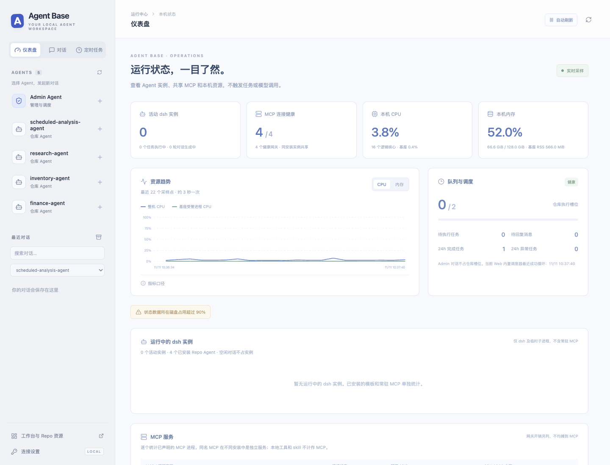

# 运行仪表盘

打开 <http://127.0.0.1:8765/dashboard> 查看本机资源、活动 CLI 实例、逐个 MCP、工作区磁盘、队列和最近异常。页面读取共享采样快照，不调用模型或业务工具，也不重启服务。

## 指标怎么读

| 指标 | 含义与限制 |
| --- | --- |
| 活动 dsh 实例 | 实际存活的任务、网页轮次或 Admin CLI；空闲会话不计入 |
| MCP 资源 | 按各自进程统计；网关开销单列，不均摊 |
| 外部 HTTP MCP | 本机无法测量远端 CPU/内存，显示未知 |
| CPU | 整机容量口径，100% 表示全部逻辑核心满载 |
| RSS | 驻留内存合计，共享页可能重复，并非独占内存 |
| 工作区磁盘 | 普通文件逻辑大小，不跟随外部链接；保留的失败/会话目录仍占空间 |
| 分配空间 | 文件系统估算，共享块、压缩与稀疏文件会影响精度 |
| 队列槽位 | 可能含准备/验证阶段，因此不等于活动推理实例数 |

首次 CPU 需要两个采样点；权限不足、归属不明显示未知。部分目录扫描显示下限，不能当完整总量。工作区清单不包括日志、session、安装模板和归档存储。

## 刷新与故障

默认约 3 秒采样，趋势保留 120 点；磁盘约 30 秒更新。暂停刷新只影响当前浏览器。采样失败保留旧快照并提示，超过 12 秒显示过期。

健康连接不证明模型在线或业务结论正确。共享部署的故障、日志、绑定和操作请到 [共享服务](ManagedServices.md)；任务结果看 [运行报告](RepoContract.md)。

