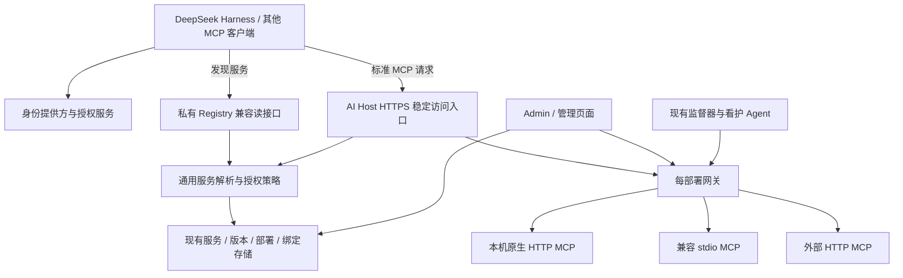

# AI Host MCP 服务发现与托管设计

日期：2026-11-16  
状态：建议方案，供评审与后续实施；本文新增的接口和字段尚未实现  
范围：可信团队、单机 AI Host、内网或受控网络的远程 Agent 客户端

## 1. 设计结论

建议把 AI Host 建成同时提供 **MCP 私有目录、稳定访问入口和服务托管** 的平台：

1. 通过兼容 MCP Registry 的 REST 接口提供服务发现，沿用官方 `server.json` 的远程服务描述。
2. 每个服务暴露独立、稳定的 Streamable HTTP 地址；目录返回 AI Host 地址，隐藏进程端口和上游凭据。
3. 复用第二阶段的服务版本、部署、发布、绑定、监督器和看护能力；在现有目录上增加客户端视图。
4. 将服务解析结果从 dsh patch 中抽离，形成与客户端无关的连接描述，再分别适配 DeepSeek Harness 和其他客户端。
5. 外部客户端使用独立的用户或工作负载身份；授权同时约束服务、工具和业务数据范围。
6. 区分协议版本：保留现有握手模式，规划 `2026-07-28` 无会话协议接入，只有经过测试的版本才进入兼容声明。

**与当前工作的关系：方向连续，托管底座可复用；远程发现、身份接入及网关完整性仍是实质性新增工作。** 不能把现有管理页的服务列表直接开放，就视为完成通用发现与对外服务。

本文默认客户端可以先配置一次 AI Host 地址和登录方式。通用发现的目标是减少逐服务配置，并保持服务接入遵循 MCP；不能承诺任意现有客户端都自动识别一个目录地址、登录并动态挂载所有服务。

## 2. 现状与评估基线

### 2.1 提交状态说明

本次检查的 Git 仓库是 `agent-base`，父目录 `ai-host` 本身不是 Git 仓库。本地 HEAD 为 `9c9bf4e`（`test: cover installation-step credential isolation`）。

用户提及的“第二步已经提交”在本地可见历史中未找到对应的第二阶段提交。当前工作区存在完整的一组第二阶段改动，包括未跟踪的 `service_store.py`、`service_install.py`、`deployment_gateway.py`、`service_catalog.py`、`service_resolver.py` 和相关测试。本文全部纳入评估，但不将这些文件称为已提交、已发布或已验收。

若另一个分支或远端已有相应提交，需要再以该 commit 校准；以下对当前工作区的技术判断仍然成立。原 [第二阶段设计](PHASE_2_MANAGED_MCP_DESIGN.md) 和文档索引还标注“待评审/尚未实施”，已经落后于工作区代码，后续验收时应一起更新。

### 2.2 已有能力

| 能力 | 本地已提交基线 | 当前工作区第二阶段代码 |
| --- | --- | --- |
| repo 长期安装、私有 MCP、dsh 注入 | 已有 v2 实现 | 保持兼容 |
| 独立 MCP 软件版本和部署 | 尚无这组独立服务模块 | v3 清单、固定 commit、部署及安装操作已实现 |
| 统一对外传输 | 已有本机 HTTP 接入及知识库服务 | 托管 stdio 经桥接提供 HTTP；原生 HTTP 经部署网关代理 |
| 发布、撤回、绑定 | 无独立共享服务目录 | 有 `ServiceCatalog` 和显式工具绑定 |
| 外部服务登记 | 无统一生命周期模型 | 有协议探测、登记和绑定；调用时直连上游 |
| 健康和恢复 | repo 级管理 | 有分层探测、恢复预算、故障单、看护入口和服务页面 |
| 客户端资源解析 | 与现有运行器集成 | `ServiceResolver` 统一处理 Run、对话、cron 等入口，但直接生成 dsh patch |
| 通用远程发现 | 未具备 | 尚无 Registry 兼容读接口和外部连接描述 |
| 外部客户端身份 | 未具备 | 服务 grant 仍主要依赖本机 Run、Turn、PID |

代码依据：

- [清单解析](../src/agent_base/manifests.py)、[服务持久化](../src/agent_base/service_store.py)、[托管安装与启停](../src/agent_base/service_install.py)。
- [部署网关](../src/agent_base/deployment_gateway.py)、[服务目录与绑定](../src/agent_base/service_catalog.py)、[资源解析](../src/agent_base/service_resolver.py)。
- [监督器](../src/agent_base/service_supervisor.py)、[服务管理接口](../src/agent_base/service_web.py)、[知识库接入](../src/agent_base/knowledge_service.py)。

### 2.3 本次验证口径

本次以源码检查为主，并针对现有四组服务回归进行验证，结果见本文末尾。当前环境安装的 Python MCP SDK 为 `1.30.0`，其 `SUPPORTED_PROTOCOL_VERSIONS` 只列出 `2024-11-05`、`2025-03-26`、`2025-06-18`、`2025-11-25`。因此，不能因为服务用了 Streamable HTTP，就认定已经支持最新协议。

没有在本次设计工作中验证真实远程 Harness GUI、OAuth 登录、跨主机网络或生产部署；相关能力均列入后续验收。

## 3. 先区分三种“发现”

| 层次 | 回答的问题 | 建议机制 |
| --- | --- | --- |
| 服务目录发现 | AI Host 有哪些我可以使用的 MCP？地址在哪里？ | Registry 兼容 REST 目录 |
| 已知端点的协议能力发现 | 这个地址支持什么协议版本、工具/资源/提示能力？ | 当前协议 `server/discover`；旧版本 `initialize` |
| 具体业务能力发现 | 工具有哪些参数？有哪些资源和提示模板？ | `tools/list`、`resources/list`、`prompts/list` 等 |

`server/discover` 面向一个**已经知道地址的服务器**，不会枚举整个 AI Host 上的其他服务。OAuth 的 protected-resource metadata 则用于定位授权服务器，也不能替代业务服务目录。[官方 Discovery 规范](https://modelcontextprotocol.io/specification/2026-07-28/server/discover)、[授权规范](https://modelcontextprotocol.io/specification/2026-07-28/basic/authorization)。

官方 Registry 定义了 `server.json` 和目录 API；官方公共 Registry 不接收仅对私网用户开放的服务，并明确建议使用私有 Registry。我们应实现兼容读接口，无需复制官方公共 Registry 的发布验证、运营或存储体系。[官方 Registry 定位](https://modelcontextprotocol.io/registry/about)。

截至本次查阅，官方将 `2026-07-28` 标为当前协议：使用每请求版本和能力信息，提供 `server/discover`，与 `2025-11-25` 及以前的初始化握手模式分开。Streamable HTTP 仍是共同的传输方式。[版本说明](https://modelcontextprotocol.io/docs/2026-07-28/learn/versioning)、[兼容规则](https://modelcontextprotocol.io/specification/2026-07-28/basic/versioning)。

## 4. 总体架构



职责划分：

- **管理面**：安装、固定版本、验证、发布、绑定、撤回、运维；复用第二阶段服务。
- **发现面**：返回当前主体可见的服务元数据，不负责启动服务、安装软件或授予新权限。
- **访问面**：稳定地址、认证、限流、协议转发；每次调用检查授权和部署状态。
- **运行面**：部署进程、数据目录、探测、恢复预算；延续现有监督器。

初期可以部署在同一台机器，Registry 与连接 API 可作为现有 Web 服务的独立路由模块。对外只暴露必要的客户端路由，管理路由使用单独的权限和入口规则；不能沿用可选 `AGENT_BASE_WEB_TOKEN` 作为所有远程用户的共享身份。

## 5. 目录及连接契约

### 5.1 对象模型

保留现有 `service_id → revision_id → deployment_id → generation`。新增以下对象，不改变部署的基本生命周期：

| 对象 | 建议字段 | 用途 |
| --- | --- | --- |
| `service_exposures` | `id, deployment_id, registry_name, public_url, audience, environment, discover_policy, enabled` | 将部署映射为稳定的客户端访问入口 |
| `service_metadata` | `service_id, description, tags, owner, docs_url` | 供检索和展示使用 |
| `service_capability_snapshots` | `deployment_id, revision_id, protocol_versions, capabilities, schema_digest, verified_at` | 记录实测协议和完整能力描述 |
| `client_principals` | `id, kind, issuer, subject, disabled_at` | 外部用户或工作负载身份 |
| `client_grants` | `principal_id, exposure_id, tools, data_scope, revision, expires_at` | 外部调用授权；与现有 repo Agent 绑定复用策略逻辑 |
| `registry_events` | `seq, name, version, action, at` | 支持分页同步、撤回和目录增量更新 |

软件版本、业务契约版本、MCP 协议版本各自独立。例如：软件 `0.3.0`、业务契约 `ticket-center/v1`、协议 `2025-11-25`，不能共用一个 `version` 字段。

首版采用“一份 exposure 对应一个可寻址部署”的模型。示例目录名：`com.example.ai-host/ticket-center-prod`。`com.example` 是待替换的示例命名空间，实际使用组织控制的名称。dev/prod 或不同数据域需要客户端明确选择时，使用不同目录名和地址。

同一 exposure 的地址不随 PID、端口、generation 变化；不要直接把 `127.0.0.1:<gateway_port>` 写入远程目录。同一软件版本的标准定义保持稳定，健康状态、当前代际和用户授权放在运行态视图，不随探测结果反复改写版本记录。

### 5.2 Registry 兼容读接口

建议 base URL：`https://ai-host.example.com/registry`，实现：

```text
GET /registry/v0.1/servers
GET /registry/v0.1/servers/{serverName}/versions
GET /registry/v0.1/servers/{serverName}/versions/{version}
```

列表支持 `cursor`、`limit`、`search`、`updated_since`、`version=latest`；路径名称按规范 URL 编码。响应沿用 `servers` / `server` / `metadata.nextCursor` 包装，详细字段按选定并固定的官方 OpenAPI 和 schema 版本验证。[Registry API](https://raw.githubusercontent.com/modelcontextprotocol/registry/main/docs/reference/api/openapi.yaml)。

示例为版本详情响应的核心部分：

```json
{
  "server": {
    "$schema": "https://static.modelcontextprotocol.io/schemas/2025-12-11/server.schema.json",
    "name": "com.example.ai-host/ticket-center-prod",
    "title": "工单中心（生产）",
    "description": "工单查询与订阅服务",
    "version": "0.3.0",
    "remotes": [
      {
        "type": "streamable-http",
        "url": "https://ai-host.example.com/mcp/ticket-center-prod"
      }
    ]
  }
}
```

`remotes` 的格式采用官方远程服务模型；它不携带实际 token、上游凭据、PID 或环境变量值。[官方 server.json 定义](https://raw.githubusercontent.com/modelcontextprotocol/registry/main/docs/reference/server-json/generic-server-json.md)。

AI Host 的运行态扩展可放入响应级命名空间 `_meta`，包括 `exposure_id`、`deployment_id`、`contract`、`availability`、`observed_at` 和连接说明链接。认证元数据以标准 OAuth 发现为准，扩展字段仅提供提示，不创造一套强制的客户端鉴权协议。

读目录必须先做主体过滤：首版只返回已发布、允许发现且主体已获授权的 exposure。没有权限的详情请求也不能泄露元数据。后续若建设“可申请访问”的服务市场，应独立区分可见权限和调用权限。

短暂故障不删除版本；在运行态标为不可用。撤回生成增量事件，使曾经看到该条目的同步方能删除本地缓存，但不向从未获准查看的主体泄露名称。分页游标绑定主体、过滤条件和目录修订；权限变更后旧游标失效或重新开始同步。

### 5.3 AI Host 自有连接 API

Registry 负责通用元数据，下面两个平台 API 负责当前身份下的精确连接：

```text
GET  /api/mcp/connections
POST /api/mcp/resolve
```

`resolve` 接收服务名、环境和可选业务契约；主体来自认证上下文，不接受客户端通过 `agent_id` 指定其他人的权限。结果示意：

```json
{
  "schema_version": 1,
  "catalog_revision": "catalog-42",
  "connection": {
    "name": "tickets",
    "exposure_id": "ticket-center-prod",
    "deployment_id": "ticket-prod",
    "transport": "streamable-http",
    "url": "https://ai-host.example.com/mcp/ticket-center-prod",
    "auth": {
      "mode": "oauth2",
      "resource": "https://ai-host.example.com/mcp/ticket-center-prod"
    },
    "protocol_versions": ["2025-11-25"],
    "capabilities": {"tools": {}},
    "contract": "ticket-center/v1",
    "allowed_tools": ["ticket_search"],
    "policy_revision": 7,
    "availability": "healthy"
  }
}
```

这是 AI Host 自有连接契约，不冒充 MCP 标准。接口不返回 Admin token，不隐式安装或绑定服务。实际 access token 由登录/授权流程获取，受控自动化可采用独立的凭据签发入口；避免把短期 token 写入目录或导出文件。

该描述也作为内部 `ServiceResolver` 的输出：解析和授权先完成，dsh YAML 生成移到单独的 renderer。保留内部 Run/Turn grant 机制作为一种凭据来源，远程身份作为另一种来源，两者使用共同的策略检查。

## 6. DeepSeek Harness 与其他客户端如何接入

### 6.1 AI Host 内部启动的 dsh

保留 `services` 声明和显式绑定：平台解析依赖，取得通用连接描述，签发本次执行的最小权限 grant，生成 `@deepseek-ai/dsh-mcp-client` patch。当前环境变量引用机制可以继续使用。

业务任务只拿到其声明且被批准的服务。新增目录不会使每个 Agent 自动获得所有服务，也不会在运行时自动安装缺失依赖。

### 6.2 用户自行运行的 DeepSeek Harness

推荐增加轻量接入命令或 Harness 插件，概念命令如下，均为待实现：

```text
agent-base connect login --host https://ai-host.example.com
agent-base connect list
agent-base connect export --client dsh --service ticket-center-prod
```

流程：用户配置一次 Host → 完成登录 → 读取授权目录 → 选择服务 → 生成当前 dsh 可接受的配置 → 由客户端建立标准 MCP 连接。

现有代码已证明 dsh patch 可以配置 `serverName`、`transport`、`url`、`headers`。尚未证明当前实际安装的 Harness GUI 支持私有 Registry、OAuth 自动续期、动态挂载或配置热重载。因此先交付导出配置及命令行接入，插件能力经真实版本验证后再承诺。

外部客户端的凭据生命周期独立于 AI Host 的本地 PID；长会话需要刷新或重新认证。仅支持固定 header 的客户端可使用可撤销、限时的专用 bearer 凭据，不能借用 Run token，也不能导出长期管理凭据。

### 6.3 其他 Agent 客户端

| 客户端能力 | 接入方式 | 自动化边界 |
| --- | --- | --- |
| 支持私有 Registry | 配置 Registry base URL，检索并连接 | 客户端仍需支持目录认证和 MCP 授权 |
| 支持远程 MCP 与 OAuth | 从服务详情复制一个稳定 URL | 服务能力由 MCP 协议发现 |
| 只支持 URL + headers | 导出对应格式，用户配置专用凭据引用 | token 更新需要客户端支持或接入助手 |
| 我们可修改的自研客户端 | 直接消费通用连接 API | 可实现启动发现、按需连接和目录刷新 |

不将某种 `mcpServers` JSON 视为所有客户端的标准格式。每个 exporter 都有明确的目标客户端与版本，必须用其解析器验收。

### 6.4 可选：目录 MCP

可以另提供 `/mcp/catalog`，暴露只读工具 `search_services`、`get_service_connection`，供 Agent 在任务中按需求查找服务。工具只返回元数据，不直接发放新权限。

“模型调用目录工具拿到 URL”不等于宿主程序会挂载新 MCP。自研 Harness 需实现宿主侧连接动作；其他客户端可用配置导出完成接入。首期目录 MCP 可后置，Registry 和静态配置接入已经能形成可用闭环。

不建议首版建设把全部业务工具塞进单一 `/mcp` 的聚合服务器。它会增加工具命名冲突、能力路由、通知、资源 URI 和版本兼容成本。需要“只配一个 MCP 地址就调用全部业务工具”的产品体验时，应作为独立网关产品能力评估。

## 7. 稳定入口与服务器托管

### 7.1 URL 与内部路由

对客户端公布：

```text
https://ai-host.example.com/mcp/{exposure_id}
```

内部可继续使用：

```text
HTTPS 入口 → 本机部署网关 → 私有端口 HTTP 后端
HTTPS 入口 → 本机部署网关 → stdio 兼容后端
HTTPS 入口 → 平台代理 → 已登记的外部 HTTP 后端
```

外部服务的代码和进程不归 AI Host 托管，但其接入、策略和凭据由平台代理管理。禁止向普通客户端分发上游共享凭据，否则平台无法统一撤销已建立的访问。

首版入口只选择 exposure 对应的活动部署，不做跨部署随机负载均衡；业务数据域与授权保持稳定。内部端口变更时更新路由，外部 URL 不变。发布时生成 exposure，后端启动本身不自动开放外部访问。

入口验证外部身份后，向部署网关传递内部短期授权，或由网关直接调用同一策略验证器。若用内部授权，应绑定目标 deployment、principal、policy revision 和短有效期，并由服务端状态检查实现即时撤销。来自公网的身份 header 必须先移除，再由可信入口写入；不能通过普通请求头伪造调用者。

### 7.2 托管流程

沿用第二阶段：

```text
固定 commit 审阅 → 安装计划 → 冻结版本 → 安装依赖
→ 启动未发布部署 → 协议/业务探测 → 发布 exposure
→ 显式授权 → 目录可见 → 客户端连接
```

安装计划、启动成功、协议验证、业务验证、发布和客户端可用是不同状态。对外发布前增加稳定入口的端到端探测，验证 TLS、路由、认证与 MCP 调用，而非只探测本机后端。

继续使用独立持久数据目录、部署锁、generation 和有限恢复预算。单机首版采用现有子进程模式；不要求立即上 Kubernetes。宿主机重启后的自动恢复需要将 `serve/worker` 纳入运维启动方式并实测，现有“调度循环中的监督器”本身不能在宿主进程全部退出后自行启动。

### 7.3 关键状态规则

| 状态 | 目录行为 | 调用行为 |
| --- | --- | --- |
| 未发布 | 普通客户端不可见 | 拒绝普通调用，仅允许运维验证 |
| 已发布且健康 | 返回服务与可用状态 | 按授权执行 |
| 已发布但降级/过期未探测 | 保留记录并标明状态 | 按策略尝试或快速返回不可用，不假称健康 |
| 已停止/维护 | 显示不可用或从默认可用列表过滤 | 阻止新业务调用，处理已有调用的排空 |
| 撤回/撤权 | 更新目录并使缓存失效 | 已缓存 URL 和旧凭据也必须被拒绝 |
| 代际切换 | URL 不变，更新运行态 | 旧会话按协议失效；写操作不自动重放 |

默认授权检查不依赖陈旧的本地缓存。若后续为性能引入缓存，需定义可验证的撤销延迟上限和失效机制。对已开始执行的业务调用，撤权不能保证撤销已发生的副作用；可中断流并尽力取消，后端仍需幂等和审计。

## 8. 身份、授权与数据范围

### 8.1 三类身份

- 平台内 Agent：repo 身份 + Run/Turn，用现有执行生命周期约束。
- 远程用户：使用组织 IdP/SSO 与 OAuth，主体是经认证的用户。
- 无人值守 Agent：使用专门的工作负载身份；首版可支持受控、限时 bearer 凭据，或经评估的机器授权方案。

`client_id` 标识客户端应用，不等于业务用户，也不等于被授权的 Agent。外部调用不得通过提交一个现有 repo 的 `agent_id` 继承权限。

### 8.2 OAuth 接入

建议复用成熟授权服务或组织身份系统，AI Host 主要作为资源服务器，提供：

1. 未认证请求返回标准 `401` 和 `WWW-Authenticate`，其中给出 protected-resource metadata 地址。
2. metadata 将当前 MCP 规范 URI 与授权服务器关联；包含 path 的服务使用对应的资源元数据，不能用模糊的全站身份替代服务 audience。
3. 用户端使用授权码与 PKCE；客户端注册优先选成熟授权服务支持的预注册或当前规范机制。
4. 每个 access token 校验 issuer、签名或 introspection、有效期、audience 和 scope，再与平台当前授权求交集。
5. 外部 token 不透传给第三方上游；上游使用其独立凭据或明确的用户委托机制。

具体规范要求以 [MCP Authorization](https://modelcontextprotocol.io/specification/2026-07-28/basic/authorization) 为准。目录 API 本身的登录方式是平台契约，MCP 标准不会自动解决私有 Registry 的认证。接入助手应处理目录登录与业务 MCP 授权，并分别管理 audience。

### 8.3 工具与数据范围

有效权限取交集：

```text
身份有效 ∩ token 范围 ∩ 当前绑定/授权 ∩ exposure 发布状态
∩ 版本契约 ∩ 工具/资源操作权限 ∩ 业务数据范围
```

工具白名单只限制“可以调用哪个工具”。它无法证明 `ticket_search(project="other")` 不会越权。

数据范围必须选择并记录一种真实可执行的方式：

- **服务端执行**：平台向后端传递受验证的调用上下文，后端按数据域检查所有读写和订阅。
- **网关策略适配**：针对已知业务契约，校验或约束参数及必要的返回结果；不能靠通用字符串替换完成。
- **部署隔离**：不支持主体范围校验的服务，按授权数据域独立部署，并使用受限后端凭据。

能力记录增加 `scope_enforcement = backend | gateway_adapter | deployment_isolation`。没有可执行方式的共享服务不能对外声称支持项目隔离。内置知识库继续复用已有专用范围校验，但其本机身份模型需适配远程主体。

绑定修订变化需要使旧授权失效，或与实时权限重新求交集。减权、禁用、撤回都应影响旧 token；增权不自动扩大旧 token 的有效范围。

## 9. Streamable HTTP 与协议兼容

### 9.1 两种协议模式都要明确

| 项目 | 现有握手模式（至 `2025-11-25`） | 当前模式（`2026-07-28`） |
| --- | --- | --- |
| 开始通信 | `initialize`，之后 initialized 通知 | 无初始化握手；可选调用 `server/discover` |
| 协议信息 | 初始化协商，HTTP 按版本传版本头 | 每请求 `_meta` 与匹配的 HTTP 头 |
| 会话 | 可选 `Mcp-Session-Id` | 无协议级会话 |
| GET / DELETE | 按实现支持 SSE 和会话终止 | 对当前模式返回 405 |
| 能力变化/长连接 | 按旧版通知及恢复规则 | 按当前规范与所支持扩展处理 |

这两者都是 Streamable HTTP。当前模式仍允许请求级 SSE 响应；“无会话”不等于把全部响应缓冲成普通 JSON。[当前 HTTP 规范](https://modelcontextprotocol.io/specification/2026-07-28/basic/transports/streamable-http)。

### 9.2 建议实施策略

先固定实际可用的 Python SDK 和 dsh 版本，建立握手模式回归；并行评估支持当前协议的 SDK。原生 HTTP 服务经透传入口可分别支持其已验证模式，目录如实标注。

需要双模式服务时，优先采用成熟 SDK 的双模式实现。不要用修改目录字段的方式“升级协议”，也不要只把 `server/discover` 加到旧服务器就宣称符合当前协议。stdio 桥接若暂时只支持握手模式，应保留并明确其限制；当前协议到旧后端的完整转换单独验证。

对外兼容集等于“客户端 ∩ 入口/网关 ∩ 后端”的实际能力。首版可先交付明确标注版本的握手模式远程接入；完成当前模式及双模式验收后，才标为支持当前 MCP 规范。

### 9.3 网关必须保持的语义

- 保留真实工具的 `description`、`inputSchema`、`outputSchema`、annotations 和其他所声明字段。
- 保留 `CallToolResult` 的结构化结果、错误标记和元数据；不能只返回 `content`。
- 透传适用的版本头、方法/名称头、参数映射头、认证 challenge、SSE 类型及缓存相关头；移除 hop-by-hop 头。
- 当前模式验证 header 与 body 的一致性；权限不能仅依据客户端可伪造的 `Mcp-Name`。
- 握手模式的 session ID 必须与主体、部署、代际关联；会话续传不能跨用户串用。
- 正确处理 SSE、背压、取消和断连；上游中断时不能向 SSE 流末尾随意拼一段 JSON。
- 分别执行工具、资源、提示、任务等授权；没有实现的能力必须拒绝或不声明，不能默认放行未知方法。
- 请求大小、并发、超时和速率有边界；长流读取和普通请求使用不同超时策略。

当前规范还要求 `Mcp-Method`、适用时的 `Mcp-Name` 以及 schema 指定的参数映射头；实现时按官方规则处理，不写死一个无法扩展的四项头白名单。[HTTP 请求头规则](https://modelcontextprotocol.io/specification/2026-07-28/basic/transports/streamable-http#standard-request-headers)。

## 10. 与当前工作区的具体 gap

| 领域 | 当前事实 | 需要补齐 | 规模 |
| --- | --- | --- | --- |
| 托管底座 | 版本、安装、锁、代际、启停已具备 | 对外入口探测、宿主恢复验收 | 小到中 |
| 目录 | 管理 `/api/services` 返回部署和绑定状态 | Registry 投影视图、搜索、分页、版本、权限过滤 | 中 |
| 地址 | 部署 endpoint 为本机端口 | exposure、HTTPS 稳定路径及路由 | 中 |
| dsh 接入 | resolver 直接生成 dsh YAML | 中立连接模型、renderer、外部接入助手 | 中 |
| 外部身份 | grant 以 Run/Turn/PID 为主 | 用户/工作负载主体、登录、刷新和撤销 | 大 |
| 外部服务 | resolver 把上游 URL 和凭据传给客户端 | 统一代理，客户端只持平台凭据 | 中 |
| 工具契约 | stdio 桥接只保留工具名并重建空 schema | 完整定义与完整结果转发、契约摘要 | 中 |
| 运行中减权 | grant 中有 binding revision，但网关未比较 | 修订检查与实时交集，撤权覆盖旧 token | 小到中 |
| 数据范围 | bindings 有 scope，通用调用链未执行 | 后端上下文契约/策略适配/部署隔离 | 中到大，取决于业务服务 |
| HTTP 完整性 | 请求只透传有限几个头，主要检查 tools/call | 按协议模式转发和校验，完整授权面 | 中到大 |
| 当前协议 | 本机 SDK 版本列表止于 `2025-11-25` | SDK 升级评估和当前/双模式兼容测试 | 中，存在依赖风险 |
| UI/运维 | 有服务页、监督器及看护 | 客户端连接页、授权和访问审计 | 中 |

### 10.1 对外开放前应优先处理的源码问题

这些是本次源码检查发现的明确差距，不代表全部已经被测试覆盖：

1. `deployment_gateway.py` 的 stdio `list_tools` 使用 `inputSchema={"type":"object"}` 重建定义，客户端无法获得后端要求的参数。`call_tool` 只返回 `answer.content`，会丢失错误和结构化结果语义。
2. 原生 HTTP 代理只检查 `tools/call`；不筛选返回的工具列表，也没有资源、提示等完整授权。当前“可调用工具”与“看到的工具”可能不同。
3. 请求头白名单没有 `MCP-Protocol-Version`，当前协议要求的 `Mcp-Method` 等也会丢失；响应未转发 `WWW-Authenticate` 等授权发现信息。
4. `ServiceResolver.attach` 对外部部署使用原始 endpoint 和上游 header，平台 grant 的撤销不能阻止已经持有上游凭据的客户端继续直连。
5. 网关 `_binding` 只匹配 enabled 与 alias；`check_tool` 使用签发时的工具列表，没有检查当前 binding revision，直接修改绑定缩小权限不会自动收紧旧 grant。
6. 通用 grant 没有携带 binding 的数据 scope，网关也未按数据域校验；目录/提示词展示 scope 不能替代执行。
7. 网关对所有带 Origin 的请求都拒绝，当前 Web 又限制 Host；远程及浏览器型客户端需要显式、受控的 Host/Origin 策略，不能只改监听地址。

以上均可在第二阶段架构内修正，无需推倒服务目录、安装执行器或监督器。

## 11. 实施分期与工作量

以下是**一名熟悉代码的工程师**的规划估计，按可复用当前工作区、单机可信团队、已有可接入 IdP、首批 1–2 个业务服务计算。它是工程判断，不是从代码行数推导的完成率。

| 批次 | 交付 | 预计工作日 | 验收边界 |
| --- | --- | --- | --- |
| P0：收敛第二阶段 | 对齐提交、文档与回归，修复 schema/结果/减权及协议头问题 | 2–4 | 当前内部能力形成可追溯基线 |
| P1：发现与稳定入口 | exposure、Registry 读接口、权限过滤、连接 API、HTTPS 路由 | 4–6 | 有权限客户端能发现并通过固定 URL 调用 |
| P2：远程身份与统一策略 | 接成熟 OAuth、远程主体、外部代理、数据范围执行 | 5–8 | 外部用户/Agent 可独立接入，撤权与数据隔离有效 |
| P3：客户端和协议验收 | dsh 导出/接入助手、第二种客户端、当前协议/双模式及流式测试 | 4–7 | 形成经验证的客户端与协议兼容表 |

整体约 **15–25 人日**。可以交付单机生产候选版本，但不包含集群高可用、多租户强隔离、完整服务市场或自建授权服务器。如果目前没有 IdP，或需要改造多个业务服务实现数据范围，需另增加约 5–10 人日或重新估算。

小范围演示可先交付 P0+P1，约 6–10 人日：明确限制在受控网络和专用测试身份，声明实测的旧版协议。完整远程接入应完成 P2；支持当前协议的声明需完成 P3 对应验收。

相对于本地已提交 HEAD，第二阶段本身还未进入该基线，不能直接套用上述增量工期。先收敛当前工作区并形成第二阶段可验收提交，才能把它作为本设计的实施起点。

## 12. 模块调整建议

| 模块 | 建议调整 |
| --- | --- |
| `service_store.py` | 增量 schema migration，增加 exposure、主体授权、元数据和目录事件 |
| `service_catalog.py` | 保留管理逻辑，增加面向主体的查询投影及发布事件 |
| `service_resolver.py` | 返回通用连接描述；把 dsh 配置输出移动到 renderer |
| `deployment_gateway.py` | 完整保留协议、每请求策略检查、支持外部代理适配 |
| `service_supervisor.py` | 复用探测恢复；增加对外可达性与 capability snapshot 更新 |
| `knowledge_service.py` / `knowledge_server.py` | 保留知识库业务范围校验，适配远程主体及稳定 exposure |
| 新 `registry_web.py` | Registry 兼容只读 API、schema 校验、分页与增量同步 |
| 新 `mcp_access.py` | principal/token 验证、统一有效权限与内部授权转换 |
| 新 `mcp_connection.py` | 中立连接数据模型及客户端 renderer |
| 新 `mcp_ingress.py` | 稳定路径路由、认证 challenge、流式转发和访问审计 |
| CLI / 服务页 | 登录、检索、复制 URL、导出配置、授权及撤销可见性 |

初期继续使用现有 SQLite 和部署存储，不增加独立 Registry 数据库、服务网格或消息队列。发布状态、绑定和目录事件的更新应在同一事务提交，避免目录宣布可用但授权状态未落地。

## 13. 验收标准

1. **发现**：全新远程客户端只配置 Host 与身份，即可列出被授权服务；未授权名称不会出现在列表或详情里。
2. **配置**：dsh 和至少另一种实际客户端可读取导出配置并调用；记录精确版本与认证能力。
3. **稳定性**：后端重启和端口变化不改变外部 URL；重连后只读调用可恢复，写调用不被平台盲目重放。
4. **授权**：A/B 两个主体的工具与数据范围不同；参数伪造、旧 token、减权和撤回都按策略拒绝。
5. **外部代理**：客户端永远不获得上游共享凭据；撤回后，已知平台 URL 和旧平台 token 不能继续调用。
6. **契约**：参数必填项、复杂 schema、structuredContent、isError、资源和提示模板按声明保留；未支持能力明确拒绝。
7. **协议**：对声明支持的每个版本分别验收；当前模式检查 `server/discover`、请求 metadata 和 headers，握手模式检查初始化和会话归属。
8. **流式**：长 SSE、客户端取消、上游断流、代理超时和并发均有测试；不破坏消息边界。
9. **运维**：宿主重启、监督器失联、过期健康证据、部署维护和恢复预算可观察；没有常驻监督器时不能显示为持续看护中。
10. **兼容**：原有 v1/v2 repo、内部 Run/cron/网页对话及内置知识库不因新目录出现而扩大权限或失去原功能。

## 14. 本次检查记录

- 已阅读第二阶段设计、核心托管/目录/网关/解析模块及相关测试。
- 本地 Python MCP SDK `1.30.0`；实际支持版本列表止于 `2025-11-25`。
- 首次在受限环境运行服务测试遇到 `Operation not permitted`，安装操作失败，不能将其判断为业务回归失败；随后允许测试使用本机端口与临时子进程进行复验。
- 复验命令：`.venv/bin/python -m pytest -x -q tests/test_services_install.py tests/test_services_catalog.py tests/test_service_supervisor.py tests/test_services_web.py`；结果 **26 passed，1 warning，38.31 秒**。提示为 Starlette/httpx 依赖弃用提示。该结果证明现有测试范围通过，不证明本文列出的远程发现、OAuth、数据范围或当前协议已实现。
- 本文 JSON 示例均已解析校验，本地文档/源码链接已检查存在。本次只新增本设计文档，未实施上述新增业务接口，也未修改既有工作区改动。

## 15. 官方参考资料

- [MCP Registry：定位与私有 Registry](https://modelcontextprotocol.io/registry/about)
- [Registry 聚合器与子目录](https://modelcontextprotocol.io/registry/registry-aggregators)
- [Registry OpenAPI](https://raw.githubusercontent.com/modelcontextprotocol/registry/main/docs/reference/api/openapi.yaml)
- [server.json 格式](https://raw.githubusercontent.com/modelcontextprotocol/registry/main/docs/reference/server-json/generic-server-json.md)
- [当前协议版本说明](https://modelcontextprotocol.io/docs/2026-07-28/learn/versioning)
- [server/discover](https://modelcontextprotocol.io/specification/2026-07-28/server/discover)
- [协议版本与向后兼容](https://modelcontextprotocol.io/specification/2026-07-28/basic/versioning)
- [Streamable HTTP](https://modelcontextprotocol.io/specification/2026-07-28/basic/transports/streamable-http)
- [Authorization](https://modelcontextprotocol.io/specification/2026-07-28/basic/authorization)

官方文档查阅日期为 2026-11-16。Registry 接口仍处于 preview，实施时应固定 schema/OpenAPI 版本并通过契约测试控制变化。
