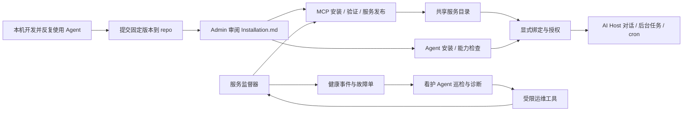

# 第二阶段设计：MCP 独立托管、发布与看护

日期：2026-11-14  
状态：已实施（本地验收完成；Windows 真机与真实内网环境待现场验收）  
适用范围：当前可信团队、单机 AI Host，兼容已有 Agent Base

本文以“本机开发调试 → 发布到 Git repo → AI Host 安装与使用”为主流程。第二阶段建设 MCP 的独立托管、服务发布、跨 repo 复用，以及 Admin Agent 和看护 Agent 的协作机制。下载已发布 Agent 到本地运行、fetch 临时工作区和 dsh GUI 自动接入暂不建设。

下文的清单、状态、管理工具和接口来自设计草案。实现已按第 13 节落地，最终字段、工具名、模块和操作方式以 [共享 MCP：安装、发布、绑定与看护](ManagedServices.md) 为准；与草案的合理差异也记录在那里，不只让测试理解最终接口。验收记录见 [VALIDATION.md](VALIDATION.md)。

## 1. 设计结论

1. **本机调试是正式发布之前的独立阶段。** 开发者在自己的电脑上反复使用和修改 Agent，满意后再把可移植、可复现的版本提交到 repo。
2. **Agent 与共享 MCP 分别发布和管理。** Agent repo 描述角色、技能、工作流程和服务依赖；MCP 服务包描述安装、启动、持久数据、工具契约和看护策略。
3. **Admin Agent 通过 Installation.md 托管安装与发布 MCP。** Admin 阅读说明、准备固定 commit 的安装计划，调用管理工具执行、验证、发布和绑定，不直接替代进程监督器。
4. **共享服务以服务部署为生命周期单位。** 同一部署可供多个 Agent 使用；Agent 更新、卸载或任务结束均不自动停止它。
5. **看护 Agent 与确定性的监督器协作。** 监督器承担持续探测和有限恢复，看护 Agent 承担诊断、巡检、策略内修复和异常升级。
6. **绑定显式可见。** 知识库、工单等都作为服务能力声明与授权接入，不再暗中增加 repo 未声明的技能或业务流程。

“发布 MCP”在本文中指将已验证部署登记到 AI Host 服务目录，并开放给获授权的 Agent；Git 提交/推送由开发者完成，发布也不默认开放公网。

## 1.1 实现现状

| 设计项 | 已实现 |
| --- | --- |
| v3 清单 `agent` / `mcp-service` | `manifests.py`、`package.py`；固定 commit/组件审阅，MCP-only 不要求 AGENTS.md |
| 服务/版本/部署/操作/绑定/故障单 | `service_store.py` 在 `runs.sqlite` 中版本化建表，向后兼容 v1/v2 |
| 托管 stdio 与原生 HTTP | 部署级 `deployment_gateway.py`；HTTP 后端使用平台分配的私有端口 |
| 外部 HTTP 登记 | `ServiceCatalog.register_external`，真实 MCP 协议验证，不管理远端进程 |
| 发布、撤销、显式绑定、统一解析 | `service_catalog.py`、`service_resolver.py`；Run/cron/对话/Admin 共用 |
| 监督器、预算、故障单 | `service_supervisor.py`；`serve`/`worker` 内运行，持久部署锁与代际检查 |
| 看护 Agent | `guardian.py` + 受限 `guardian_server.py`，经真实 dsh 入口执行 |
| 管理页与指标 | `/services` 页面、`service_web.py`；按部署去重的资源归属 |
| 知识库接管 | `knowledge_migration.py`；预检/执行/核对/回滚，隔离验收 |
| 示例与统一验收 | `examples/managed-services/`、`scripts/validate_managed_services.py` |

相对草案的实现差异（公共契约）：

- 内置知识库部署复用统一目录模型，配置标记 `builtin: knowledge`，进程由 `KnowledgeService` 按部署数据根管理；监督器对内置部署执行真实 MCP 协议探针和只读目录探针。
- HTTP 代理模式在网关侧按绑定过滤 `tools/list`（JSON 与 SSE），工具目录与实际调用范围一致；未知响应类型直接拒绝而不是放行未过滤目录。
- 绑定按 Agent + 部署 + alias 唯一；一个 v3 Agent 对同一服务 ID 的多个部署应使用不同 alias。
- 普通共享服务的数据范围只支持 `scope={"projects":[...]}` 项目白名单；绑定拒绝未知范围结构，网关逐次校验项目参数。知识库使用自己的项目/投稿范围字段。
- 外部 HTTP 服务通过平台本机接入层代理：Agent 只拿本机地址和平台 grant，外部业务凭据留在接入层；工具目录、范围、撤权和协议错误都在接入层生效，平台仍不管理远端进程。
- v3 Agent 的 `services` 声明是精确的：空数组/缺失字段不挂载任何共享服务；只有 Admin 无 manifest 时使用全部绑定。
- stdio 网关缓存并透传完整工具定义与 `CallToolResult`；HTTP 目录过滤只计一次在途调用。
- 看护 patch 禁用 dsh 默认工具行（fs/搜索、shell、jobs、skill、subagent、workflow、web、goal、todo、plan-mode、MCP 资源目录），模型工具目录只保留 `mcp__guardian__*`。
- 重新安装新 commit 时按 revision/config 身份切换代际；相同 revision/config 的重复安装复用现有代际。
- 部署目录为 `deployments/<deployment_id>/{data,logs,backups,receipts}`；revision 源码/环境仍在 `services/<service_id>/revisions/<revision_id>`。

## 2. 范围与非目标

### 2.1 本阶段交付

- 独立 MCP 服务包、托管安装与发布流程。
- 平台管理的服务部署及外部服务端点登记。
- 跨 Agent repo 的服务绑定、契约检查和访问控制。
- 确定性服务监督器、事件记录、看护 Agent 与运维页面。
- 当前知识库接入统一服务目录与显式绑定机制。
- 旧 v2 repo 私有 MCP 的兼容及显式迁移路径。

### 2.2 暂不建设

- fetch 已发布 Agent、临时本地运行目录、本地连接器或 dsh GUI 自动识别。
- 用平台工具替代开发者现有的本机 Agent 调试方式。
- 集群调度、跨主机高可用和自动扩缩容。
- 完整组织身份系统或多租户沙箱；本阶段延续可信团队的使用边界。
- Agent repo 单一活动版本和多轮对话升级迁移的完整机制；另立阶段处理。
- 看护 Agent 自动改业务源码、自动升级版本或自动执行不可逆的数据修复。

## 3. 从开发到使用的完整流程



### 3.1 本机开发调试

开发者可以使用本机 stdio MCP、自己维护的测试服务，或平台授予开发权限的共享测试服务。Agent 的调试结果、技能和工作流程经反复使用后进入版本管理。

连接平台开发服务时，只需标准 MCP 客户端配置与独立的开发授权；本阶段可由平台提供不含凭据的连接说明，开发者在自己的 dsh 环境配置。不会建设 fetch 或目录自动连接机制。

开发授权显式限定测试项目/数据范围，可撤销、有期限；不复制 Admin 的平台管理凭据，也不借用某个生产 Run 的授权。现有知识库的本机 PID/Run 授权不能直接作为开发者远程登录方案；若第二阶段提供该入口，应新增独立的开发访问主体和授权记录。

使用本机 MCP 的开发者需要在发布前补齐服务安装文档；使用已有共享服务的 Agent 只声明依赖即可。开发测试数据不会因提交源码而自动进入平台生产数据目录。

### 3.2 发布到 repo

发布前应具备角色说明、运行入口、技能、服务依赖和安装说明。MCP 还需具备明确的启动方式、依赖锁定、配置引用、持久目录、健康检查和维护责任人。

同一 Git repo 可以包含 Agent 与 MCP 源码；发布时按组件路径分别生成候选和收据。Agent 更新不隐式发布该 repo 中的 MCP。共享服务也可以使用单独的服务 repo，推荐将发布节奏不同的组件分开维护。

安装引用固定 commit；tag/branch 只用于解析候选版本，不在运行中自动跟随。服务软件版本、工具契约版本和 Git commit 分别记录。

### 3.3 平台安装与使用

管理员可以一次表达完整意图：“托管安装这个 MCP，验证后发布，并供这两个 Agent 使用。”Admin 完成计划、执行、验证、发布与绑定，返回实际状态和收据。该指令足以授权正常安装步骤，不为每一步重复索取确认。

若用户只要求安装，服务准备完成即可，不自动扩大访问范围。若托管安装要求启动验证，服务以未发布状态启动检查。若明确要求安装并发布，则验证成功后完成发布；不能把“已 clone”或“进程已启动”报告成“服务已可用”。

涉及影响已有调用方的停机、超出既定策略的操作或不可逆数据迁移时，Admin 先形成具体计划和影响清单，再请求所缺的授权。

## 4. 核心对象和职责

| 对象 | 含义 | 生命周期 |
| --- | --- | --- |
| Agent 定义/版本 | 角色、技能、流程、依赖，来自固定 repo commit | 随 Agent 发布演进 |
| 服务定义 `service_id` | 逻辑业务能力，如 `project-knowledge`、`ticket-center` | 跨版本和 repo 稳定 |
| 服务版本 `revision_id` | 固定源码、清单与依赖锁定结果 | 不可变，可追溯 |
| 服务部署 `deployment_id` | 某环境和数据范围的一份服务，如 `knowledge-dev` | 独立安装、更新、停用 |
| 进程实例/代际 `generation` | 部署的一次启动及 PID/出生时间、实例身份 | 重启/切换时变化 |
| 服务绑定 | Agent → 部署 → 能力/工具/项目授权 | 独立增删改，带修订号 |
| 安装操作/故障单 | 一次安装或一组相关健康异常 | 可查询、可恢复、可审计 |

唯一性以部署为单位：一份部署同一时刻只有一个活动服务代际。开发和生产可以是同一服务的两个独立部署，分别拥有数据和授权。不要按命令行相同、工具名相同或 repo URL 相同自动合并服务。

| 角色/组件 | 负责 | 不负责 |
| --- | --- | --- |
| 开发者 | 本机调试、发布源码、维护安装与运行文档 | 隐式部署平台共享服务 |
| Admin Agent | 理解安装意图、审阅、形成计划、调用安装/发布/绑定工具 | 自行持续轮询每个进程 |
| 服务执行器/监督器 | 持久状态、部署锁、启动停止、探测、有限重启、故障事件 | 自由解释 Markdown 或修改业务代码 |
| 看护 Agent | 定期巡检、诊断、关联影响、执行策略允许的修复、升级处置 | 无上限重启或绕过停用状态 |
| MCP 业务服务 | 业务数据、工具实现、权限校验 | 获得模型 provider 或平台管理凭据 |

## 5. Installation.md 与组件清单

### 5.1 文档与机器配置的关系

保留现有约定：`Installation.md`/`installation.md` 正文供 Admin 理解，唯一的 `agent-base-install` 配置块供安装器解析；也可使用 `agent.yaml`，但两处不能同时提供机器配置。安装器继续执行结构化、固定 argv 的步骤，Markdown 正文不会被直接当成脚本。

建议新增 schema v3，通过 `kind` 区分 `agent` 和 `mcp-service`；v1/v2 保持原行为。Admin 沿用第一阶段的固定 commit 审阅流程。MCP 组件只有 Installation.md 也应可以被审阅，不要求业务 server 为安装目的伪装成 Agent 并提供 AGENTS.md。

同一 repo 有多个组件时，管理员显式选择组件相对目录。组件目录、启动文件、runbook、检查程序都进行包内路径校验；复制冻结后再次验证。文档里的可移植性仍由 Admin 语义审阅。

### 5.2 MCP 服务清单示意

下面的占位符和字段均为拟议接口，需随 v3 解析器实现；端口由执行器分配，秘密从部署配置引用，不能写入 repo。

````markdown
# 工单服务安装说明

用途：提供工单查询和订阅；维护责任人为服务登记的 owner。
先在本机完成测试，再由 Admin 在 AI Host 托管安装。

```agent-base-install
schema_version: 3
kind: mcp-service
service:
  id: ticket-center
  version: 0.1.0
  contract: ticket-center/v1
environment:
  lockfile: uv.lock
installation:
  steps:
    - argv: ["${runtime.python}", "scripts/prepare.py"]
      timeout_seconds: 120
runtime:
  transport: streamable_http
  argv: ["${runtime.python}", "server.py", "--host", "127.0.0.1", "--port", "${service.port}"]
  environment:
    TICKET_AUTH: {from_env: TICKET_SERVICE_AUTH}
    TICKET_DATA: "${service.data}"
health:
  interval_seconds: 30
  timeout_seconds: 5
  failure_threshold: 3
  recovery_threshold: 2
  expected_tools: [ticket_search, ticket_subscribe]
  startup_timeout_seconds: 60
operations:
  runbook: docs/operations.md
  restart_safe: true
```
````

`restart_safe` 是维护者提供的声明；实际是否可自动重启还要满足部署恢复策略、当前活动调用和授权条件。仅有该字段不能绕过这些限制。

清单描述软件怎样安装、运行和被检查；部署配置描述环境、owner、凭据引用、数据目录、发布范围和恢复预算。一次安装操作冻结清单、配置修订号和有效策略，避免执行过程中出现不明的配置漂移。

### 5.3 Agent 清单示意

```yaml
schema_version: 3
kind: agent
package:
  name: ticket-assistant
skills:
  - name: triage
    path: skills/triage
services:
  - alias: knowledge
    service: project-knowledge
    contract: project-knowledge/v1
    permissions: [read, submit]
  - alias: tickets
    service: ticket-center
    contract: ticket-center/v1
    permissions: [read, subscribe]
tasks:
  daily-triage:
    requires: [knowledge, tickets]
```

该声明表达依赖和权限申请；实际端点、部署与数据范围由绑定决定。Agent 绑定已有服务时不启动第二份 server。需要新服务而目录中没有部署时，Admin 报告依赖缺失，或按用户已经授权的安装计划先部署服务；运行器不擅自下载另一份 server。

可选服务缺失时，交互会话仍可做不依赖它的工作；要求该服务的任务应在产生业务副作用前明确失败。服务中途故障不能伪装成空查询结果。

## 6. 托管服务与外部服务统一接入

| 模式 | 资源归属 | Host 的管理能力 |
| --- | --- | --- |
| `managed` | Host 安装包、进程、配置和数据目录 | 安装、启动、探测、按策略重启、更新、停用 |
| `external` | 用户或其他平台维护的端点 | 登记、授权、探测、停用平台路由；不杀进程或修改远端机器 |

首版支持托管 stdio 与本机 HTTP MCP：

- stdio 服务由部署级 adapter 启动并持有连接，统一对 Agent 暴露 HTTP MCP；连接数或会话不能按 Agent repo 各自复制进程。
- 原生 HTTP 服务由执行器启动，通过平台路由接入；其监听端口保持私有，发布后对 Agent 提供稳定逻辑地址。
- 外部 HTTP 端点复用同一目录与绑定机制，凭据由平台受控传递。外部 stdio 接入本机时归入托管部署。

对 Agent 暴露稳定的服务别名与工具名，不继续为共享工具添加 repo hash。路由按部署和授权处理，具体进程地址变化不改变服务身份。MCP 连接会话及在途请求不承诺热迁移；服务切换后新调用重新连接。

共享部署不代表共享用户业务会话。调用方身份、项目范围和 Run/轮次关联应随请求传递，不能通过修改共享进程的 cwd、环境或“当前用户”变量切换。对保留客户端私有状态的后端，必须明确连接/会话隔离策略；首版共享 stdio 只接入能安全复用连接的服务。无法隔离的服务按授权范围单独部署，不能直接把一个全局 ClientSession 交给所有 Agent。

## 7. Admin 安装、验证和发布流程

1. **准备候选**：解析 repo/ref/组件，固定 commit，读取安装说明及相关文档，不执行安装代码。
2. **形成安装计划**：确认复用还是新建、环境、依赖、配置缺项、凭据引用、owner、数据目录、端口、检查方式、恢复策略和发布目标。
3. **记录操作**：分配 operation_id，在部署锁下保存计划摘要与配置修订，进入 installing。重复请求使用幂等键返回同一操作。
4. **安装准备**：冻结源码、安装锁定依赖、执行声明的安装步骤；日志与返回值不得包含凭据。失败保留现场，部署不发布。
5. **私有启动验证**：先检查进程/连接，再执行 MCP initialize、工具目录检查及配置的无副作用探针。目录应完整分页读取；没有业务探针时只报告 protocol_verified，不能宣称业务正确。
6. **服务发布**：验证达标后事务性登记服务目录与当前活动代际，标记 published。目录能列出服务不等于任何 Agent 已获授权。
7. **绑定与交付**：按用户指令绑定 Agent，验证工具和项目范围，交付 service_id、deployment_id、版本/commit、实际验证级别及服务状态。

MCP-only 安装不创建业务任务、不自动运行某个 Agent 的 entrypoint。安装脚本若修改审阅文档，可复核同一版本的安装后文档。

### 7.1 状态和操作恢复

安装操作状态：`queued → preparing → installing → validating → succeeded`，其他终态包括 failed/cancelled/needs_input。只有发布及其必要验证完成，发布操作才可报告 succeeded。

部署分别保存三类状态，避免混淆用户意图与观察结果：

- 期望状态：running / stopped / removed。
- 发布状态：unpublished / published / withdrawn。
- 观测状态：unknown / starting / healthy / degraded / unhealthy / stopped，并附最后检查时间和证据。

控制器重启后根据操作记录、目录收据与进程身份继续协调。无副作用步骤可安全重复；有副作用的安装步骤要求明确的幂等/检查约定，未知结果进入 needs_input，不盲目重跑。

### 7.2 更新、回退和停用

服务升级独立于 Agent 升级，先展示所有绑定方、接口变化、数据迁移和停机影响。可隔离的新版本在独立端口和测试数据上预检；无法隔离的服务先停止旧调用入口、排空在途调用、释放旧实例，再启动新代际。

只有一个控制器可以变更部署；Admin、看护 Agent 和自动恢复均经同一个部署锁和代际检查。旧执行器不能重新拉起已淘汰代际，发布路由只指向一个活动代际。

旧源码与运行环境在切换完成前保留为回退材料；持久业务数据放在部署数据目录中，不随 revision 删除。涉及数据库迁移的回退必须有数据兼容/恢复方案；恢复旧代码不等于恢复旧数据。

管理员主动停止、维护中或 withdrawn 的服务不会被看护 Agent 擅自重新发布。撤销发布阻止新接入，已有调用按排空策略处理。删除部署需列出绑定方和数据保留策略；解绑某个 Agent 不删除共享服务。

## 8. Agent 如何连接共享 MCP

### 8.1 绑定与权限

服务绑定至少包含 Agent 稳定身份、部署、服务别名、契约版本、工具权限、项目/数据范围、是否启用及修订号。Agent 稳定身份来自平台登记，不由客户端任意报一个 repo 名称取得权限；现有 repo hash 可作为迁移映射来源，不作为未来可复制的授权秘密。

一次 Run/对话轮次冻结使用的 Agent 版本、绑定修订、工具契约和所需授权范围。普通配置变更不悄悄替换在途调用的契约；安全撤权可以立即生效，下一次调用明确返回授权失效。共享服务仍独立检查业务数据范围。

### 8.2 运行时接入

资源解析器把已授权绑定转换为 dsh MCP 客户端配置与 `.agent/resources.json`。两份输出来自同一份解析结果，包含别名、可用状态、契约版本和授权范围摘要。凭据只通过受控环境/连接层传递，不进入角色文档、资源目录或源码。

第一版可沿用按轮次生成的 dsh patch，避免引入新的本地连接器。所有执行入口共用同一解析器：普通 Run、cron、网页对话和 Admin 获授权的业务访问。业务 MCP 管理能力不会因此暴露给普通 Agent。

知识库、工单与其他共享服务遵守相同规则。平台不再为知识库额外拼接一套隐藏工作流程；repo 的技能/入口明确说明何时检索或投稿，服务通过工具描述及可读取资源解释接口。

## 9. 看护机制：监督器与看护 Agent

### 9.1 持续探测与有限恢复

监督器不依赖模型可用性运行，持有每份部署的探测计划、恢复预算与操作锁。建议的默认值：每 30 秒探测，连续 3 次失败进入 unhealthy，连续 2 次成功恢复 healthy；启动阶段有独立宽限期。具体值可由部署策略调整。

监督器运行在 Host 常驻服务/worker 中；多个入口通过持久租约选出同一部署的唯一协调者。Host 进程本身的拉起由部署环境负责，Host 停机期间不报告仍在巡检，也不通过无限递归的看护 Agent 解决宿主可用性。

探测分三层，结果分别记录：

| 层次 | 检查内容 | 不能据此声称什么 |
| --- | --- | --- |
| 进程/连接 | 受管 PID 与出生时间、代际身份，或外部端点可达性 | 可达不等于 MCP 可用 |
| MCP 协议 | initialize、ping 或工具目录和契约检查 | 协议正常不等于业务依赖正常 |
| 业务就绪 | 明确声明的只读探针与业务依赖状态 | 无探针时不能声称业务验证通过 |

不能强求所有服务都有 `/health` HTTP 接口；按服务适配相应探针。探针不得创建工单、消费订阅、批准投稿或重放真实业务调用。

进程已退出且期望 running 时，可按预算恢复。建议默认 10 分钟内最多 3 次、30/60/120 秒退避；由唯一恢复控制器计数，现有 recover 循环必须并入，不能形成两套叠加重启预算。

对存活但不健康的服务，先停止新调用并检查在途调用。只有策略允许、恢复预算足够、维护/升级未占用且满足排空条件时才重启。存在结果未知的非幂等调用或无法安全排空时，升级故障单，不能为了“恢复健康”反复强杀。

### 9.2 看护 Agent 的巡检闭环

看护 Agent 同时由固定巡检周期和健康事件触发，默认可每 5 分钟检查一次状态摘要。每次巡检有执行超时、上下文/日志上限及模型调用预算；没有新异常时无需反复运行昂贵诊断。

巡检步骤：

1. 获取全部托管部署、最近探测、恢复记录、活动操作和受影响 Agent。
2. 对照期望状态排除主动停止、维护期和已知受控切换。
3. 读取限量、脱敏日志和安装 runbook，归类为配置缺失、鉴权失败、依赖不可用、进程退出、资源压力或契约变化等。
4. 先输出证据与诊断，再调用策略允许的探测、重启或暂停新调用工具；所有动作使用同一个部署锁。
5. 重新探测并记录恢复结果；未恢复、预算耗尽或需要变更配置/数据时，明确升级给 Admin/责任人。

同一部署、代际和相关故障合并为一张故障单，汇总所有受影响 repo，避免按调用方重复重启和重复通知。恢复后记录持续观察结果再关闭故障单，保留原因、动作和验证证据。

### 9.3 可执行操作边界

| 动作 | 默认权限 |
| --- | --- |
| 查状态、读脱敏日志、执行声明的只读探针 | 自动执行 |
| 重启托管服务 | 仅在部署预授权策略、预算和排空条件全部满足时执行 |
| 为外部服务登记故障、暂停不健康路由 | 按策略执行，不控制远端进程 |
| 修改凭据、切换版本、安装新依赖、数据迁移/修复 | 形成具体计划，交 Admin/责任人授权 |
| 自动修改代码、删除业务数据、复活主动停用服务 | 不允许作为巡检默认行为 |

看护 Agent 不持有通用宿主 shell 或模型/平台管理员秘密。其工具凭证只包含观测和获准的恢复操作；安装 runbook 与日志是诊断资料，不能自行授予权限。

“保证正常”的工程含义是持续发现、按策略恢复并让无法恢复的异常及时可见，不承诺模型或平台能修复任意故障。监督器持续记录心跳；巡检超时或看护 Agent 无法运行时，平台仍探测服务，并在管理页显示“看护不可用”。恢复不能依赖再次调用同一个已故障的模型。

## 10. 数据、配置和审计

建议增加服务定义、版本、部署、绑定、运维操作、健康事件和故障单表。当前单机实现可以复用 runs.sqlite 的事务设施，明确模型与迁移版本；业务知识和工单数据仍留在各服务的数据存储中。

部署需要独立目录，示意：

```text
.agent-base/services/<service_id>/revisions/<revision_id>/
  source/              固定源码与清单
  env/                 锁定运行依赖
  receipt.json         安装/验证收据
.agent-base/deployments/<deployment_id>/
  data/                跨版本持久数据
  logs/                分级留存并脱敏的日志
  runtime.json         当前代际与进程身份
```

平台保存 owner、配置引用与修订、有效恢复策略、健康证据和操作审计。凭据值不进入这些公开收据。模型 provider 凭据与服务业务凭据分别授权，沿用第一阶段的声明名隔离；服务确实需要的业务凭据通过部署配置显式传递。

持久数据备份由服务声明方式与维护责任人落实；未做恢复验证不能报告“可回滚”。日志轮转、配额和保留期按部署管理，清理安装版本不遍历删除 data。

工单订阅属于服务持久业务状态：订阅以用户/项目/Agent 的稳定身份持有，多个对话不重复建订阅，服务重启后按持久游标恢复。MCP 发布本身不代表已经实现订阅后台消费；事件触发 Agent 时应走持久队列与幂等触发机制，不能靠维持一个 GUI 连接完成调度。

## 11. 管理工具与页面

下列为工具职责草案，名称可在实现时统一。读写操作均返回 operation_id 或可核对的状态，不以工具返回文本代替持久事实。

| 管理工具 | 用途 | 使用者 |
| --- | --- | --- |
| `prepare_service_install` / `get_service_install_plan` | 固定版本、读取文档、形成计划 | Admin |
| `apply_service_install` / `get_service_operation` | 执行、取消和查询安装操作 | Admin |
| `publish_service` / `withdraw_service` | 服务目录发布与撤销 | Admin |
| `register_external_service` | 登记外部端点及契约 | Admin |
| `list_services` / `get_service` / `probe_service` | 状态、契约和受控探测 | Admin、看护 Agent |
| `read_service_log` / `list_service_incidents` | 脱敏日志与故障记录 | Admin、看护 Agent |
| `start_service` / `stop_service` / `restart_service` | 按操作策略变更部署状态 | Admin；看护只获准 restart 子集 |
| `bind_agent_service` / `unbind_agent_service` | 显式服务与数据范围绑定 | Admin |

看护工具不能通过传任意参数提升为完整 Admin 权限；服务端校验动作、部署范围、代际和策略。安装/发布可组合为一个管理意图，但底层操作和检查证据分开记录。

管理页增加“共享服务”，列出托管/外部类型、部署版本、健康层次、最新检查时间、绑定 Agent、owner、维护状态和故障单。服务统计按 deployment_id 计一次，不按 repo 重复计算 CPU/内存；外部服务只显示可观测指标，不冒充本机进程。

故障提示默认进入平台管理页和事件记录；外部通知渠道只有在管理员明确配置并授权后接入。

## 12. 当前代码的演进与兼容

| 当前机制 | 第二阶段调整 |
| --- | --- |
| `Repositories` 同时负责安装 Agent 与启动 repo MCP | 保留 Agent 安装；新增独立服务安装、部署与目录模型 |
| `repo_server.py` 按 installation_id 聚合所有服务 | 私有 v2 资源保持兼容；共享服务改为部署级 adapter/路由 |
| `repo_patch` 只连接 repo 网关 | 共用资源解析器，按显式绑定挂载共享服务客户端 |
| `knowledge_service.attach()` 特殊注入说明与连接 | 知识库注册为核心共享服务，按显式声明/绑定接入 |
| `Repositories.recover()` 自行恢复各 repo 安装 | 私有兼容路径保留；共享部署由单一监督器恢复，不双重接管 |
| 仪表盘按安装/进程统计 | 新增共享部署视图，按实际归属去重 |

迁移原则：

- v1/v2 语义不悄悄改变，不把现有 repo 私有 MCP 自动转为共享服务。
- 第一次迁移先生成服务定义、数据位置、调用方和权限的清单，由明确的迁移操作接管。
- 接管既有知识库尽量复用原数据与服务身份，排空活动调用后再变更唯一监督归属；不能同时启动两个管理器读写同一数据目录。
- 旧绑定先映射为显式的平台绑定记录并展示给管理员；修改 repo 清单或切换到 v3 通过明确发布完成。
- 基座生成的旧知识库流程说明逐步移至 repo 可审阅技能或服务可读取说明。迁移收据记录哪个版本仍使用兼容行为，不偷偷修改冻结源码。
- Agent 升级继续使用共享部署，MCP 发布独立演进。服务绑定的修改与后续 Agent 对话迁移应共用稳定身份，但本阶段不实现全部对话迁移。

## 13. 实施路线和验收（已落地）

> 本地验收实际结果见 [VALIDATION.md](VALIDATION.md)；统一收据由 `scripts/validate_managed_services.py` 生成。

### 2A：服务包与安装控制面

实现 v3 kind 分流、固定 commit/组件的审阅计划、服务定义/版本/部署表、安装操作和独立目录。接入一个受控 stdio 示例和一个原生 HTTP 示例；Admin 可以按 Installation.md 完成私有安装和验证。

### 2B：发布、共享与显式绑定

实现服务目录、外部端点登记、稳定路由、工具契约检查和资源解析器。两个 Agent 绑定同一部署，启动/停止任一个 Agent 都不影响该部署；凭据和数据范围相互独立。

### 2C：监督器和看护 Agent

统一探测、故障单、锁、预算和有限恢复；部署看护 Agent 的巡检流程和受限工具。验证模型不可用时监督器仍工作，主动停用不会被复活，Admin 与看护同时操作不会产生重复实例。

### 2D：知识库迁移与现场验收

知识库接入共享服务目录；完成显式绑定、兼容行为标记和仪表盘调整。用工单 MCP 示例验证服务共享与维护闭环；订阅后台消费和事件触发若另需业务实现，单独标记，不把示例发布等同于完整工单系统上线。

关键验收场景：

- [x] 本机调试后的服务 repo 可由 Admin 固定版本安装；不依赖开发机绝对路径或本机未发布文件。
- [x] 仅安装、安装并发布、登记外部服务三种意图得到不同且正确的状态。
- [x] 两个 Agent 复用一个部署；重复安装、并发 Admin 操作和恢复不会额外启动实例。
- [x] 工具契约不兼容、凭据缺失、依赖失败时不报告 published/healthy，不暴露秘密。
- [x] Agent 卸载/更新不停止共享部署；有绑定的部署删除操作能明确报告影响。
- [x] 业务工具隔离遵循当前任务授权与快照，配置变更不会重新暴露旧凭据。
- [x] 进程退出、协议异常、业务依赖异常可以分别识别；无业务探针时验证等级准确。
- [x] 恢复具有预算、退避、排空和幂等保护；无未知结果业务重放，无重复恢复控制器。
- [x] 主动 stopped、维护中、withdrawn 的状态受到尊重；外部服务不被平台越权重启。
- [x] 看护 Agent 能读证据、执行允许的修复并复核；模型不可用时监督器继续探测且看护故障可见。
- [x] 服务升级中控制器崩溃可恢复状态；涉及持久数据的切换明确验证兼容与恢复边界。
- [x] 知识库迁移不丢数据、不双重监督，跨 repo 使用通过显式绑定实现，无隐藏技能注入。
- [ ] Windows 与真实内网依赖在具备环境时现场验证；自动模拟结果与实机结果分开记录（本地项已验收，现场项见 VALIDATION）。

本阶段完成的判断是：开发者在本机调试并发布后，Admin 能依据安装文档交付可验证、可共享、可看护的 MCP 部署，Agent 能通过显式绑定使用它。该判断不依赖本地 fetch 或 GUI 自动连接功能。
