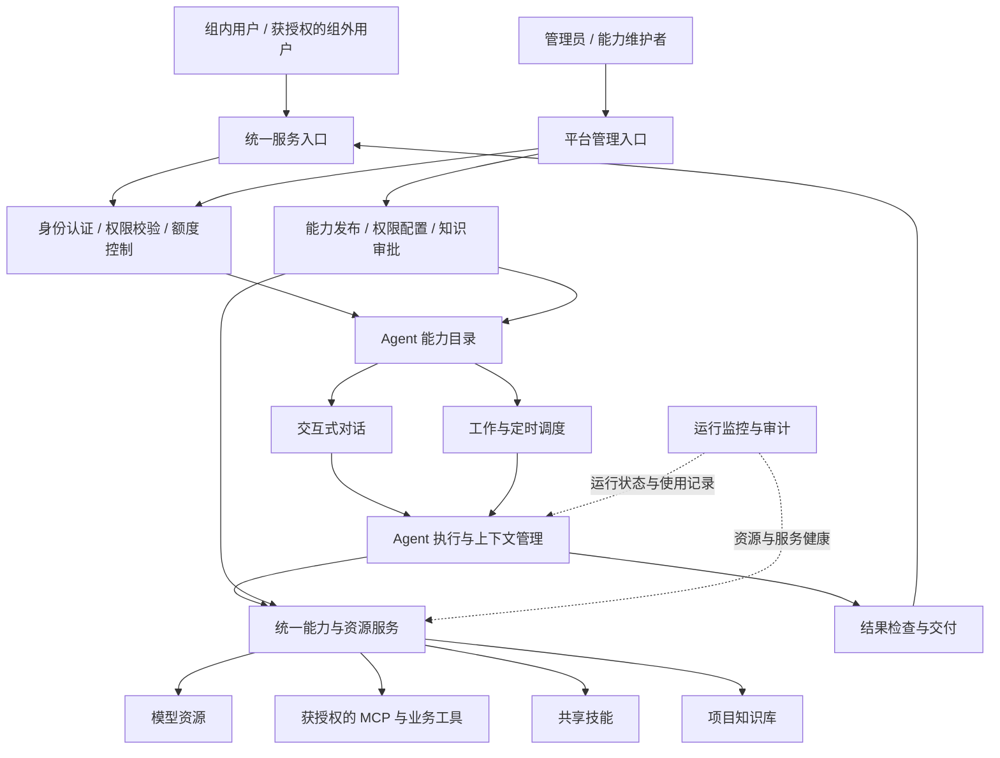
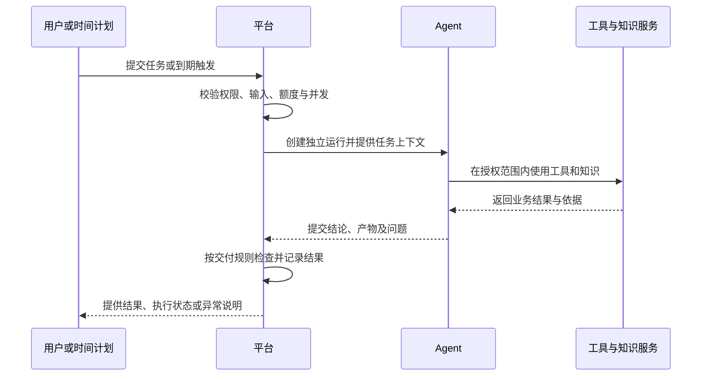

# Agent Base 项目设计书（立项草稿）

版本：v0.2 草稿  
编制日期：2026-11-13  
适用对象：项目立项、方案评审与组内汇报

> 本文描述拟建设的系统及其业务设计。文中的能力、权限和运行规则均为建设目标，不代表已经完成实施；具体技术选型、接口与代码结构在详细设计阶段展开。

## 1. 项目概述

### 1.1 项目定位

**建设统一的组内 AI 能力共享与运行平台，将员工个人积累的 Agent、技能、工具和经验转化为团队可持续使用的公共能力，并逐步向更多业务场景推广。**

平台统一承接 Agent 能力发布、用户访问、任务执行、知识共享和运行管理。业务开发者负责沉淀领域能力，使用者通过统一入口获取服务，管理员负责资源、权限和运行保障。

### 1.2 建设背景与目标

目前，AI 提效能力主要分散在员工个人环境中。个人能够使用，并不意味着同事可以直接复用；业务能力、工具配置和经验积累缺少统一承载，也限制了面向一线及组外同事提供服务。

| 主要问题 | 建设目标 | 预期价值 |
| --- | --- | --- |
| Agent 和 AI 能力依赖个人环境，难以迁移给其他人 | 将个人能力整理为可发布、可授权使用的团队 Agent | 降低对个人的依赖，让能力随团队持续积累 |
| skill、MCP 重复开发，环境配置复杂 | 统一管理技能、工具和运行环境，优先复用已有资源 | 减少重复建设和接入成本 |
| Agent 使用经验和问题处理知识难以共享 | 建立可检索、可审核、可持续更新的项目知识库 | 让一个人的经验能够支撑多个 Agent 和使用者 |
| 部分一线及新入职员工缺少 token 额度，难以使用 AI 服务 | 在组织许可和模型服务规则允许的范围内，统一提供模型资源、额度分配与使用入口 | 让获授权人员无需自行配置个人模型额度即可使用指定服务 |
| 工作依赖人工启动和跟进，缺少无人值守能力 | 支持手工触发、定时执行、后台运行和结果交付 | 使重复性工作能够持续执行，减少人工盯守 |

项目总体目标是集中组内 AI 提效能力，形成可复用的服务体系，并在真实使用中验证价值、逐步扩展服务范围。

### 1.3 服务对象与场景

| 服务对象 | 主要场景 | 服务方式 |
| --- | --- | --- |
| 组内同事 | 使用其他同事沉淀的分析、处理和辅助决策能力 | 从统一目录选择获授权 Agent，发起对话或提交任务 |
| 需要周期性处理工作的同事 | 定期汇总、巡检、报告生成等重复工作 | 配置工作和计划，由平台无人值守执行并交付结果 |
| 一线及新入职员工 | 缺少环境配置经验或个人 token 额度，需要使用指定 AI 能力 | 通过平台授权入口及统一资源分配获得服务 |
| 组外咨询或问题单发起人 | 常见问题咨询、信息补充、初步分析与处理建议 | 由 Agent 先行解答和分流，需要人工处理时转交责任人 |
| 能力维护者与管理员 | 发布能力、维护知识、管理权限和运行资源 | 通过管理入口维护 Agent、工具、知识及使用范围 |

首期优先接入组内可控、责任明确的业务场景。组外支援从明确范围的咨询与问题单初步处理开始，涉及高影响操作或无法确认的结论时转交人工。

## 2. 总体建设思路

平台围绕“能力沉淀—授权使用—任务运行—结果交付—经验回流”组织建设。

1. **能力集中**：以仓库为载体整理 Agent、skill、MCP 和业务流程，形成统一能力目录。
2. **服务共享**：将个人环境中的能力发布为团队服务，按权限开放给组内及指定组外人员。
3. **资源统一**：集中准备运行环境和模型资源，按使用者、Agent 及任务管理额度与并发。
4. **持续运行**：同时支持交互式咨询和无人值守工作，保留任务状态、结果和异常。
5. **经验回流**：将有复用价值的处理经验提交知识库，审核后供其他 Agent 使用。

能力开发者、普通使用者和管理员承担不同职责。平台应让普通使用者主要关注问题与结果，减少其对仓库、环境和工具配置的依赖。

## 3. 业务对象与运行模式

### 3.1 核心对象

| 对象 | 业务含义 | 设计规则 |
| --- | --- | --- |
| 用户 | 使用或维护平台能力的人员 | 按身份和职责获得访问、执行及管理权限 |
| Agent / Repo | 以一个仓库维护的一组相关业务能力 | 一个 repo 提供一个统一安装与服务入口，可以承担多项相关工作 |
| 有效安装 | 对外提供服务的 Agent 部署 | 每个 repo 同一时刻仅保留一个有效服务版本，统一管理其技能、工具与环境 |
| 工作定义 | 一项可重复执行的业务工作 | 明确任务目标、输入、交付要求及可选执行计划 |
| 运行实例 | 一次具体执行 | 独立记录输入、执行状态、产物及异常 |
| 对话 | 用户围绕一个 Agent 的连续交互 | 持续保存上下文，并按用户及业务范围管理可见性 |
| 知识项目 | 一组可共享的业务知识 | 可以授权给多个 Agent，保留来源、版本和审核记录 |

### 3.2 单一入口与版本管理

每个 repo 通过统一入口提供服务，在入口内根据工作类型、任务参数或用户需求选择业务流程。同一 repo 可以支持咨询、分析、报告生成等多项相关工作，不需要为每项工作分别安装一套资源。

**同一 repo 的不同版本不同时对外运行。** 升级以仓库能力、skill、MCP 和相关配置的整体兼容为单位，避免多个版本同时访问共享服务产生协议或业务状态冲突。

升级前停止接收新任务，等待活动任务结束或明确处置，再完成兼容检查和服务切换；已有对话在确认上下文与工具兼容后续接，无法兼容时提示用户创建新对话。历史任务记录继续保留，旧版本材料可用于追溯和受控回退，但不作为并行服务入口。涉及共享业务数据变化时，回退还需评估数据兼容性。

### 3.3 三种运行模式

| 模式 | 使用方式 | 主要用途 |
| --- | --- | --- |
| 交互式服务 | 用户选择 Agent，连续咨询并补充信息 | 日常分析、知识问答、组外咨询与问题单初步支援 |
| 无人值守工作 | 手工提交或按计划触发，后台执行并交付结果 | 周期汇总、巡检、批量处理与报告生成 |
| 平台管理 | 管理员通过管理页面或管理 Agent 操作平台 | 发布能力、分配权限、管理资源、处理异常 |

## 4. 总体架构

### 4.1 逻辑架构

系统分为统一服务入口、平台管理、Agent 执行和共享能力四个层次。身份、权限、额度与审计贯穿各层。

### 4.2 职责边界

平台负责能力发布、资源准备、授权、调度、运行保障和交付检查；Agent 执行引擎负责推理、工具调用和任务上下文；业务能力维护者负责领域流程、工具和知识质量。

模型接入应支持企业允许的服务方式，业务能力尽量通过统一运行约定接入，减少更换模型或运行引擎时对业务流程的影响。

## 5. 模块划分与职责

平台划分为八个功能模块，用户身份、权限、额度和审计作为贯穿模块的公共能力。

| 模块 | 主要职责 | 对使用者的价值 |
| --- | --- | --- |
| 统一入口与管理 | 提供能力目录、服务入口、用户访问和平台管理 | 一处发现和使用所需能力 |
| Agent 接入与资源管理 | 管理 repo 发布、统一安装、版本切换、skill 与 MCP 复用 | 减少环境配置和重复开发 |
| 任务执行 | 管理执行环境、上下文、状态、停止、超时和异常 | 任务能够独立运行，过程可追踪 |
| 工作与定时调度 | 管理工作定义、执行计划、队列、并发及重叠任务 | 支撑重复工作与无人值守 |
| 多轮会话 | 支持连续咨询、信息补充、历史和人工转交 | 支撑组内交互和组外初步支援 |
| 项目知识库 | 管理共享知识、检索、投稿、审核与版本 | 将经验转化为团队公共资产 |
| 结果检查与交付 | 按任务要求检查产物，提供结论、依据和待处理事项 | 使用者能判断任务是否完成、还需什么处理 |
| 运行观测与运维 | 查看服务健康、任务异常、资源使用及额度消耗 | 便于保障服务并持续优化投入 |

模块之间通过任务、会话、资源和知识等统一业务对象协作。模块划分用于明确责任边界，具体部署方式在详细设计阶段确定。

## 6. 核心业务流程

### 6.1 发布与使用一项团队能力

1. 维护者将个人 Agent、技能、工具和业务流程整理为 repo，并明确适用范围与负责人。
2. 平台准备统一运行环境，检查依赖、工具和业务流程的兼容性。
3. 管理员配置可使用人员、可调用工具、可访问知识及模型额度。
4. 通过代表性业务任务验证后，以该 repo 的唯一有效版本发布到能力目录。
5. 获授权用户选择 Agent 发起咨询或工作，维护者根据实际反馈持续更新。

### 6.2 无人值守运行与交付

任务在排队、执行、检查和结束各阶段均应有明确状态。输入不足、执行失败或结果无法确认时，应保留原因和已完成内容，交由用户或负责人处理，避免重复执行结果未知的外部操作。

### 6.3 组外咨询与问题单初步支援

1. 用户通过获授权入口提交问题，Agent 收集必要背景并识别问题类型。
2. Agent 在授权知识与工具范围内检索已有经验，给出解答或初步分析。
3. 对可处理的问题，提供建议、依据及需要用户确认的信息。
4. 对超出范围、信息不足或需要人工决策的问题，整理问题摘要、已检查事项和待办，转交对应负责人。
5. 根据人工处理结论补充可复用知识，减少同类问题反复咨询。

Agent 的初步支援范围和人工转交条件应由业务负责人确认；对接问题单系统、发送通知或执行外部操作时，应另行配置相应权限。

### 6.4 知识沉淀与共享

Agent 或维护者提交新经验和修改建议，审核人员核对来源、适用范围和内容后发布。获授权的其他 Agent 按需检索并引用相关知识；未经批准的内容保留为待审稿，不直接影响正式答复。

## 7. 多用户、权限与资源治理

### 7.1 授权关系

权限设计应同时覆盖“谁可以使用能力”和“能力可以访问什么”。

| 授权关系 | 需要控制的内容 |
| --- | --- |
| 用户 → Agent | 是否可发现、咨询、提交工作、配置定时任务及查看结果 |
| 用户 → 管理操作 | 是否可发布 Agent、管理资源、审批知识和分配额度 |
| Agent → MCP / 工具 | 允许调用的服务、操作类型和数据范围 |
| Agent → 知识库 | 可读取的知识项目、可投稿范围；审批权限单独分配 |
| 用户 → 数据与历史 | 可查看的输入、会话、产物和问题单；跨用户共享需明确授权 |
| 用户 / Agent → 模型资源 | 可使用的模型、额度、并发和使用优先级 |

一次工具或知识访问，应同时满足用户业务权限与 Agent 资源权限。共享 Agent 模板和技能不意味着共享用户私有输入、会话或产物；后台计划应保留发起人身份，并在执行时检查权限、额度和资源是否仍有效。

### 7.2 模型资源与额度

由平台管理员配置组织允许的模型服务和资源分配规则。获授权用户通过平台使用指定能力，无需自行准备个人模型凭据；凭据由平台受控管理，不向使用者或 Agent 对话暴露。

用量应能按用户、Agent 和任务归属，支持额度上限、并发限制、用量查询及超额处理。额度不足时明确提示并保留任务状态，由有权限的人员调整资源或重新安排执行。

### 7.3 审计与共享资源

关键管理操作、任务执行、知识发布和外部工具调用应保留操作者、使用的 Agent、资源范围与结果。权限变更和凭据撤销需要有明确生效规则。

公共 MCP 应区分可共享的服务能力与用户数据状态。服务端需要校验实际调用身份和授权范围，避免仅依赖 Agent 提示词约束。对可产生业务变更的工具，按操作影响设置确认或审批要求。

## 8. 运行保障与交付原则

| 关注点 | 设计原则 |
| --- | --- |
| 业务交付 | 每项工作明确输入、产物、完成条件及负责人；区分 Agent 自报和平台检查 |
| 无人值守 | 计划持久保存，服务持续运行；支持暂停、停止和异常处理 |
| 并发与重复运行 | 管理队列与资源占用，避免重复提交和不必要的任务重叠 |
| 版本更新 | 每 repo 一个有效版本，统一切换；兼容检查覆盖 MCP、技能、数据与持续会话 |
| 数据保护 | 按用户及业务范围管理输入、历史和产物，共享需授权 |
| 故障处置 | 保留执行记录与必要现场，明确责任人与人工处理入口 |
| 运维管理 | 提供服务健康、异常、模型用量和资源占用视图，建立备份与恢复规则 |

## 9. 建设路径与敏捷迭代

### 9.1 重点建设方向

| 方向 | 建设内容 | 阶段完成条件 |
| --- | --- | --- |
| 多用户与权限 | 用户身份、用户到 Agent、Agent 到 MCP/知识库的授权，以及数据和额度管理 | 不同用户按授权使用能力，越权请求被拒绝，关键操作可以追溯 |
| 多 repo 正式接入 | 选择多个有实际需求和维护人的 repo，规范安装、发布、版本及交付 | 多个业务 Agent 进入正式使用，能够处理真实工作并有负责人维护 |
| 真实使用驱动迭代 | 建立试用、问题收集、优先级判断、修复与反馈机制 | 反馈能够进入迭代并由实际使用者验证，形成持续改进记录 |

### 9.2 推进步骤

1. **确定首批场景与责任人**：选择需求明确、交付可检查、工具访问范围可控的工作，同时确认模型资源和使用人员。
2. **建立基础授权与接入规则**：落实首批用户所需的访问、数据和工具边界，按统一约定接入多个 repo。
3. **小范围真实试用**：让组内同事持续用于实际工作，覆盖交互式咨询和无人值守任务，记录阻塞与使用反馈。
4. **短周期迭代**：优先处理权限与数据问题、运行阻塞和高频体验问题；每轮变更在发布前验证核心流程，并由反馈人确认效果。
5. **逐步推广**：基础流程稳定后扩大组内覆盖，再向指定组外人员开放咨询与问题单支援，持续调整权限、额度和服务范围。

### 9.3 效果评估

项目应以真实使用和业务结果评估效果。建议跟踪实际活跃用户、复用 Agent 数、业务任务完成情况、无人值守工作覆盖、咨询初步解决及人工转交情况、知识复用、模型资源消耗和反馈修复周期。

节省工时、响应效率和成本改善应结合试用前后的实际数据核算。具体目标值、排期与资源投入，在确认首批场景及基线后确定。
