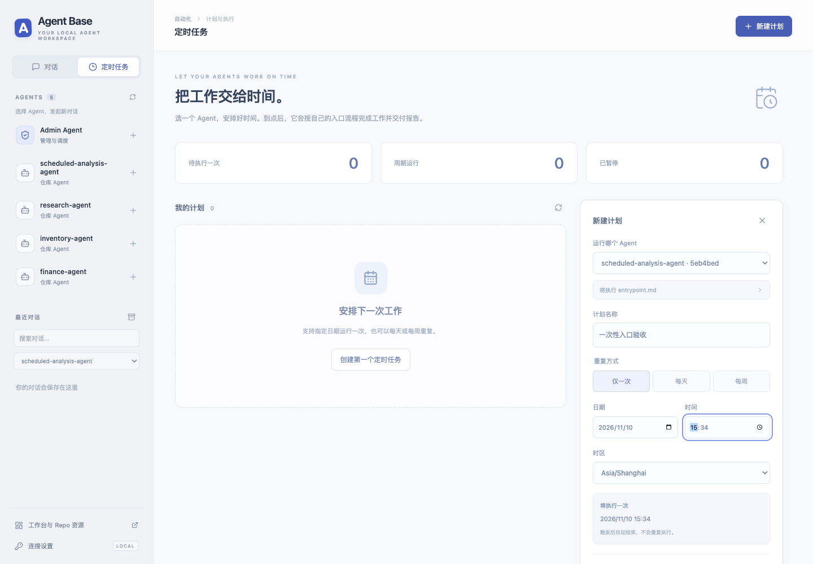

# 页面安排定时任务

启动 `agent-base serve`，打开 <http://127.0.0.1:8765/cron>。登录与聊天页共用会话。

## 创建计划

1. 点击“新建计划”，选择已安装、启用且提供 `entrypoint.md` 的 Repo Agent。
2. 选择仅一次、每天或每周；填写日期、时间与 IANA 时区。
3. 核对执行预览。需要时补充任务参数、模型、推理强度和超时。
4. 保存后在计划卡片查看下次执行，在“运行记录”查看结果与完整报告。

计划绑定固定安装版本和 commit，不自动跟随仓库更新。Admin 不是定时目标；旧安装没有入口时，补充入口、提交并安装新版本。

## 暂停与补执行

| 情况 | 行为 |
| --- | --- |
| 一次性触发已受理 | 计划自动停用，Run 继续排队或执行 |
| 已触发的一次性计划 | 不能恢复重放；再次执行需新建 |
| 一次性暂停后恢复 | 仅未触发且目标时间仍在未来时允许 |
| 服务停机时错过一次性时间 | 恢复后补触发一次，前提是计划未暂停 |
| 周期计划 | 沿用停机合并和 overlap=skip；恢复后面向未来 |

过去时间、无效时区、空星期、一次性夏令时不存在或歧义时间均会被拒绝。修改目标或时间可先暂停原计划，再新建。

浏览器关闭不影响计划；服务或 worker 必须常驻。平台不创建系统 crontab。Agent 自报 completed 与平台 succeeded、checks_passed 的区别见 [运行契约](RepoContract.md)。CLI/API 注册见 [工作调度](Scheduling.md)。
